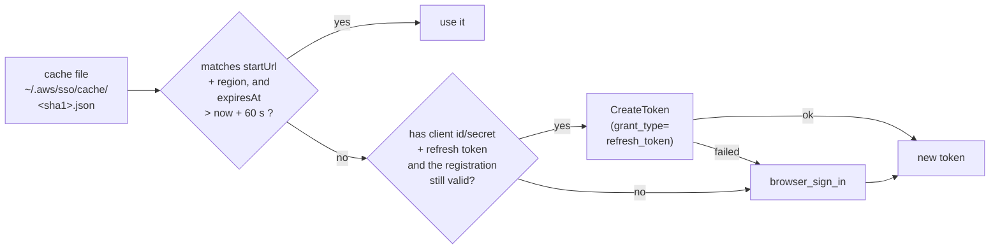
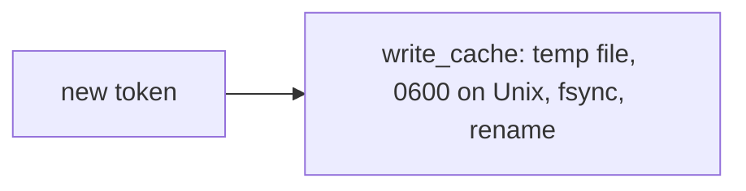

# AWS

The cloud account: read the local `~/.aws` profiles, sign in (the SDK's own credential chain,
or an SSO sign-in in the browser), and list the ElastiCache Redis endpoints the account sees
as ordinary connections. Nothing here is saved by this module: the endpoints are known for
one run, and the settings attached to them live in [settings](crate::wiki::settings).

## Where to look

| File | What it holds |
|------|---------------|
| `aws/mod.rs` | [`profiles`](crate::aws::profiles), [`login`](crate::aws::login), [`redis_connections`](crate::aws::redis_connections), [`AwsError`](crate::aws::AwsError), `sign_in`, `chain_config` |
| `aws/sso.rs` | the SSO access token: cache, refresh, browser sign-in with PKCE |
| `connection/store/mod.rs` | `set_cloud_connections`, `cloud_key`: where the listing is held |
| `settings/cloud/mod.rs` | per account / per endpoint profile and SSH tunnel (`apply_cloud`, `fill_cloud_secrets`) |

## Profiles

[`profiles`](crate::aws::profiles) reads the `.aws` config and credentials files **as the SDK does**
(`aws_config::profile::load`), `default` first, then by name. For each
[`Profile`](crate::aws::Profile) it works out the SSO settings, which may live in the profile itself
or in the `[sso-session]` it names: start URL, SSO region, `sso_registration_scopes`,
account id and role name. A profile that lacks any of the four needed values has no SSO settings
(`sso: None`). [`aws_dir`](crate::aws::aws_dir) says whether `~/.aws` exists; the app
only offers the AWS pill when it does. [`Profile::account_id`](crate::aws::Profile::account_id)
gives an SSO profile's account before any listing, so its settings can be shown and edited.

## Signing in

Two entry points, both taking a [`SignInPage`](crate::aws::SignInPage) (the three texts the
browser tab shows afterwards, in the interface language, since the core has no translation):

- [`login`](crate::aws::login) is "like `aws sso login`" and runs for the title bar's "Sign in to AWS" pill. Profiles
  are tried in turn: the one named by `AWS_PROFILE`, then `default`, then the rest. For each,
  if the SDK's own chain already yields credentials, it returns `Ok`. Otherwise, a profile with SSO
  settings gets an SSO token (cache, refresh or browser) and that ends the loop; a profile without
  SSO is skipped, remembering `NoUsableCredentials`. With no profile at all: `NoProfile`.
- `sign_in(profile, page)` (private, used by
  [`redis_connections`](crate::aws::redis_connections)) returns an `SdkConfig` whose credentials
  work: the SDK chain first (`chain_config`: keys, assumed role, an existing `aws sso login`), else
  the SSO route: get an access token, call `GetRoleCredentials` for the profile's role and
  account (failure is [`RoleRefused`](crate::aws::AwsError::RoleRefused)), and build static
  `Credentials` with provider name `cachemire-sso` and the role's expiry. The region is the
  profile's, falling back to the SSO region.

Calls made before credentials exist (`GetRoleCredentials`, the OIDC client) use
`anonymous_config`, a client with `no_credentials()`. The HTTP client is built with rustls
and the `ring` crypto provider (`http_client`).

## Listing ElastiCache

[`redis_connections`](crate::aws::redis_connections) returns a [`Listing`](crate::aws::Listing)
(account id from STS `GetCallerIdentity`, region, items):

1. find the profile, sign in, require a region ([`NoRegion`](crate::aws::AwsError::NoRegion));
2. page through `DescribeCacheClusters` (with node info): engine must be `redis` or `valkey`; a
   cluster with a replication group id only records the group id; a standalone one becomes an item
   from its first node's endpoint;
3. page through `DescribeReplicationGroups`: the groups seen in step 2 become items, using the
   configuration endpoint of a group in cluster mode, else the first node group's primary endpoint;
4. sort by name.

Memcached and ElastiCache Serverless caches are left out. A cluster-mode group's connection finds
the cluster's nodes from its configuration endpoint (see [connection](crate::wiki::connection)). Each item is a
[`ConnectionItem`](crate::connection::ConnectionItem) with id
[`connection_id`](crate::aws::connection_id)`(profile, name)` = `aws:<profile>:<name>` (prefix
[`ID_PREFIX`](crate::aws::ID_PREFIX)), a URL from `cloud_url` (`rediss://` when in-transit
encryption is on, port from the endpoint else 6379), no credentials, no SSH and no profile. The
settings layer fills in the profile and tunnel afterwards
([`apply_cloud`](crate::settings::SettingsStore::apply_cloud)).

## Errors

[`AwsError`](crate::aws::AwsError) becomes [`Error::Cloud`](crate::error::Error::Cloud). Its
[`kind`](crate::aws::AwsError::kind) is `NotFound` for a missing profile, `Timeout` for
`SignInTimedOut`, `System` for browser or callback failures, and `Cloud` for the rest. AWS service
errors are shown as `message (code)` (`describe`), falling back to the SDK's whole error chain.
See [errors](crate::wiki::errors).

## SSO sign-in and the shared token cache

`aws/sso.rs` gets an access token for a start URL with
`access_token(sso, page)`:

A new token is then stored:

### The cache file

- Path: `~/.aws/sso/cache/<sha1 hex>.json`, where the hash is of the **`sso-session` name**, or of
  the **start URL** for an old-style profile with no `sso-session`. This is the name the AWS CLI
  uses, so the token is **shared** with `aws sso login` and the SDKs in both directions.
- Format (`CachedToken` in the source): camelCase JSON (`startUrl`, `region`, `accessToken`,
  `expiresAt`, and optionally `clientId`, `clientSecret`, `registrationExpiresAt`, `refreshToken`).
  Secrets are `Secret`s in memory. Absent optional fields are omitted when written.
- A file that is missing, unreadable or lacks required fields is simply "no token".
- A token within 60 seconds of its end (`EXPIRY_MARGIN`) counts as gone, and an unreadable end
  time is never relied on.
- It is written through a temporary file with mode `0600` on Unix (it holds credentials), flushed,
  then renamed. A write failure is only logged (the sign-in still succeeds for this run).

### Browser sign-in (authorization code with PKCE)

`browser_sign_in`:

1. Bind a listener on `127.0.0.1` with a free port; the redirect URI is
   `http://127.0.0.1:<port>/oauth/callback`.
2. `RegisterClient` with the SSO OIDC service: client name `cachemire`, type `public`, grant types
   `authorization_code` and `refresh_token`, issuer = the start URL, scopes from the
   `sso-session` or `sso:account:access` by default. (The registered redirect URI has no port;
   the authorisation request carries the real one.)
3. Generate a PKCE pair: 32 random bytes (`getrandom`), base64url without padding as the
   **verifier**, SHA-256 of it as the `S256` **challenge**; and a random UUID as `state`.
4. Open `https://oidc.<region>.amazonaws.com/authorize?...` in the user's browser (`open`
   crate); failure is [`AwsError::Browser`](crate::aws::AwsError::Browser).
5. `wait_for_code` within `SIGN_IN_TIMEOUT` (10 minutes, else
   [`SignInTimedOut`](crate::aws::AwsError::SignInTimedOut)).
6. `CreateToken` with `authorization_code`, the code, the redirect URI and the verifier. The result,
   including client id/secret, registration expiry and refresh token, is what is cached.

### The callback server

`wait_for_code` loops over incoming connections on the local port:

- A connection that sends nothing for 10 seconds (a browser preconnect) gets `404` and does not
  hold up the next.
- Only the path `/oauth/callback` is accepted (`callback_params`; the head is capped at 16 KiB);
  anything else is a `404`.
- The `state` parameter must equal ours. An answer with another state is turned down with `400`
  and the loop goes on, so a forged request cannot inject a code.
- With our state: `error=` ends the sign-in with
  [`SignInRefused`](crate::aws::AwsError::SignInRefused) (the `error_description` when given), and a
  `code=` is returned. In both cases the browser tab is shown the localised "signed in" or
  "refused" page, with the texts HTML-escaped.

The app raises its window after the call returns, since the browser had the focus.

## Invariants

- Access, client-secret and refresh tokens are [`Secret`](crate::secret::Secret)s; the token file
  is owner-only on Unix. (On Windows the code sets no explicit permissions.)
- The state parameter and PKCE verifier protect the local callback; the listener is bound to
  loopback only.
- Cloud connections are never written to `databases.json`: only per-account and per-endpoint
  settings are saved (see [settings](crate::wiki::settings)).
