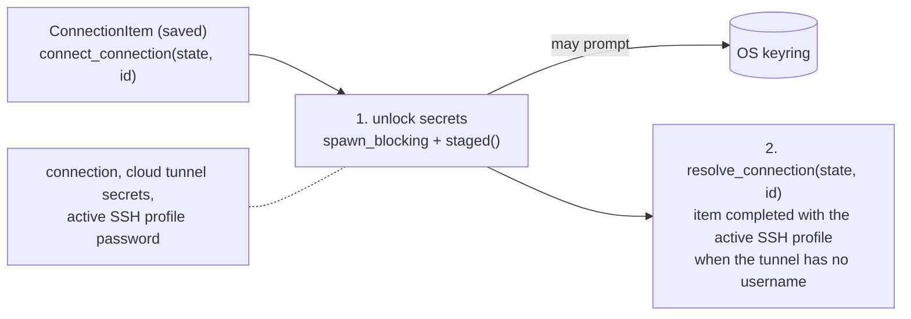
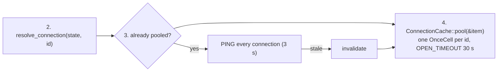
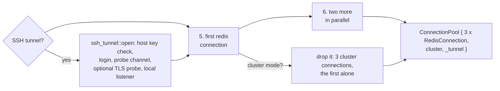
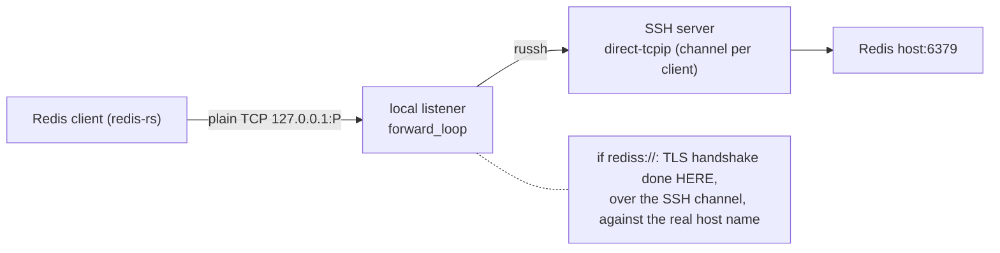
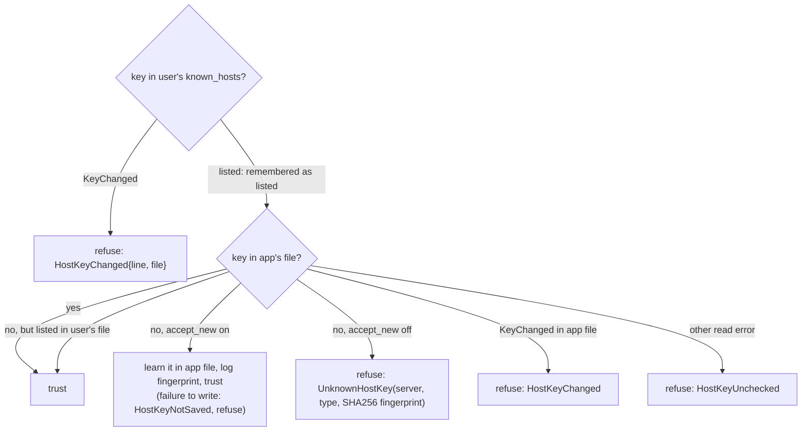

# Connections

A saved connection ([`ConnectionItem`](crate::connection::ConnectionItem)) is turned into a
usable Redis client in three steps: its secrets are read from the keyring, an optional SSH
tunnel is opened, then a small pool of auto-reconnecting Redis connections is built on top.
This chapter covers everything under `src/connection/`; the secrets themselves are in
[secrets](crate::wiki::secrets), cloud endpoints in [aws](crate::wiki::aws), and what is done
*with* the pool in [session](crate::wiki::session).

## Where to look

| File | What it holds |
|------|---------------|
| `connection/mod.rs` | [`ConnectionItem`](crate::connection::ConnectionItem), [`SshSettings`](crate::connection::SshSettings), [`Endpoint`](crate::connection::Endpoint), [`ConnectionPayloadInput`](crate::connection::ConnectionPayloadInput), and the two entry points [`connect_connection`](crate::connection::connect_connection) / [`test_connection`](crate::connection::test_connection) |
| `connection/url.rs` | [`parse`](crate::connection::url::parse): the connection URL grammar |
| `connection/client.rs` | [`build_client`](crate::connection::client::build_client), [`create_connection`](crate::connection::client::create_connection): the `redis-rs` client; `build_cluster_client`, `create_cluster_connection`: a cluster's |
| `connection/tls.rs` | trusted roots: [`roots_pem`](crate::connection::tls::roots_pem), [`connector`](crate::connection::tls::connector) |
| `connection/pool.rs` | [`ConnectionCache`](crate::connection::pool::ConnectionCache), [`ConnectionPool`](crate::connection::pool::ConnectionPool) and [`RedisConnection`](crate::connection::pool::RedisConnection) (one server or a cluster) |
| `connection/tunnel/mod.rs` | [`Tunnel`](crate::connection::tunnel::Tunnel), [`Dialer`](crate::connection::tunnel::Dialer), [`TunnelResolver`](crate::connection::tunnel::TunnelResolver): the local ports, whatever transport carries them |
| `connection/kube_tunnel/mod.rs` | [`open`](crate::connection::kube_tunnel::open) (the Kubernetes transport), [`KubeError`](crate::connection::kube_tunnel::KubeError), [`contexts`](crate::connection::kube_tunnel::contexts) |
| `connection/ssh_tunnel/mod.rs` | [`open`](crate::connection::ssh_tunnel::open) (the SSH transport), [`HostKeys`](crate::connection::ssh_tunnel::HostKeys), [`TunnelError`](crate::connection::ssh_tunnel::TunnelError) |
| `connection/store/mod.rs` | [`ConnectionStore`](crate::connection::store::ConnectionStore): the saved connections file |

## The data model

- [`ConnectionItem`](crate::connection::ConnectionItem) is the in-memory form of a
  connection: id, name, URL, optional username and [`Secret`](crate::secret::Secret) password,
  an optional [`SshSettings`](crate::connection::SshSettings) or
  [`KubeSettings`](crate::connection::KubeSettings) (the latter wins: one way in), the id of its (display) connection
  profile and a `read_only` flag.
- [`Endpoint`](crate::connection::Endpoint) is what the URL *and* the item's own fields say
  together, computed by [`ConnectionItem::endpoint`](crate::connection::ConnectionItem::endpoint):
  host, port (default 6379), database (default 0), TLS flag, username and password.
  The URL's own user and password win; the item's fields only fill in what the URL leaves out.
- [`CloudKey`](crate::connection::CloudKey) identifies an AWS endpoint across runs
  (`account/region/name`); see [aws](crate::wiki::aws).
- [`ConnectionPayloadInput`](crate::connection::ConnectionPayloadInput) is the add/update
  payload. Every field is an `Option`: `None` keeps the current value, which is how a blank
  password box means "keep the stored password".

Two different things are called "profile". A *connection profile* (name, colour, read-only)
is a label chosen per connection; an *SSH profile* is a shared tunnel login. Both live in
the settings, see [settings](crate::wiki::settings).

## URLs

[`url::parse`](crate::connection::url::parse) accepts `redis://[user[:password]@]host[:port][/db]`:

- the scheme may be left out (`host:6380` works) and is case-insensitive;
- `rediss://` and `valkeys://` mean TLS; `redis://` and `valkey://` do not; any other
  scheme is [`Invalid::UnknownScheme`](crate::error::Invalid::UnknownScheme);
- user and password are percent-decoded, and an `@` inside a password needs no encoding;
- an IPv6 host comes back without its brackets; a database that is not a number is left
  unsaid (`None`), a negative one is [`Invalid::InvalidDatabase`](crate::error::Invalid::InvalidDatabase);
- an unreadable URL, or an empty host, is [`Invalid::UnreadableUrl`](crate::error::Invalid::UnreadableUrl).

## The store of saved connections

[`ConnectionStore`](crate::connection::store::ConnectionStore) keeps the saved connections in
memory and writes them through to a JSON file (`databases.json` in the data directory, see
[`resolve_data_file`](crate::state)). Facts visible in the code:

- The file is read with [`persist::load_store`](crate::persist::load_store). A file that cannot
  be read is moved aside, and one that cannot even be moved aside makes the store read-only
  for the run (`dry_run`), so it is never overwritten by defaults.
- Writes go through [`persist::save`](crate::persist::save) (temporary file, flush, rename).
- A fresh install starts with one `env-default` connection seeded from `REDIS_URL`,
  `REDIS_HOST`, `REDIS_PORT`, `REDIS_DB`, `REDIS_USERNAME`, `REDIS_PASSWORD`.
- Old files that have `host`/`port`/`db` instead of a URL get a URL built for them on load
  (`give_urls`); those three fields are only ever read, never written back.
- Each saved connection remembers what its server was when last connected to
  ([`ServerKind`](crate::connection::ServerKind): Redis or Valkey, version, primaries of a cluster),
  set by [`remember_server`](crate::connection::store::ConnectionStore::remember_server) and
  forgotten when its URL changes; [`server_info::server_kind`](crate::server_info::server_kind) asks a
  connected server. A cloud connection's comes from its listing and lives for the run, as does when
  it was last connected to ([`last_connected_at`](crate::connection::store::ConnectionStore::last_connected_at)).
- Unknown JSON fields written by a newer version are kept (`#[serde(flatten)] extra`) and
  saved back as they were.
- `commit` is "persist, then swap": the new state replaces the in-memory one only after the
  write succeeded, so memory and disk never disagree after a failure.
- A password typed into the URL is moved to the password field (`finish`), so a URL on disk
  never carries one. [`connection_string`](crate::connection::store::ConnectionStore::connection_string)
  puts credentials back for the "copy connection string" button.
- `import_all` saves several connections all-or-none; an import never makes one active.
- **Cloud connections** (AWS endpoints) live in the store only for the run
  ([`set_cloud_connections`](crate::connection::store::ConnectionStore::set_cloud_connections)),
  and `cloud_active` can make one of them the active connection without ever being saved.
- [`set_active`](crate::connection::store::ConnectionStore::set_active) records
  `last_connected_at` and saves; [`remove`](crate::connection::store::ConnectionStore::remove)
  hands back a [`SecretsCleanup`](crate::secret_vault::SecretsCleanup) so the keyring is
  cleaned off the UI thread.

How secrets are placed (file or keyring, `in_vault`, `left_out`) is the subject of
[secrets](crate::wiki::secrets); the store only calls `vault_secrets` and `unlock_secrets`.

## From a profile to a client

Then the pool is checked, and built when needed:

Step 4 (`ConnectionCache::pool`) then opens the tunnel if any, and the connections:

### Step 1 and 2: secrets and resolution

[`connect_connection`](crate::connection::connect_connection) first reads the connection's
secrets from the keyring inside `spawn_blocking`, wrapped in
[`staged`](crate::secret_vault::staged) so that the store's lock is not held while the
keyring waits for the user. It does the same for a cloud connection's tunnel secrets and for
the active SSH profile's password when the tunnel has no username of its own.
Then [`resolve_connection`](crate::state::resolve_connection) builds the final item.

### Step 3: stale pools

A pool that is already open may have gone silently stale (laptop sleep, dropped NAT
mapping). `connect_connection` PINGs each of its connections with a 3 second timeout
([`ConnectionCache::responds`](crate::connection::pool::ConnectionCache::responds)); if one does
not answer, the pool is invalidated and rebuilt. The result type is a
[`ConnectionItem`](crate::connection::ConnectionItem); the connection is **not** made active
here (the app does that, see the app's connections chapter).

### Step 4 to 6: the pool

[`ConnectionCache`](crate::connection::pool::ConnectionCache) holds one
`Arc<OnceCell<Arc<ConnectionPool>>>` per connection id, so callers racing to open the same
pool share a single open. Behaviour worth knowing:

- [`ConnectionCache::pool`](crate::connection::pool::ConnectionCache::pool) replaces the cell
  when the existing pool's tunnel is down ([`Tunnel::is_alive`](crate::connection::tunnel::Tunnel::is_alive)),
  so the next call opens a fresh one.
- Opening is bounded by `OPEN_TIMEOUT` (30 s), reported as
  [`Timeout::Connect`](crate::error::Timeout::Connect).
- A pool has `POOL_SIZE` = 3 physical connections. The **first** is opened alone so bad
  credentials or an unreachable host fail once and quickly; the other two open in parallel.
- Connection 0 is the "background" one ([`ConnectionPool::background`](crate::connection::pool::ConnectionPool::background)):
  long reads (the key walk, searches, exports, queries). Short reads and writes round-robin
  over the others ([`ConnectionPool::pick`](crate::connection::pool::ConnectionPool::pick)),
  because Redis serves one connection strictly in order and a big reply would block everything
  queued behind it.
- A server in cluster mode (`cluster_enabled` on the first connection) gets cluster connections
  instead, the first opened alone too: see [Clusters](#clusters) below.
- The tunnel is stored in the pool (`_tunnel`): it lives exactly as long as the pool, and
  dropping it aborts forwarding.
- [`ConnectionCache::invalidate`](crate::connection::pool::ConnectionCache::invalidate) drops the
  entry (used when a connection is edited, deleted or disconnected).
  [`ConnectionCache::test`](crate::connection::pool::ConnectionCache::test) opens a throwaway pool and pings it;
  [`test_connection`](crate::connection::test_connection) wraps it for the unsaved form,
  completing the tunnel from the active SSH profile first.

### The Redis client

[`build_client`](crate::connection::client::build_client) and
[`create_connection`](crate::connection::client::create_connection):

- RESP2 on purpose (every server speaks it, replies are decoded in their RESP2 shapes).
- TCP no-delay, and keepalive probes (30 s idle, 10 s interval) to find silently dead sockets.
- Timeouts: 20 s to connect, 60 s per response, **zero retries**: a failed (re)connect is
  reported at once and the next command tries again. The
  [`ConnectionManager`](redis::aio::ConnectionManager) reopens its socket by itself after a drop.
- Through a tunnel, the client talks plain TCP to `127.0.0.1:<local port>` (see below).

## Clusters

A connection to any node of a cluster (or to an ElastiCache configuration endpoint) is a connection
to the whole cluster; nothing in the saved connection says so, the pool finds out on opening.

- [`RedisConnection`](crate::connection::pool::RedisConnection) is `Server(ConnectionManager)` or
  `Cluster(ClusterConnection)` and implements `redis::aio::ConnectionLike` for both, so the
  [session](crate::wiki::session) builds commands the same way; it handles what a cluster needs.
- `build_cluster_client` starts from the endpoint (its login, database, TLS and certificates, RESP2,
  the same TCP settings and timeouts) and finds the other nodes from it (`CLUSTER SLOTS`). redis-rs
  sends each command to the node serving its key, follows `MOVED`/`ASK` (3 quick retries, 100 ms to
  1 s apart, unlike a single server's zero) and reopens what drops.
- The pool keeps the split of a single server: connection 0 for long reads, the other two in turn.
  Each cluster connection holds one socket per node.
- The nodes are reached at the addresses they announce: a client that can reach the endpoint but not
  those addresses (NAT, Docker Desktop's port publishing) fails on the other nodes.
- Through a tunnel (SSH or Kubernetes), the cluster client resolves every node's address with the tunnel's
  [`TunnelResolver`](crate::connection::tunnel::TunnelResolver) (see [below](#ssh-tunnel)).

## TLS

`rediss://` connections verify the server certificate (`insecure: false`). The trusted
roots are the bundled `webpki-root-certs` plus the operating system's store
(`rustls-native-certs`), de-duplicated and each validated once by a `RootCertStore`
(`trusted_roots`, cached in a `OnceLock`). A system store that cannot be read, or a
certificate in it that is unusable, is logged and skipped.

- [`roots_pem`](crate::connection::tls::roots_pem) serialises those roots as a PEM bundle in the
  form `redis-rs` takes (`redis::TlsCertificates::root_cert`).
- [`connector`](crate::connection::tls::connector) gives a `tokio-rustls` connector with the same
  roots and no client auth; used by the SSH tunnel.
- [`tls_name_of`](crate::connection::client::tls_name_of) returns the
  `ServerName` the certificate must match, only when the endpoint is secured.
- There is no client-certificate support in the code seen here (`client_tls: None`).

## SSH tunnel

A [`Tunnel`](crate::connection::tunnel::Tunnel) is a local port whose connections a
[`Dialer`](crate::connection::tunnel::Dialer) (a transport) carries to the Redis server, each
through its own stream. The SSH transport does what `ssh -L port:redis-host:6379` does, with the
pure-Rust `russh` client and no `ssh` binary: each stream is a `direct-tcpip` channel.

[`ssh_tunnel::open`](crate::connection::ssh_tunnel::open), in order:

1. `connect`, within `SETUP_TIMEOUT` (20 s, [`TunnelError::Timeout`](crate::connection::ssh_tunnel::TunnelError::Timeout)):
   TCP connect, **host key check**, authentication. The SSH session sends keepalives every
   30 s and has no inactivity timeout, since the tunnel is long-lived and mostly idle.
2. **Probe**: it opens one `direct-tcpip` channel to the Redis host, so a wrong host or port
   is reported as [`TunnelError::Unreachable`](crate::connection::ssh_tunnel::TunnelError::Unreachable)
   instead of a bare "connection closed" later. With TLS, the probe also performs the handshake
   ([`TunnelError::Tls`](crate::connection::ssh_tunnel::TunnelError::Tls) on failure) and is then dropped.
3. [`Tunnel::start`](crate::connection::tunnel::Tunnel::start) binds `127.0.0.1:0` (a free port) and
   spawns `forward_loop`, which accepts local connections and forwards each through its own stream of
   the dialer (`copy_bidirectional`). The loop owns a `JoinSet` of forwarders, so aborting it closes them all.

Why TLS is done by the tunnel: the Redis client sees plain TCP on localhost, so the
certificate would otherwise be checked against `127.0.0.1`. The tunnel connects the TLS
session over the SSH channel with the endpoint's real host name
([`build_client`](crate::connection::client::build_client) sets `tls = false` and the local port when `via_local_port` is given).

For a cluster, the same transport forwards to every node:
[`Tunnel::resolver`](crate::connection::tunnel::Tunnel::resolver) gives the cluster client
a DNS resolver that opens, on first use, a local listener per node address (`Forwards::port_to`), and
answers `127.0.0.1:<its port>`. These forwards are plain TCP: redis-rs keeps the node's real address
for its slot map and its redirects, and does the TLS handshake itself, with that name, over the
forwarded socket. The SSH server resolves the addresses the nodes announce, as it would for one server.

[`Tunnel::is_alive`](crate::connection::tunnel::Tunnel::is_alive) is true while the forwarding task
runs and the dialer stands (for SSH: the session is open); the pool uses it to rebuild itself.
`Drop` aborts the forwarding tasks.

### Authentication

`authenticate` tries, in order:

1. the **private key**, if a path is set (`~` expands to the home directory by `expand_home`).
   The file is read and decoded with the passphrase if any. A key that is encrypted and does
   not open becomes [`TunnelError::KeyPassphrase`](crate::connection::ssh_tunnel::TunnelError::KeyPassphrase);
   `key_is_encrypted` recognises OpenSSH, PKCS#8, legacy PEM and PuTTY formats without
   decrypting. For RSA keys the best hash supported by the server is used.
2. the **password**, if there is one.

No key and no password gives `NothingToLogInWith`; both tried and refused gives
[`LoginRefused`](crate::connection::ssh_tunnel::TunnelError::LoginRefused), which records which
methods were tried. A tunnel with no username of its own is completed from the active SSH profile
(see [settings](crate::wiki::settings)) before this point.

### Host keys and `known_hosts`

[`HostKeys`](crate::connection::ssh_tunnel::HostKeys) says where host keys are looked up and
remembered:

- the app's own file `ssh_known_hosts`, next to `databases.json` in the data directory
  (new keys are written here);
- the user's `~/.ssh/known_hosts`, **read-only**, added by
  [`with_user_known_hosts`](crate::connection::ssh_tunnel::HostKeys::with_user_known_hosts)
  (not used in the tests' `AppState::for_tests`);
- `accept_new`, a shared atomic flag mirroring the setting "trust new host keys without asking"
  (default off; [`AppState::set_accept_new_ssh_host_keys`](crate::state::AppState::set_accept_new_ssh_host_keys) saves and applies it at once).

The handler `HostKeyCheck::check_server_key` decides:

A refusal makes `russh` fail with a generic key error, so the real reason is parked in a
shared `refusal` slot and substituted when `connect` fails. A **changed** key is never
overridable from the UI: the message tells the user to delete the line if the server was
reinstalled, otherwise someone may be impersonating it.

An *unknown* key is recoverable: the error carries an
[`UnknownHostKey`](crate::connection::ssh_tunnel::UnknownHostKey) (host, port, key type,
fingerprint). The app shows it in a dialog; on "trust" it calls
[`HostKeys::trust`](crate::connection::ssh_tunnel::HostKeys::trust) and retries the whole
connection. See the app's connections chapter.

### Errors

[`TunnelError`](crate::connection::ssh_tunnel::TunnelError) is boxed into
[`Error::Tunnel`](crate::error::Error::Tunnel), whose
[`ErrorKind`](crate::error::ErrorKind) is `Tunnel` for every variant. The UI records that the
failure was the tunnel's. Localisation and the full model are in
[errors](crate::wiki::errors).

## Kubernetes

[`kube_tunnel::open`](crate::connection::kube_tunnel::open) reaches a server that only lives inside a
Kubernetes cluster, through its API server, signed in with the user's kubeconfig (`kube` crate: the
context's credentials, sign-in commands such as `aws eks get-token`, token refresh). The connection's
[`KubeSettings`](crate::connection::KubeSettings) name the context, the namespace (empty: the
kubeconfig's) and an optional relay pod; the URL's host is the name inside the cluster (`redis://redis:6379`).
Its dialer is one of two kinds:

- **Port-forward** (no relay pod), what `kubectl port-forward` does. Each address is first turned into a
  pod: an IP is the pod with that `status.podIP` (a cluster's nodes announce theirs); `service` or
  `service.namespace[.svc…]` is a ready pod behind that Service, with the Service's `targetPort`;
  `pod.subdomain.namespace.svc…` and a bare name are that pod. Found pods are remembered until a
  port-forward to one fails. A Service with no selector has no pods to forward to:
  [`KubeError::NoSelector`](crate::connection::kube_tunnel::KubeError::NoSelector).
- **Relay pod**: each stream is a `kubectl exec` in that pod of `RELAY_SCRIPT`, which connects to the
  address with socat, else nc (through a fifo, so it stops when stdin ends), else bash's `/dev/tcp`, and
  relays stdin and stdout. The pod resolves names itself, so this reaches Services with no selector,
  servers outside the cluster, and any address a cluster's nodes announce. Its stderr goes to the debug log.

`open` checks the way in before listening: the relay pod runs the script in `probe` mode (connect, then
exit) and what it says on failure becomes [`KubeError::RelayFailed`](crate::connection::kube_tunnel::KubeError::RelayFailed);
a port-forward is opened once; with TLS the handshake is tried. An error the API server answers (a
missing pod, a refused permission) is [`KubeError::Refused`](crate::connection::kube_tunnel::KubeError::Refused)
with its message. Like SSH, [`Error::Kube`](crate::error::Error::Kube) has the kind `Tunnel`.

On Windows the app sets `KUBE_RS_UNSTABLE_CREATE_NO_WINDOW` first thing, so a sign-in command doesn't
open a console window.

## Invariants to keep

- Any password, passphrase or token is a [`Secret`](crate::secret::Secret).
- A connection URL on disk never carries a password.
- A failed save leaves memory and disk as they were (`commit`).
- Secrets are fetched from the keyring off the async workers and outside the store's lock
  ([`staged`](crate::secret_vault::staged)).
- A pool is never half-open: either all three connections exist or the open fails.
- Host keys are confirmed by the user unless the user turned that off; a changed key is always refused.
