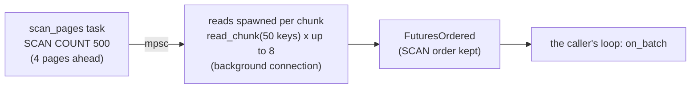

# Explorer: browsing keys and reading values

The explorer is the layer between the UI and [`Session`](crate::session::Session): it turns
`SCAN` cursors into a folder tree, reads one key's value in a bounded way, walks the whole
keyspace for the global search, and performs the edits and the folder-wide delete and rename.
It is plain async functions taking an [`AppState`](crate::state::AppState) and an optional
connection id; it holds no state of its own.

## Where to look

| File | What it holds |
|------|---------------|
| `src/explorer.rs` | everything described below |
| `src/key_name/mod.rs` | [`KeyName`](crate::key_name::KeyName) and the byte/text encoding |
| `src/redis_value_type.rs` | [`RedisValueType`](crate::redis_value_type::RedisValueType) |
| `src/server_info.rs` | [`used_memory`](crate::server_info::used_memory), [`format_bytes`](crate::server_info::format_bytes) |
| `src/session/` | the commands; see [session](crate::wiki::session) |

## Vocabulary

- **Key name**: raw bytes ([`KeyName`](crate::key_name::KeyName)); its `id()` string is what the UI holds.
- **Delimiter**: the string (usually `:`) that cuts a key name into a folder path. Folders are
  purely a display idea; Redis has none.
- **Prefix**: a folder's full name including its trailing delimiter (`user:` for `user:42`).
- **Level**: the folders and keys directly under one prefix.
- **Entry**: one `(field, value)` pair of a key, the unit the global search looks at.

## Types: `RedisValueType`

[`RedisValueType`](crate::redis_value_type::RedisValueType) is the reply of `TYPE`:

```text
String Hash List Set Zset Stream     the six built-in types
Missing                              "none": no such key
Other(String)                        any other reply, e.g. a module type; the text is kept
```

`From<String>`/`From<&str>` parse the reply, `as_str`/`Display` give it back. A key whose `TYPE`
the server refuses (an ACL not covering it) is typed `Other("")` by
[`Session::types`](crate::session::Session::types). The reading code treats `Other` as
"unsupported": the value shows as `[unsupported type: ...]`.

## Key names: `key_name/`

[`KeyName`](crate::key_name::KeyName) wraps `Vec<u8>`. Its methods:

| Method | Purpose |
|--------|---------|
| `as_bytes`, `From<&str>`, `From<Vec<u8>>` | construction and access |
| [`id`](crate::key_name::KeyName::id) / [`from_id`](crate::key_name::KeyName::from_id) | the UI-safe text and its exact inverse |
| [`display_id`](crate::key_name::KeyName::display_id) | how an id reads on screen (`\\` shown as `\`) |
| `to_string_lossy` | UTF-8 text with replacement characters, for Redisql and completion, where a key typed in a query is its text |
| `prefix(end)` | the part up to a byte offset; the caller cuts at an ASCII delimiter so the cut is safe |

Free functions [`display_bytes`](crate::key_name::display_bytes),
[`field_name`](crate::key_name::field_name), [`field_bytes`](crate::key_name::field_bytes) and
[`is_text_field`](crate::key_name::is_text_field) do the same for values and hash field names.
An id for an all-UTF-8 name without a backslash is the name itself, which is nearly every key.
`from_id` leaves an unrecognised `\` sequence as it is.

## Browsing: the folder tree

### `scan_namespaces`: one level at a time

[`scan_namespaces`](crate::explorer::scan_namespaces) lists the level under a prefix and streams
it through an `on_batch` callback as `SCAN` advances. The tree is therefore built lazily: the
UI asks for the root, then for each folder the user opens.

```text
pattern, count = if prefix is empty:  "*",              COUNT 1000
                 else:                escaped(prefix)+"*", COUNT 10000
loop while keep_going():
    page = KeyScan::next            (one SCAN step, MATCH pattern)
    for each name in page:
        skip if it does not start with prefix
        rest = name after prefix
        if rest contains the delimiter at offset a:
            folder = name[.. prefix.len + a + delimiter.len]
            emit it once (seen_folders set of byte strings)
        else:
            leaf key
    session.types(leaf keys)         (one pipelined TYPE round trip)
    on_batch(NamespaceBatch { folders: new this batch, keys: typed leaves })
```

Decisions visible in the code:

- `SCAN` walks the whole keyspace whatever `MATCH` says, so a prefix costs round trips, not
  results. A bigger `COUNT` under a prefix skips more server-side per trip; with no prefix a
  smaller count bounds each reply.
- The prefix is glob-escaped (`glob_escape` backslash-escapes `* ? [ ] \`) so a folder whose name
  looks like a glob only matches itself.
- It is uncapped on purpose: a partial listing could not be topped up later.
- [`NamespaceBatch`](crate::explorer::NamespaceBatch)`.folders` holds only prefixes first seen in
  this batch; `keys` may repeat across batches (SCAN's guarantee), so consumers de-duplicate by
  name.
- `keep_going` is polled between pages; when it turns false (a reload, another connection) the
  walk stops quietly with `Ok(())`.
- It uses a normal [`Session::open`](crate::session::Session::open), not the background
  connection: a level listing is a user-visible, short action.

### `walk_keyspace`: the flat walk

[`walk_keyspace`](crate::explorer::walk_keyspace) visits every key once with `SCAN COUNT 1000`
on the background connection and hands typed pages ([`WalkBatch`](crate::explorer::WalkBatch)) to
a callback. It stops after `max_keys` keys. `WalkBatch` carries `scanned`, `total` (`DBSIZE`, 0
if unknown), `done`, and `capped` (stopped by `max_keys` while the cursor was not finished).
This is the variant that fills a flat key list, as opposed to the level-by-level tree.

### Counting and folder operations

- [`count_keys_under`](crate::explorer::count_keys_under) and the private `keys_under` collect
  every key whose name starts with the escaped prefix (`SCAN MATCH prefix*`, `COUNT 1000`), into
  a set so repeats vanish.
- [`delete_folder`](crate::explorer::delete_folder): `UNLINK`s those keys, `KEYS_PER_WRITE` (500)
  at a time, returns the count.
- [`rename_folder`](crate::explorer::rename_folder): builds `(old, new)` pairs by swapping the
  prefix, first checks every target chunk with `EXISTS`; if any target exists it returns
  [`FolderMove::Taken`](crate::explorer::FolderMove::Taken) and changes nothing. Otherwise it
  runs `RENAMENX` per chunk. A later failure stops the run and returns
  `FolderMove::Moved { moves, failed: Some(error) }` with the moves done so far, so the UI can
  update what did move. Not atomic: a concurrent writer can still make a target appear between
  the check and the rename; `RENAMENX` then reports `false` for that pair and the pair is left
  out of `moves`.

Both folder operations use the background connection and `ensure_writable` (below).

## Reading one key

[`get_key_details`](crate::explorer::get_key_details) is what a click on a key calls. It returns
a [`KeyDetails`](crate::explorer::KeyDetails): type, TTL (-1 for none, never -2), a JSON `value`,
`truncated`, and hash-specific paging fields.

```text
empty key id           -> Invalid::KeyRequired
TYPE + TTL pipelined   -> Missing => NotFound::Key
hash   -> paged by field names          (below)
string -> STRLEN + GETRANGE first MAX_STRING_BYTES; truncated = len > MAX; binary flag
other  -> read_value(key, type, max_items)
```

`read_value` shapes each type as JSON, bounded to `max_items`:

| Type | JSON `value` | `truncated` when |
|------|--------------|------------------|
| string | a JSON string | length > `MAX_STRING_BYTES` |
| hash | object field -> value, fields sorted | the hash has more fields than read |
| list | array of strings | length > max_items |
| set | array of members (via `SSCAN`) | more members than read |
| zset | array of `[member, score]`; a score JSON cannot hold (NaN, inf) becomes `null` | size > max_items |
| stream | array of `{"id", "values": {...}}` | `XLEN` > max_items |
| `Other` | a string `[unsupported type: x]` | never |
| `Missing` | error `NotFound::Key` | |

Serde's `preserve_order` feature is needed for field order to reach the UI (said in the doc of
`fetch_hash_fields_as_map`).

### Hashes: names first, values by page

A hash can have millions of fields, so the panel works in two steps:

1. `scan_field_names` follows `HSCAN` (with `NOVALUES` when the server knows it) from a cursor,
   `COUNT 1000` per step, until `HASH_NAMES_BATCH` (10 000) names are read or the cursor is 0,
   de-duplicating names a scan may repeat. It never uses `HKEYS`, which would hold a huge hash up.
2. The names are sorted in *natural order* (`natord`: `a2` before `a10`), ascending or descending,
   and only a page (`hash_page_size`) of them is fetched with `HMGET`.

If the caller passes `focus` (a field the user wants to see) and it is not in the first batch of
names, `HEXISTS` is checked and the field is added, then the page that contains it is the one
returned (`page_start = index / page_size * page_size`). `KeyDetails` carries
`all_field_names` (the names read so far, as sorted), `page_start`, `field_count` (`HLEN`),
`names_cursor` (where the name scan goes on, `None` at its end), `oversized` and `binary_fields`.

Follow-up calls fill the rest as the panel scrolls or a search needs it:

- [`hash_more_names`](crate::explorer::hash_more_names): the next batch of names from a cursor.
- [`hash_field_page`](crate::explorer::hash_field_page): the values of given names, leaving out
  those over [`MAX_FIELD_BYTES`](crate::explorer::MAX_FIELD_BYTES); the left-out ones come back in
  `HashValues::oversized` with their size (measured by a pipelined `HSTRLEN`) and are read only
  when opened, saved, copied or asked for.
- [`hash_full_values`](crate::explorer::hash_full_values): values whatever their size.
- [`KeyDetails::empty_hash`](crate::explorer::KeyDetails::empty_hash): a hash being created in
  the app, which Redis only stores once it has a field.

[`HashValues`](crate::explorer::HashValues) also lists `binary` fields (values that were not
UTF-8), which the UI shows read-only.

### Export reads

[`read_for_export`](crate::explorer::read_for_export) reads a key whole (up to
`EXPORT_MAX_ITEMS`, 1 000 000 entries, marked `truncated` beyond) and returns an
[`ExportedKey`](crate::explorer::ExportedKey), or `None` once the key is gone. It is used by
[`export_files`](crate::wiki::utilities).

## Writing

All writes go through `write_session` / `write_background_session`, which call
[`ensure_writable`](crate::state::ensure_writable) (error [`Error::ReadOnly`](crate::error::Error::ReadOnly)
for a read-only connection or profile) before opening a session. Hash writes also call
`ensure_text_field`: a field whose name is not UTF-8 text can be shown but never written
([`Error::BinaryData`](crate::error::Error::BinaryData)).

| Function | Effect |
|----------|--------|
| [`write_value`](crate::explorer::write_value) | set a hash field (`Some(field)`) or a whole string (`None`); with `expected`, only if the stored value is still it |
| [`rename_hash_field`](crate::explorer::rename_hash_field) | move a field to a free name, optionally checked |
| [`write_new_hash_field`](crate::explorer::write_new_hash_field) | `HSETNX`; false if the field exists |
| [`delete_hash_field`](crate::explorer::delete_hash_field) | `HDEL` |
| [`delete_key`](crate::explorer::delete_key) | `UNLINK` |
| [`rename_key`](crate::explorer::rename_key) | `RENAMENX`; false if the target exists |
| [`key_exists`](crate::explorer::key_exists) | `EXISTS` (a read; no write check) |

The result [`Checked`](crate::session::Checked) is re-exported from `explorer`.
Atomicity and fallbacks are described in [session](crate::wiki::session).

## Global search: scanning entries

[`scan_entries`](crate::explorer::scan_entries) walks the whole keyspace and hands, per key, its
first `depth` entries ([`KeyEntries`](crate::explorer::KeyEntries)) to a callback in
[`EntriesBatch`](crate::explorer::EntriesBatch)es (`keys`, `scanned`, `total`, `done`). The UI
does the matching; this function only reads. It is a small pipeline of three stages:



| Constant | Value | Role |
|----------|-------|------|
| `SEARCH_PAGES_AHEAD` | 4 | channel capacity: the walk may be this many pages ahead of the reads |
| `SEARCH_READ_KEYS` | 50 | keys per read: a huge key only holds up its few neighbours |
| `SEARCH_READS_IN_FLIGHT` | 8 | reads running at once, all on the background connection |

Behaviour worth knowing:

- Each read is a spawned task wrapped in `AbortOnDrop`, so dropping the future (the search is
  cancelled) aborts the reads and the SCAN task.
- Reads finish in any order but their results come out in the order they were started
  (`FuturesOrdered`), so batches arrive in SCAN order and `scanned` climbs read by read.
- `paused` is a `tokio::sync::watch::Receiver<bool>`: while true no new reads start and, once the
  running ones are drained, the loop waits for a change. A closed sender ends the search.
- `keep_going` is checked at every loop turn; when false the function returns `Ok(())` at once.
- When the last page held no keys, one final empty batch with `done: true` is still sent.
- A SCAN error ends the walk and is returned; the callback is not called for it.

### Server-side filter

When `server_filter` is given (the needle, already lowercased), each read first tries
`read_entries_lua`, which runs `search.lua` through
[`Session::search_script`](crate::session::Session::search_script): the server returns only the
keys and entries that *might* match. Keys the script leaves to the caller (streams, status 1) are
then read the ordinary way and slotted back by position (`keys_of_script_reply`).

The shared `ServerFilter` has a `working` flag. If a read fails with
[`is_script_refused`](crate::error::Error::is_script_refused), the flag turns false for every
read of this search and the plain path is used from then on: a pipelined `TYPE`
([`Session::types`](crate::session::Session::types)) then
[`Session::entry_heads`](crate::session::Session::entry_heads). The plain path silently turns a
failed round trip into empty entries (`read_entries`); the script path propagates other errors.

## Server info

[`used_memory`](crate::server_info::used_memory) opens a session, runs `INFO memory` only (not
the whole several-KB reply) and parses `used_memory:`; 0 when the line is missing.
[`format_bytes`](crate::server_info::format_bytes) writes a byte count in the largest unit under
1024 (`B KB MB GB TB`; TB is the cap), one decimal except for plain bytes. Redisql uses it in the
"too big" message.

## Limits, at a glance

| Constant | Value | Where |
|----------|-------|-------|
| `HASH_NAMES_BATCH` | 10 000 | hash field names per batch |
| `MAX_STRING_BYTES` | 4 MiB | string read in the panel |
| `MAX_FIELD_BYTES` | 4 MiB | hash field value read with its page |
| `EXPORT_MAX_ITEMS` | 1 000 000 | entries per key in an export |
| `KEYS_PER_WRITE` | 500 | keys per `UNLINK`/rename round |

## Not established

- Which app module consumes each function (the key tree, search tab, key panel) is described in
  the app chapters; this chapter only describes the core side.
