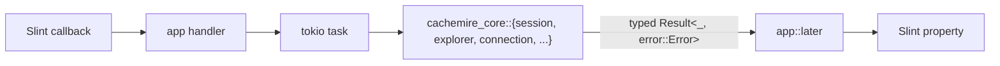

# cachemire-core

The UI-free library behind Cachemire, a desktop Redis and Valkey client. It holds everything the
application *does*: saved connections and their pools, SSH tunnels, AWS sign-in, the keyring, every
Redis command, the key explorer, the Redisql language, settings and their persistence.

The application crate, `cachemire` (a Slint window, documented in its own wiki front page), is only glue
between the screen and this library. The core **must not depend on Slint or on the app's `t!` messages**: its error
messages are English and the app translates them (see [errors](crate::wiki::errors)). That keeps the
core testable without a window.

## How the app uses it



Core functions are `async` where they touch the network (they run on the Tokio runtime from
[`runtime::spawn`](crate::runtime::spawn)) and plain where they only touch memory or small files. Most take
`&AppState` and a connection id.

## Module map

| Module | What it holds | Chapter |
|---|---|---|
| [`state`](crate::state) | [`AppState`](crate::state::AppState) (the shared stores), the instance lock, the data-file location, `resolve_connection`, read-only checks | in the app's *state* chapter |
| [`runtime`](crate::runtime) | the Tokio runtime on its own thread | in the app's *runtime* chapter |
| [`error`](crate::error) | [`Error`](crate::error::Error), its sub-enums and [`ErrorKind`](crate::error::ErrorKind) | [errors](crate::wiki::errors) |
| [`connection`](crate::connection) | saved connections ([`store`](crate::connection::store)), [`client`](crate::connection::client), [`pool`](crate::connection::pool), [`tls`](crate::connection::tls), [`url`](crate::connection::url), [`ssh_tunnel`](crate::connection::ssh_tunnel) | [connection](crate::wiki::connection) |
| [`secret`](crate::secret) | [`Secret`](crate::secret::Secret): zeroized text, `Debug` prints `***` | [secrets](crate::wiki::secrets) |
| [`secret_vault`](crate::secret_vault) | the OS credential store and the policies for it | [secrets](crate::wiki::secrets) |
| [`aws`](crate::aws) | `~/.aws` profiles, SSO sign-in, ElastiCache | [aws](crate::wiki::aws) |
| [`session`](crate::session) | [`Session`](crate::session::Session): every Redis command, with its reply decoded | [session](crate::wiki::session) |
| [`explorer`](crate::explorer) | walking and searching the keyspace, reading a key's details | [explorer](crate::wiki::explorer) |
| [`redisql`](crate::redisql) | the query language: lexer, parser, executor, completion, history, scripts | [redisql](crate::wiki::redisql) |
| [`settings`](crate::settings) | preferences, SSH and connection profiles, saved queries, cloud settings | [settings](crate::wiki::settings) |
| [`persist`](crate::persist) | reading and writing the JSON files safely | [settings](crate::wiki::settings) |
| [`json_path`](crate::json_path) | the key panel's filter path (`a.b[0]`, `*`, `..key`) | [utilities](crate::wiki::utilities) |
| [`key_name`](crate::key_name) | [`KeyName`](crate::key_name::KeyName): a key's name as raw bytes, with a text id | [utilities](crate::wiki::utilities) |
| [`export_files`](crate::export_files) | writing keys to JSON files | [utilities](crate::wiki::utilities) |
| [`redis_value_type`](crate::redis_value_type) | [`RedisValueType`](crate::redis_value_type::RedisValueType): string, hash, list... | [session](crate::wiki::session) |
| [`server_info`](crate::server_info) | `INFO` readings such as used memory, and `format_bytes` | [session](crate::wiki::session) |
| [`link`](crate::link) | `cachemire://` links to a key | in the app's *platform* chapter |
| [`updates`](crate::updates) | looking for a newer release on GitHub, fetching its installer | in the app's *platform* chapter |
| [`i18n`](crate::i18n) | [`Language`](crate::i18n::Language) and the languages there are translations for | in the app's *i18n* chapter |
| `test_support` | helpers shared by tests (feature `test-support`) | in the app's *testing* chapter |
| `e2e` | tests against a real Redis, run with `cargo xtask e2e` (tests only) | in the app's *testing* chapter |

`now_ms()` at the crate root is the one free function: the current time in milliseconds.

## Chapters

| Chapter | What it covers |
|---|---|
| [errors](crate::wiki::errors) | The typed error system: `Error`, sub-enums, `ErrorKind`, conventions. |
| [connection](crate::wiki::connection) | Saved connections, client, pool, TLS, SSH tunnel. |
| [secrets](crate::wiki::secrets) | `Secret`, the vault, policies, staged operations. |
| [aws](crate::wiki::aws) | AWS profiles, ElastiCache, the SSO sign-in. |
| [session](crate::wiki::session) | Commands on a server, timeouts, value types. |
| [explorer](crate::wiki::explorer) | The keyspace walk, searches, key details. |
| [redisql](crate::wiki::redisql) | The Redisql language pipeline. |
| [settings](crate::wiki::settings) | Settings, profiles, saved queries and how they persist. |
| [utilities](crate::wiki::utilities) | JSON paths, key names, export files. |

The app-level chapters (architecture, runtime, state, UI...) are in the application's wiki; its
front page is the `cachemire` crate's page.

## Conventions of the crate

- **Typed errors.** Every fallible function returns [`error::Result`](crate::error::Result) or a more
  specific error that converts into [`Error`](crate::error::Error). `Display` is English.
- **Secrets are `Secret`.** Any password, passphrase or token is a [`Secret`](crate::secret::Secret);
  saving one in clear text needs the user's consent, and SSH host keys are confirmed.
- **`unwrap` only in tests.** The workspace lints warn on `unwrap_used`.
- **Tests sit beside the code**, in a sibling `tests.rs` of each module.
- **Persistence is whole-file and atomic**: see [`persist`](crate::persist) and the
  [settings](crate::wiki::settings) chapter.

## Building the wiki

```text
cargo wiki --open
```

An alias of `cargo xtask wiki`: `cargo doc --no-deps --document-private-items`, then the diagrams (`mermaid`
blocks drawn in the browser, `dot` blocks rendered by Graphviz). The chapters are Markdown files of
`crates/cachemire-core/wiki/`, included as modules of `crate::wiki` that exist only in documentation
builds. Code excerpts use `text` fences because this crate runs doctests.
