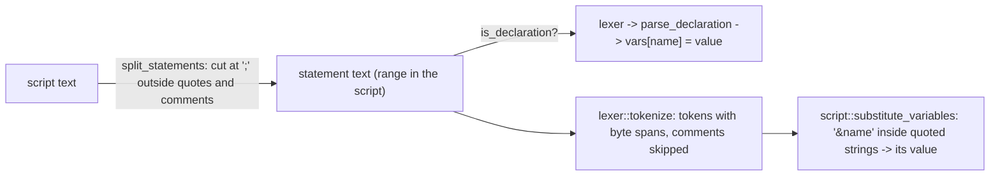
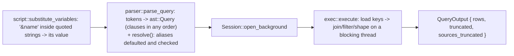

# Redisql: the query language and its engine

Redisql pulls rows out of keys that hold JSON (a hash whose fields are JSON objects, or a string
holding an object or an array of objects), joins them on matching field values, filters and
shapes them, and returns them as JSON maps. This chapter documents the pipeline in
`crates/cachemire-core/src/redisql/` and the language itself. The UI side is in the app crate's wiki chapter `redisql`.

## Where to look

| File | Role |
|------|------|
| `redisql/mod.rs` | public API, [`QueryError`](crate::redisql::QueryError), [`Located`](crate::redisql::Located), [`run_script`](crate::redisql::run_script) |
| `redisql/lexer.rs` | `tokenize`: text to `Token`s with byte spans |
| `redisql/parser/mod.rs` | recursive descent: tokens to a `Query` |
| `redisql/ast.rs` | the parsed query and the limits |
| `redisql/script/mod.rs` | statement splitting, `var` declarations, `&name` substitution |
| `redisql/exec/mod.rs` | loading keys, joining, filtering, shaping; [`field_names`](crate::redisql::field_names) |
| `redisql/complete/mod.rs` | completion for the query box |
| `redisql/history/mod.rs` | persisted run history |
| `redisql/tests.rs` and each folder's `tests.rs` | unit tests; `e2e/redisql.rs` runs against a real Redis |

## The pipeline





The entry point is [`run_script`](crate::redisql::run_script)`(state, connection_id, script)`,
returning one [`StatementResult`](crate::redisql::StatementResult) per executed query:

```text
StatementResult { output: Result<QueryOutput, Error>, error_span: Option<Range<usize>> }
```

Rules of `run_script`:

- Statements run in order against the active connection (or the given id).
- A `var` declaration produces no result; it sets a variable for the statements after it. A script
  of declarations only returns an empty vector.
- It stops at the first error; that error is the last (and only failed) result. Nothing after it runs.
- An error's `error_span` is a byte range *in the whole script text* (the statement's own spans are
  shifted by [`Located::shifted`](crate::redisql::Located) with the statement's start). This is how
  the UI highlights the faulty spot.
- Each statement is lexed from the original text of its range (comments included), so spans stay
  true; the comment-stripped copy in `Statement::text` is used by callers such as the app, not by `run_script`.

## The language

### Lexical rules

Keywords are case-insensitive. `--` starts a comment that runs to the end of the line.

```text
Word     a name, a keyword, or a bare value like true; starts with a letter or _,
         then letters, digits, _ - : (a Word stops at '.', which is a separator)
Number   starts with a digit, or '-' followed by a digit; may contain '.' (1.5), '-' and ':'
         (so 2024-01-01 is one Number token)
Str      '...' or "..."; inside, the quote written twice stands for itself
Punct    .  ,  =  *  [ ]  ( )
```

Anything else is `UnexpectedText`; an unclosed quote is `UnterminatedQuote` (the span runs to the
end of that line; quotes cannot span lines in the error report).

### Statements and scripts

```text
script     := statement ( ';' statement )*          empty statements are ignored
statement  := declaration | query
declaration:= VAR name '=' value                    value: string, number or bare word, not empty
```

A statement is a declaration when its first token is `var` ([`is_declaration`](crate::redisql::is_declaration)).
A declaration with anything after the value, or no value, is `InvalidDeclaration`.

### Queries

```text
query  := clause+                                   clauses in any order
clause := FROM KEY 'key' [AS alias]
        | JOIN KEY 'key' AS alias ON ref '=' ref    JOIN may repeat
        | WHERE cond ( AND cond )*
        | SELECT item ( ',' item )*
        | LIMIT number
cond   := ref '=' value
        | ref IN '[' value (',' value)* ']'         or with ( ) instead of [ ]
ref    := alias '.' field | field                   no alias: the FROM alias
item   := '*' | alias '.' '*' | alias '.' field | field
value  := 'string' | number | bare word
```

FROM, WHERE, SELECT and LIMIT may each appear once ([`QueryError::RepeatedClause`](crate::redisql::QueryError));
a missing FROM is `MissingFrom`. The alias of FROM defaults to `src`. In a JOIN, a side of the ON
with no alias belongs to the joined key; the two sides must name different aliases and one must
be the JOIN's own (`JoinOnItself`, `OnWithoutOwnAlias`), the other must be an alias already
defined earlier (`UnknownJoinAlias`). Aliases are case-insensitive and unique (`DuplicateAlias`).

Examples:

```text
FROM KEY 'orders' AS o
WHERE o.status = 'paid' AND o.country IN ['FR', 'DE']
SELECT o.id, o.total
LIMIT 100
```

```text
FROM KEY 'orders' AS o
JOIN KEY 'customers' AS c ON o.customerId = c.id
SELECT o.id, c.name
```

```text
var companyId = 255;
FROM KEY 'company:&companyId' AS c;      -- a variable inside a quoted key
FROM KEY 'orders' WHERE customerId = 7   -- no alias: defaults to src
```

### Variables

`var name = value;` sets a variable. It is used as `&name`, and only **inside a quoted string** of a
later statement, and only as a whole `:`-separated segment: in `'user:&id:name'` the segment `&id`
is replaced, in `'user&id'` nothing is. `name` is letters, digits and `_`
([`variable_ranges`](crate::redisql::variable_ranges) finds them; the UI's highlighter reuses it).
Substitution works on the token's text before parsing, so a variable holding a quote cannot break
the syntax. An unknown name is `UnknownVariable`, pointed at the `&name` inside the string.

### Semantics

- **Sources.** A key may be missing (`KeyNotFound`, kind `NotFound`), a hash, or a string. Any other
  type is `NotQueryable`. A hash contributes one row per field, each field's value must be a JSON
  object (`NonObjectField`, `FieldJson` name the key and field). A string contributes the object it
  holds, or the objects of the array it holds (non-objects inside the array are skipped); a blank
  string gives no rows; other JSON is `NonObjectValue`, invalid JSON `ValueJson`.
- **Field lookup** is case-insensitive (exact match first, then ASCII-case-insensitive).
- **Comparison** is on strings: a value is normalised (`string` as is, number and bool by their text,
  other JSON by its serialisation); `null` or an absent field never matches anything, in a join or
  a WHERE. `=` compares to the one value, `IN` tests membership; the comparison is case-sensitive.
- **Joins** are inner joins on equality of the two named fields. A JOIN builds an index of the joined
  key's rows by the join field; one row can match several (it produces several result rows).
  Each WHERE is checked as soon as its alias's record joins the row.
- **SELECT.** Empty, or a lone `*`: all fields of all aliases. Otherwise each item gives a column;
  an unknown field is `null`. Column names are `alias.field` when the query has several aliases or
  the alias was written, else plain `field`. `alias.*` expands all of that alias's fields.
- **Order.** Rows come in the order of the FROM key's rows; for a hash that is the order of the
  `HSCAN`, which Redis does not specify. Not sorted.

### Limits

| Limit | Value | Notes |
|-------|-------|-------|
| `DEFAULT_LIMIT` | 250 | rows when no LIMIT |
| [`MAX_LIMIT`](crate::redisql::MAX_LIMIT) | 5000 | a larger LIMIT is clamped; the minimum is 1 (a negative number becomes 0, then 1) |
| `MAX_SOURCE_FIELDS` | 20 000 | a hash is read until that many rows were collected; `sources_truncated` says more was left |
| `MAX_STRING_BYTES` | 16 MiB | a longer string key fails with `StringTooBig` before it is read |
| `MAX_FIELD_NAMES` | 100 | most field names `field_names` lists |

`MAX_SOURCE_FIELDS` is checked per scan page (500 fields), so the real count may exceed it by up to
a page; the "more was left" flag is "the cursor did not come back to 0". A join against a cut key
may miss matches. `QueryOutput::truncated` means more rows matched than the limit
(the join stops one row past it).

## Errors and where they point

[`QueryError`](crate::redisql::QueryError) lists every language error with an English `Display`
(translated by the app, see [errors](crate::wiki::errors)). Its `kind()` gives the
[`ErrorKind`](crate::error::ErrorKind): `NotFound` for a missing key, `Invalid` for a key that
cannot be queried or holds bad JSON/too much, `Parse` for everything else.

[`Located`](crate::redisql::Located) pairs an [`Error`](crate::error::Error) with an optional span:

```text
Located { error: Error, span: Option<Range<usize>> }
```

- Lexer and parser errors point at the token they are about (`Parser::here`: the current token, or
  the last one at the end of a statement).
- The AST keeps spans of what is checked later (`key_span`, `alias_span`, `anchor_span`), so the
  alias checks of `resolve` and a missing key found by `exec` can still point at the place the key
  or alias is written (`Located::at`).
- `EmptyQuery` and `MissingFrom` have no span (nothing to point at).
- Redis errors during execution convert into `Located` without a span.
- Statement spans are relative to the statement; `run_script` moves them into the script's
  coordinates, and the app moves them again into the box's (see the app chapter).

## Completion: `complete/`

[`complete`](crate::redisql::complete::complete)`(state, caches, text, cursor, force)` works out
what could replace the token under the caret and returns a
[`Completion`](crate::redisql::complete::Completion):

```text
Completion { start, end, quote: Option<char>, items: Vec<(String, Range<usize>)> }
```

`start..end` is the text a chosen item replaces; each item carries the part that matches what was
typed (for bold rendering). It returns `None` when there is nothing to offer, no active
connection, or the cursor is not on a char boundary.

How the token is found: inside an open quote (quotes before the caret on its line open and close in
turn) it is the whole quoted key up to the closing quote; otherwise the run of ASCII letters, digits
`_ : .` around the caret.

Three kinds of suggestions:

1. **Fields** after `alias.`: the alias is mapped to its key by scanning the text for
   `KEY 'k' [AS] alias` (`alias_keys`, ASCII-lowercase search so offsets stay valid), then
   [`field_names`](crate::redisql::field_names) lists the key's fields (first records only). Items
   match anywhere in the name; sorted by match position then length.
2. **Keywords** (`FROM JOIN KEY AS ON WHERE SELECT LIMIT AND IN`), only outside quotes.
3. **Key names and folders**: one level of the keyspace under the part of the token before its last
   `:`, listed with [`scan_namespaces`](crate::explorer::scan_namespaces) using `:` as delimiter,
   folders (ending `:`) before keys.

Unless `force` (Ctrl+Space) is true, fewer than two typed characters offer nothing (except after
`alias.`). Limits: `MAX_ITEMS` 50 items; a level listing may take `SCAN_BUDGET` (1.5 s) and keeps up to
`SCAN_NAMES` (300) names; results are cached for `CACHE_TTL` (30 s) in [`Caches`](crate::redisql::complete::Caches),
two maps (levels and fields) keyed by `(connection id, prefix or key)`. The UI owns one `Caches`.

[`Completion::accept`](crate::redisql::complete::Completion::accept)`(text, index)` writes an item
in and returns the new text and caret: a key typed outside quotes gets its quotes; a folder (ending
`:`) leaves its quote open so the user can continue; inside quotes a key gets its closing quote
unless already there or it is a folder. The app re-opens suggestions right after accepting a folder.

## History: `history/`

[`HistoryStore`](crate::redisql::history::HistoryStore) keeps the runs of the query tabs in
`query_history.json` (the path comes from [`AppState`](crate::state::AppState), field `history`).

```text
HistoryEntry { connection_id, text, executed_at (ms), duration_ms, ok }   camelCase JSON
```

- Newest first; at most `PER_CONNECTION` (50) entries per connection.
- [`record`](crate::redisql::history::HistoryStore::record) removes an earlier run of the same
  text on the same connection and puts the new one on top, so re-running a text moves it up.
- [`for_connection`](crate::redisql::history::HistoryStore::for_connection) and
  [`clear`](crate::redisql::history::HistoryStore::clear) work per connection.
- Loading goes through [`persist::load_store`](crate::persist::load_store): a file that cannot be read
  is kept, never replaced; the store is then not writable and `save` does nothing. Save failures
  are logged, not raised.

The saved (named) queries are a different thing: they live in the settings store (see
[settings](crate::wiki::settings)).

## Tests

Unit tests per module (lexer and parser via `parse_query`, which is `#[cfg(test)]`), plus
`redisql/tests.rs` for whole scripts that fail before reaching a server, and `e2e/redisql.rs` for
real runs. Changes to the language go through the `redisql-feature` skill.

## Notes

- The repository's README shows one example query only: the clause rules are those of this chapter
  and of the parser.
