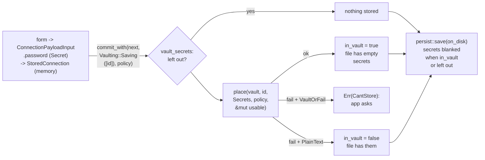
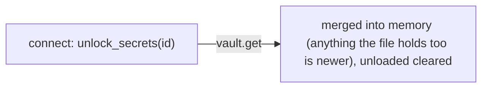

# Secrets

Every password, passphrase and token is a [`Secret`](crate::secret::Secret): zeroed on drop and
never printed. Saved connections keep theirs in the operating system's credential store
(the "vault") rather than in `databases.json`; when that store cannot take them, the
[`SecretsPolicy`](crate::secret_vault::SecretsPolicy) decides, and the app asks the user.

## Where to look

| File | What it holds |
|------|---------------|
| `secret.rs` | [`Secret`](crate::secret::Secret) |
| `secret_vault/mod.rs` | [`Vault`](crate::secret_vault::Vault) trait, [`OsVault`](crate::secret_vault::OsVault), [`Secrets`](crate::secret_vault::Secrets), [`SecretsPolicy`](crate::secret_vault::SecretsPolicy), [`LeftOut`](crate::secret_vault::LeftOut), [`place`](crate::secret_vault::place), [`staged`](crate::secret_vault::staged) |
| `connection/store/mod.rs` | the main consumer: `vault_secrets`, `unlock_secrets`, `commit_with` |
| `settings/ssh_profiles.rs`, `settings/cloud/mod.rs` | the other consumers (SSH profile passwords, cloud tunnel secrets) |

## `Secret`

[`Secret`](crate::secret::Secret) wraps a `Zeroizing<String>`.

- **Wiped on drop.** [`Secret::clear`](crate::secret::Secret::clear) zeroes it in place.
- **Never printed.** `Debug` writes `***` (or `""` when empty). There is no `Display`.
- **Reading is explicit.** The text only comes out through [`Secret::expose`](crate::secret::Secret::expose),
  which makes every use greppable.
- **Serialisation is plain.** `Serialize` writes the text and `Deserialize` reads it, because the
  same type is used for the files and for the export. The protection is therefore not in the type
  but in the stores: before a connection is written to disk its secrets are replaced by empty ones
  when they live in the vault or were left out (see `commit_with`).
- `Clone` copies the text into a new zeroizing buffer. Copies handed to other libraries
  (for example `redis-rs` receiving `expose()`) are outside what the type guarantees; whether
  those libraries wipe them is not established here.

## What is stored

[`Secrets`](crate::secret_vault::Secrets) is everything secret about one saved connection:
`password`, `ssh_password`, `ssh_passphrase`. It is stored as **one JSON entry per connection**,
named by the connection id, so a connection costs one lookup. The entries are filed under the
service name `Cachemire`.

Entries are also used for other owners with their own key: an SSH profile's password
(`vault_key(id)` in `settings/ssh_profiles.rs`) and a cloud scope's tunnel secrets
(`cloud_vault_key(scope)`); they reuse the same [`Vault`](crate::secret_vault::Vault) trait and
`Secrets` shape.

**Old name.** Entries written under the former app name `Redust` are read when `Cachemire` holds
nothing for an id; when the copy is stored, the old entry is deleted. `delete` removes both.

## Which store, per platform

[`OsVault`](crate::secret_vault::OsVault) goes through
[`keyring-core`](https://docs.rs/keyring-core) with a default store chosen at first use
(`STORE`, a `LazyLock`; a failure to create it is remembered and reported on every use):

| Platform | Store |
|----------|-------|
| Windows | Credential Manager (`windows-native-keyring-store`) |
| Unix except macOS, iOS, Android (Linux) | Secret Service over D-Bus (`zbus-secret-service-keyring-store`) |
| Anything else (macOS included, as the code stands) | none: `platform_store` returns `NoDefaultStore` |

The comment on `platform_store` says it is "the one `keyring` 4 used, so what it saved is found
again". Without a store every vault call fails with a [`VaultError::Keyring`](crate::secret_vault::VaultError::Keyring),
which feeds the policy below. Whether macOS is meant to be supported is not established by this code.

Tests never touch the real store: `MemoryVault` (behind `cfg(test)` or the `test-support`
feature) is an in-memory vault that can be switched to "broken".

## Errors

- [`VaultError`](crate::secret_vault::VaultError): the store itself failed (`Keyring`), the
  saved JSON is unreadable (`Json`), or there is no store (`Unavailable`). It is `Clone`
  (errors are `Arc`ed) because [`staged`](crate::secret_vault::staged) replays answers.
- [`KeyringError`](crate::secret_vault::KeyringError) says *what* was being done:
  `ConnectionPasswords`, `SshProfilePassword`, `TunnelSecrets` (reads that failed ahead of a
  connection) and `CantStore` (a save refused). It becomes
  [`Error::Keyring`](crate::error::Error::Keyring) with kind
  [`ErrorKind::Keyring`](crate::error::ErrorKind::Keyring); see [errors](crate::wiki::errors).

## The policy when the vault will not take a secret

[`SecretsPolicy`](crate::secret_vault::SecretsPolicy) is what a **save** does with a secret the
store refuses:

| Policy | Effect |
|--------|--------|
| `VaultOrFail` (default) | the save fails with [`KeyringError::CantStore`](crate::secret_vault::KeyringError::CantStore) |
| `PlainText` | the secret stays in clear text in the data file |
| `LeaveOut` | saved nowhere: asked at connection time, kept in memory for the run |

The rule behind the project's "plain-text save asks the user first": the app always starts a
save with `VaultOrFail`. Only when it fails with `CantStore` does the app show a dialog and run the
same save again under `PlainText` or `LeaveOut`, whichever the user chose (see the app's
connections chapter). Nothing in the core picks `PlainText` on its own for a user action.

Two exceptions are visible in the code, both *quiet* migrations of what the file already holds:

- [`place`](crate::secret_vault::place) with `PlainText` and a vault already known unusable skips
  the attempt, so a run makes no more tries (and, on Linux, no more unlock prompts).
- [`Vaulting::Quietly`](crate::secret_vault::Vaulting::Quietly) (used by `unlock_secrets`) moves
  secrets that are still in the file into the vault when it can, and silently leaves them in
  the file if it cannot. They were already in the file, so this is no new exposure.
  Secrets that were already in the file are not asked about again on a later save
  (`in_file_already`).

### `Vaulting` and `place`

[`Vaulting`](crate::secret_vault::Vaulting) tells a commit what to do:

- `Untouched`: leave secrets as they are;
- `Quietly`: move what is not in the vault, failures stay in the file;
- `Saving(ids)`: the connections named follow the caller's policy, the others are moved quietly.

[`place`](crate::secret_vault::place) stores `secrets` under a key as the policy says and returns
`Ok(true)` if they went to the vault. `usable` is cleared by the first failure.

## Left-out secrets

[`LeftOut`](crate::secret_vault::LeftOut) flags which of a connection's three secrets were left out
of every store (`left_out` in the saved file, omitted when empty). For such a connection:

- the file and the vault never receive the secret (`Secrets::without`);
- [`ConnectionStore::missing_secrets`](crate::connection::store::ConnectionStore::missing_secrets)
  reports which are still empty this run;
- the app prompts and calls [`ConnectionStore::provide_secrets`](crate::connection::store::ConnectionStore::provide_secrets),
  which holds the answers in memory only; an empty field keeps what is known;
- typing a new secret in the form clears the flag (`apply_payload`).

## The life of a secret

And when the connection is made:

At load, connections with `in_vault = true` are listed in `unloaded`: their secrets are
empty in memory until `unlock_secrets` reads them. `vault_secrets` skips those, so a
secret that was never read is never overwritten with emptiness. If the entry vanished
behind the app's back, `in_vault` is cleared.

## `staged`: keeping the lock free

The vault can take a long time (an unlock prompt, a first-time setup), and the stores sit
behind a `Mutex`. [`staged`](crate::secret_vault::staged) runs an operation on a store in two passes:

1. **Rehearsal** on a clone with `dry_run` set: reads go to the real vault (and are recorded), writes
   are only noted. The lock is *not* held during this.
2. The noted writes are made for real (stopping at the first failure), then the operation is run
   **again** on the real store under the lock, with the vault replaced by a `Recorded` that
   replays the recorded reads and write results.

Consequences: the operation must be deterministic (no fresh ids inside; the app generates ids and
name choices outside the closure), and it must be called off the UI thread
(`spawn_blocking`). Any store that holds secrets implements
[`VaultBacked`](crate::secret_vault::VaultBacked) (`vault_mut`, `set_dry_run`);
[`ConnectionStore`](crate::connection::store::ConnectionStore) and the settings store do.

## Removing

[`ConnectionStore::remove`](crate::connection::store::ConnectionStore::remove) does not touch the
keyring. It returns a [`SecretsCleanup`](crate::secret_vault::SecretsCleanup) (best effort,
ignores errors) for the caller to run on a blocking thread; a locked or missing store leaves an
orphan entry that nothing refers to.

## Export and import

The app's export writes `password`/`passphrase` as `null` unless the user ticks "include
passwords"; to include them it first unlocks the secrets through `staged`. An import goes through
`import_all` with the same policy dance as a save. See the app's connections chapter.

## Other secrets that are not in the vault

- The AWS SSO access token (and refresh token, client secret) are `Secret`s in memory but are
  cached on disk in `~/.aws/sso/cache`, shared with the AWS CLI, with owner-only permissions on
  Unix. See [aws](crate::wiki::aws).
- URL passwords typed into the connection URL are moved to the password field before saving.
