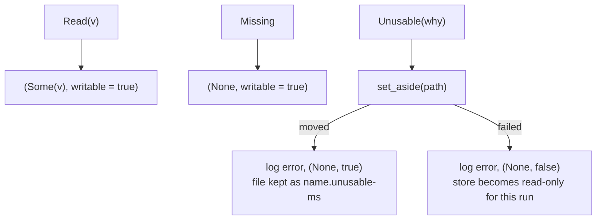

# Settings and persistence

Everything the app keeps on disk is a small JSON file in one data directory.
[`persist`](crate::persist) reads and writes those files safely,
[`SettingsStore`](crate::settings::SettingsStore) owns `settings.json` (preferences, SSH profiles,
connection profiles, saved queries, cloud settings), and [`state`](crate::state) decides where the
directory is and who may write to it.

## Where to look

- `src/persist/mod.rs`: [`load`](crate::persist::load), [`load_store`](crate::persist::load_store),
  [`save`](crate::persist::save), [`set_aside`](crate::persist::set_aside).
- `src/settings/mod.rs`: [`SettingsStore`](crate::settings::SettingsStore), the private
  `StoredSettings` (the JSON shape), `commit`.
- `src/settings/ssh_profiles.rs`, `connection_profiles.rs`, `saved_queries.rs`, `cloud/mod.rs`:
  one `impl SettingsStore` block per topic.
- `src/state.rs`: [`resolve_data_file`](crate::state::resolve_data_file),
  [`lock_instance`](crate::state::lock_instance), [`AppState::load`](crate::state::AppState::load).
- `src/settings/tests.rs`, `src/persist/tests.rs`: what the behaviour below is pinned by.

## The files and where they live

The data directory is resolved once per process by [`resolve_data_file`](crate::state::resolve_data_file),
which returns the path of `databases.json`; every other file sits next to it (`with_file_name`).

| Platform / mode | Directory |
|---|---|
| Windows | `%APPDATA%\Cachemire` (what the `dirs` crate calls the data dir) |
| Linux | `~/.local/share/Cachemire` (honours `XDG_DATA_HOME` through `dirs`) |
| Portable (any OS) | `data/` next to the executable, when an empty file named `portable` is there too |
| No per-user dir known | the executable's own directory |

The files in it:

| File | Owner | Content |
|---|---|---|
| `databases.json` | `ConnectionStore` ([connection](crate::wiki::connection)) | saved connections |
| `settings.json` | [`SettingsStore`](crate::settings::SettingsStore) | this chapter |
| `query_history.json` | [`HistoryStore`](crate::redisql::history::HistoryStore) | Redisql runs per connection |
| `ssh_known_hosts` | `HostKeys` ([connection](crate::wiki::connection)) | trusted SSH host keys |
| `cachemire.lock` | [`lock_instance`](crate::state::lock_instance) | the single-instance lock |
| `last_session.json`, `window.json`, `logs/`, `links/` | the app crate (see its [settings](crate::wiki::settings) chapter, not core) | session, window rect, log files, link inbox |

The portable marker is checked first, so a portable install never touches `%APPDATA%`.
The `portable` file is created by the packaging task (`cargo xtask build-windows`), not by the app.

### Migration of old layouts

Only the *location* has been migrated, never the content. Two copies happen once, on the first
call of `resolve_data_file`, and only while the new directory has no `databases.json` yet:

- from the former application name: the `Redust` directory beside `Cachemire` is copied
  (`databases.json`, `ssh_known_hosts`, `settings.json`, `query_history.json`); if every copy
  succeeded, the old directory is removed;
- from the executable's directory (the layout before there was a data dir): `databases.json` and
  `ssh_known_hosts` are copied, the originals are left alone.

Both go through `migrate_legacy_data`, which never overwrites a newer data directory.

## The JSON shape: forward and backward compatibility

`settings.json` is read into the private `StoredSettings`. The rules that keep old and new files
loadable, all visible in the struct:

- `#[serde(default)]` on every field: a file written before a field existed still loads, the field
  takes its default (`false`, `""`, empty list, `0`).
- A trailing `#[serde(flatten)] extra` map keeps keys this version does not know and writes them
  back unchanged, so a downgrade does not erase what a newer version stored.
- Enums read leniently: [`OpeningView`](crate::settings::OpeningView) has `#[serde(other)]` on its
  default `Fields` variant; a profile colour is a string code and
  [`ProfileColor::from_code`](crate::settings::ProfileColor::from_code) maps an unknown one to red;
  the language is a code string and [`Language::from_code`](crate::i18n::Language::from_code)
  maps an unknown one to "automatic"; the update channel is a string read by
  [`Channel::from_code`](crate::updates::Channel::from_code), `None` when unknown.
- "Seeded once" flags (`connection_profiles_seeded`, `default_profile_read_only_set`) make a
  one-time upgrade step idempotent. `SettingsStore::with_vault` adds the default red read-only
  "Production" profile if it has never been seeded, and sets it read-only once for files that predate
  the read-only option. Because the flag is saved, deleting or un-ticking it afterwards sticks.
- Wire names are camelCase (`#[serde(rename_all = "camelCase")]`); the `StoredX` structs are the
  disk form, separate from the public item types (`ConnectionProfile`, `SavedQuery`,
  `SshProfileItem`) that the UI sees. `to_profile` / `to_saved_query` convert.

Main groups of fields in `StoredSettings` (read the struct for the full list, each field has a
comment):

- preferences: `language`, `export_escaped`, `opening_view`, `last_view_table`, `restore_session`,
  `check_updates_at_startup`, `update_channel`, `accept_new_ssh_host_keys`, `server_search`,
  `search_depth`, `shortcuts`, `theme`, `syntax_theme` (names the app gives its themes);
- lists: `ssh_profiles` (+ `active_ssh_profile`), `connection_profiles`, `saved_queries`;
- `cloud`: per AWS account / endpoint overrides, plus which local AWS profile last listed what.

Reads of the preferences are plain getters (`language`, `restore_session`, ...). `search_depth` is
validated against [`SEARCH_DEPTHS`](crate::settings::SEARCH_DEPTHS) and falls back to
[`DEFAULT_SEARCH_DEPTH`](crate::settings::DEFAULT_SEARCH_DEPTH).

## Load and save

### Loading: nothing is ever replaced by defaults silently

[`load`](crate::persist::load) returns a [`Loaded`](crate::persist::Loaded):
`Missing` (first run), `Read(value)`, or `Unusable(why)` (invalid JSON, unknown shape, unreadable).
Stores call [`load_store`](crate::persist::load_store), which adds the policy:



`SettingsStore` stores `dry_run = !writable`: when the bad file could not be moved, every later
`commit` updates memory but skips `persist::save`, so the user's file is never overwritten.

### Saving: temp file, flush, rename

[`save`](crate::persist::save) writes pretty JSON to `<name>.tmp` (created owner-only with mode
`0600` on Unix), `sync_all`s it, then renames over the target. The target is therefore always the
old content or the whole new one. On failure the temp file is removed and a
[`FileError`](crate::error::FileError) comes back (see [errors](crate::wiki::errors)).
Directories it creates are `0700` on Unix ([`create_private_dir`](crate::persist::create_private_dir)),
because the files may hold passwords when the keyring was refused.

Windows has no mode bits there: the files rely on the per-user directory.

## The commit pattern of `SettingsStore`

Every setter has the same shape, which is the one thing to know before editing the store:

```text
let mut next = self.state.clone();   // work on a copy
next.<field> = <new value>;          // validate first, return Err(Invalid::..) early
self.commit(next, false)             // save, then replace self.state
```

`commit_with` does, in order: (optionally) move changed secrets to the credential store; build an
`on_disk` copy in which the passwords of entries flagged `in_vault` are blanked; save it unless
`dry_run`; only then replace `self.state`. If the save fails, memory is unchanged and the error goes
to the caller, so the UI never shows a value that is not on disk.

Secrets inside the settings (SSH profile passwords, tunnel secrets of cloud entries) follow the
[secrets](crate::wiki::secrets) rules:

- each carries `in_vault: bool`; the file keeps the secret only when it is `false`;
- `unloaded` is the set of vault keys whose secret has not been read yet. They are read lazily by
  `unlock_active_ssh_profile` / `unlock_cloud`, just before a connection needs them, so startup
  never talks to the keyring;
- vault keys: `ssh-profile:<id>`, `cloud-account:<account>`, `cloud-endpoint:<account/region/name>`;
- `vault_usable` is cleared by the first failure to store, so a plain-text run makes no more attempts;
- [`staged`](crate::secret_vault::staged) lets the app run a settings operation without holding the
  `AppState::settings` mutex across slow keyring calls: it rehearses on a clone (`dry_run`), plays the
  vault writes outside the lock, then replays the operation for real with the recorded answers
  (`SettingsStore` implements [`VaultBacked`](crate::secret_vault::VaultBacked) for this).

## The topics

### SSH profiles (`ssh_profiles.rs`)

A profile is a username + password that an SSH tunnel *without its own username* logs in with.
One profile can be "active" (`active_ssh_profile`, empty for none); the first one created becomes
active. [`fill_ssh`](crate::settings::SettingsStore::fill_ssh) completes an
[`SshSettings`](crate::connection::SshSettings) from the active profile only when the tunnel's
username is empty; a connection with its own username ignores the profile. The UI sees
`SshProfileItem`, which never carries the password. Removing a profile returns an optional
`SecretsCleanup`, to be run off the UI thread, that deletes its keyring entry.

### Connection profiles (`connection_profiles.rs`)

A [`ConnectionProfile`](crate::settings::ConnectionProfile) is a name, a
[`ProfileColor`](crate::settings::ProfileColor) (fixed palette of eight, each checked against the
app background), a `read_only` flag and a `light_tint` flag (only the connection pill takes the color). The default profile has the fixed id `production`.
The store does not know which connections use a profile: `remove_connection_profile` leaves that
check to the caller. Read-only is enforced by [`is_read_only`](crate::state::is_read_only) /
[`ensure_writable`](crate::state::ensure_writable).

### Saved queries (`saved_queries.rs`)

A [`SavedQuery`](crate::settings::SavedQuery) is a Redisql text with a name and an optional
`connection_id` (empty means global). Create validates a non-empty trimmed name and text;
`remove_saved_queries_of` drops the queries of a deleted connection.
See [redisql](crate::wiki::redisql) for the language itself.

### Cloud settings (`cloud/mod.rs`)

What the user set for AWS accounts and endpoints, as `CloudEntry` values (optional connection
profile, optional [`CloudSsh`](crate::settings::CloudSsh) tunnel), kept in three maps:
`accounts` (by account id), `endpoints` (by `account/region/name`) and `profiles` (local AWS profile
name to the `account/region` it last listed, used to resolve links).

- Inheritance: an endpoint's own setting wins over its account's (`cloud_effective`); an unset
  field inherits, a disabled tunnel (`CloudSsh::none`) means "no tunnel even if the account has
  one". A profile id that no longer exists counts as none.
- [`apply_cloud`](crate::settings::SettingsStore::apply_cloud) stamps a listing's items with the
  effective profile and tunnel (without secrets); `fill_cloud_secrets` adds them at connect time.
- Pruning: [`observe_cloud_listing`](crate::settings::SettingsStore::observe_cloud_listing) counts
  how many complete listings in a row lacked an endpoint (`missed`); at
  `MISSES_BEFORE_PRUNING` (3) its settings and keyring entry go. A listing that has it resets
  the counter. See [aws](crate::wiki::aws).

## The instance lock

[`lock_instance`](crate::state::lock_instance) opens `cachemire.lock` and takes an exclusive
advisory lock (`File::try_lock`), returning an [`InstanceLock`](crate::state::InstanceLock):

- `Held(file)`: this process is the only one saving; keep the value alive to the end of `main`
  (the OS releases the lock however the process ends, a crash included);
- `Taken`: another instance runs; this one must not save over its files;
- `Unavailable`: the lock file cannot be made or locked (read-only folder); the app goes on.

It lives in the same directory as the data, so a portable copy and an installed copy do not exclude
each other. What the app does with `Taken` (hand a link over, show a message, exit) is in the app's
platform chapter. The core itself does not enforce the lock: stores
write whenever asked.

## Gotchas

- Settings are a single file: every setter rewrites all of it. `set_last_view_table` skips the save
  when the value is unchanged because it fires on every view switch.
- `SettingsStore::in_memory` (tests and the `test-support` feature) swaps the keyring for a
  `MemoryVault`; `AppState::for_tests` points every file at a temp directory.
- The two "seeded" booleans are state, not preferences: do not reset them when adding a setting.
- Adding a field: serde default first, then the getter/setter pair; the UI side is described in the
  app's [settings](crate::wiki::settings) chapter.
