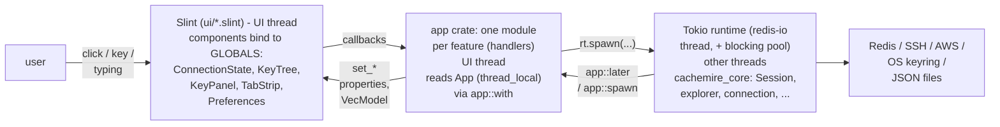
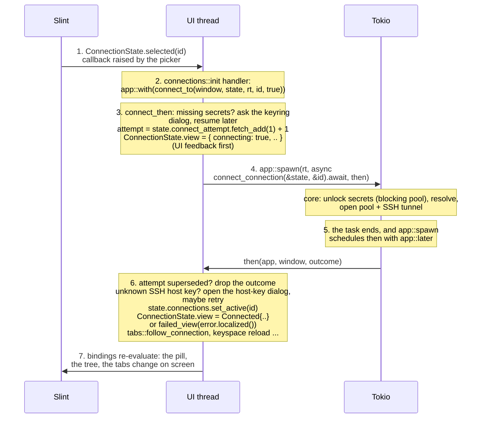

# Architecture

The app is a thin Slint front end over a UI-free core library. This chapter gives the layers, the
startup sequence of `main`, a map of the app crate's modules, and the path one user action takes
from a Slint callback to the core and back.

Where to look:

- `crates/cachemire/src/main.rs`: startup, in the order described below.
- [`crate::app`]: the shared state of the UI thread and the helpers that cross threads.
- `crates/cachemire/ui/globals.slint`: what Rust reads and writes, grouped by feature.
- `crates/cachemire-core/src/state.rs`: the core's shared state, [`AppState`](cachemire_core::state::AppState).

## Layers

Three rules hold the layers apart:

1. **Slint never reaches the core and the core never reaches Slint.** The app is the only place that
   knows both. The core must not depend on Slint or on `rust-i18n`.
2. **Slint handles live on the UI thread only.** Tokio tasks cannot hold the window: they hold
   plain data and hand results back with [`app::later`](crate::app::later) (see
   [runtime](crate::wiki::runtime)).
3. **No business logic in the app.** Handlers translate between Slint values and core calls. The
   rules (what is valid, what is read-only, how a key tree is built) are in the core.

## Startup sequence

`main` in `main.rs` does, in this order:

| Step | What | Why it is there |
|---|---|---|
| 1 | [`logging::init`](crate::logging::init) with the `logs/` folder next to the data file | the log must exist before anything can fail |
| 2 | [`links::from_args`](crate::links) reads a `cachemire://` link from the arguments | a launch may be a link |
| 3 | [`lock_instance`](cachemire_core::state::lock_instance) | only one instance may save to the data directory |
| 4 | if the lock is [`Taken`](cachemire_core::state::InstanceLock::Taken): hand the link to the running instance or show "already running", then return | a second instance never opens a window |
| 5 | `select_backend`, `slint::set_xdg_app_id` | renderer choice (software on Windows), Wayland icon |
| 6 | `MainWindow::new`, [`window_state::install`](crate::window_state), [`toast::init`](crate::toast::init), the winit event hook | the window and what listens to it |
| 7 | window callbacks owned by `main`: drag, maximize, clipboard probe | tiny platform glue |
| 8 | [`AppState::load`](cachemire_core::state::AppState::load) | reads connections, settings, history from disk |
| 9 | [`i18n::apply`](crate::i18n::apply) with the saved language | needs the window (Slint translations) and the settings |
| 10 | [`runtime::spawn`](cachemire_core::runtime::spawn) | the Tokio runtime on its own thread |
| 11 | [`updates::init`](crate::updates) | the update check needs only window, state, runtime |
| 12 | build the [`App`](crate::app::App) and [`app::install`](crate::app::install) it | after this, `app::with` works |
| 13 | the `init` of every feature module (see below) | attach the `on_*` callbacks |
| 14 | [`connections::keep_active_in_step`](crate::connections::keep_active_in_step) | nothing is connected yet, so no connection stays "active" from the last run |
| 15 | open the link given, else [`last_session::restore`](crate::last_session::restore) | the only two things that connect at startup |
| 16 | [`last_session::keep_saved`](crate::last_session::keep_saved), [`links::watch`](crate::links) | timers and the link inbox |
| 17 | `window.run()` (the Slint event loop), then [`last_session::save`](crate::last_session::save) and the window state save | exit |

The `init` calls of step 13 come in two groups, as the comments in `main.rs` say. Those that need
the shared [`App`](crate::app::App) (tabs, tree, search and query tabs) take `&Rc<App>`:
`tabs`, `keyspace`, `search`, `redisql`, `connections`, `cloud`, `connections::profiles`, `links`.
Those that need only the stores and the runtime take `Arc<AppState>` and the runtime handle:
`server_stats`, `redisql::saved`, `shortcuts`, `settings`.

Nothing auto-connects at startup. The user picks a connection, unless the setting "restore the last
session" is on, in which case [`last_session`](crate::last_session) reconnects. See
[state](crate::wiki::state).

## Module map of the app crate

| Module | Role | Chapter |
|---|---|---|
| [`app`](crate::app) | `App`, `with`, `later`, `spawn`, `spawn_blocking` | [runtime](crate::wiki::runtime) |
| [`error`](crate::error) | `Localize`, the app's `Error` | [errors](crate::wiki::errors) |
| [`connections`](crate::connections) | picker, form, connect, profiles, import/export | [connections](crate::wiki::connections) |
| [`cloud`](crate::cloud) | AWS account sign-in, cloud endpoints | [connections](crate::wiki::connections) |
| [`keyring_dialogs`](crate::keyring_dialogs), [`host_key_dialog`](crate::host_key_dialog) | ask about secrets, ask about SSH host keys | [connections](crate::wiki::connections) |
| [`keyspace`](crate::keyspace) | key tree: walk, rows, edit, selection | [keys_and_tabs](crate::wiki::keys_and_tabs) |
| [`key_detail`](crate::key_detail) | key panel: load, fields, table, edit, export | [keys_and_tabs](crate::wiki::keys_and_tabs) |
| [`search`](crate::search) | search tabs | [keys_and_tabs](crate::wiki::keys_and_tabs) |
| [`tabs`](crate::tabs) | the tab strip, per-connection tab sets | [keys_and_tabs](crate::wiki::keys_and_tabs) |
| [`redisql`](crate::redisql) | query panel and query tabs, saved queries | [redisql](crate::wiki::redisql) |
| [`settings`](crate::settings) | Settings dialog glue | [settings](crate::wiki::settings) |
| [`i18n`](crate::i18n) | `apply` the language | [i18n](crate::wiki::i18n) |
| [`links`](crate::links), [`updates`](crate::updates), [`window_state`](crate::window_state), [`last_session`](crate::last_session), [`logging`](crate::logging) | platform-ish services | [platform](crate::wiki::platform) |
| [`server_stats`](crate::server_stats) | polls memory use of the connected server every 3 s | [state](crate::wiki::state) |
| [`shortcuts`](crate::shortcuts) | configurable keyboard shortcuts | [ui](crate::wiki::ui) |
| [`styled_text`](crate::styled_text), [`table_text`](crate::table_text), [`theme_colors`](crate::theme_colors) | text/colour helpers for Slint | [ui](crate::wiki::ui) |
| [`toast`](crate::toast) | transient toasts placed at the pointer | [errors](crate::wiki::errors) |
| [`value_actions`](crate::value_actions) | clipboard and value actions | [keys_and_tabs](crate::wiki::keys_and_tabs) |
| `drag_latch` (Windows only) | window drag workaround | [platform](crate::wiki::platform) |
| `ui_tests` (tests only) | headless UI harness | [testing](crate::wiki::testing) |

Most feature modules follow one shape: a public `init(app, window)` that attaches the callbacks of
their globals, private handlers, and a sibling `tests.rs`. A module that owns long-lived UI-thread
state exposes it as a struct stored in [`App`](crate::app::App) (for example
[`Tabs`](crate::tabs::Tabs), [`Keyspace`](crate::keyspace::Keyspace),
[`KeyDetail`](crate::key_detail::KeyDetail)).

## Data flow of one user action

Take "the user clicks a connection in the title bar's picker". The same shape applies to nearly
every action.

Points worth noticing:

- **Feedback before work** (step 3): the UI changes to "connecting" synchronously, then the slow
  part runs elsewhere.
- **Answer on the UI thread** (steps 5-6): the closure given to `app::spawn` runs with the
  [`App`](crate::app::App) and the window, so it may touch Slint freely.
- **Stale answers are dropped by tickets.** The connect attempt number
  ([`AppState::connect_attempt`](cachemire_core::state::AppState::connect_attempt)), the keyspace
  walk generation and the key panel's epoch all serve the same purpose: an answer that is not for
  the latest request is ignored. See [state](crate::wiki::state).
- **Errors become text at the edge.** The core returns typed errors; the app turns them into the
  interface language with [`Localize`](crate::error::Localize) right where it sets a property or a
  toast. See [errors](crate::wiki::errors).

The same flow for a *setting* is shorter, because saving is a quick local file write done directly in
the callback: callback, core `set_*` (which persists), then on success the global's property is set
(the `saved` helper in `settings.rs`). See [settings](crate::wiki::settings).

## Where logic belongs

| Question | Answer |
|---|---|
| Does it talk to Redis, disk, keyring, AWS or SSH? | The core. |
| Does it decide what is allowed (read-only, valid URL)? | The core ([`ensure_writable`](cachemire_core::state::ensure_writable), `Invalid`). |
| Does it set a Slint property, a model or a toast? | The app. |
| Does it need a translated sentence? | The app (`t!` and [`Localize`](crate::error::Localize)); the core's `Display` stays English. |
| Is it a colour or a size? | `theme.slint`, never hard-coded elsewhere. See [ui](crate::wiki::ui). |
