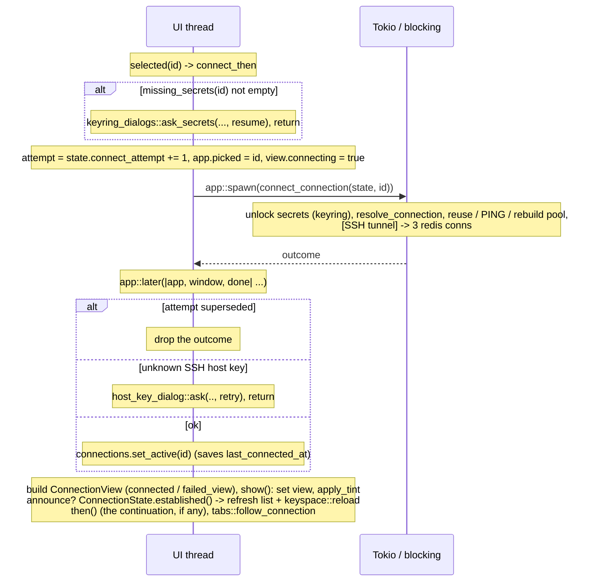
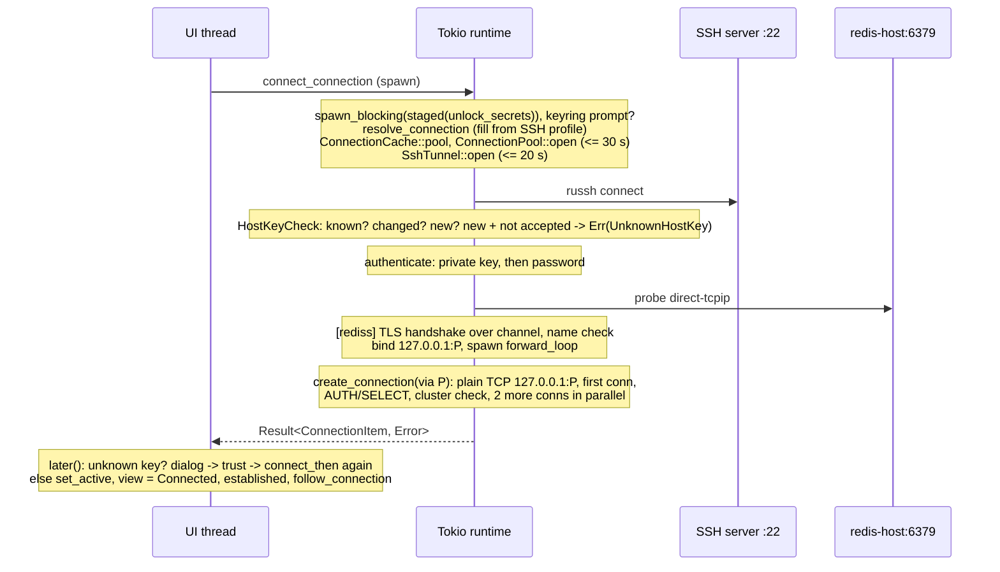

# Connections (app side)

How the Slint UI turns a click on a saved connection into a connected session, how the
connection form saves and tests, how the secret and host-key dialogs interrupt and resume
an attempt, and how AWS cloud connections and import/export are wired. All business logic
is in the core ([connection](cachemire_core::wiki::connection),
[secrets](cachemire_core::wiki::secrets), [aws](cachemire_core::wiki::aws)); this crate only glues.

## Where to look

| File | Role |
|------|------|
| `src/connections/mod.rs` | list rows ([`refresh`](crate::connections::refresh)), form callbacks (save, test, delete), [`disconnect`](crate::connections::disconnect) |
| `src/connections/connect.rs` | [`connect_to`](crate::connections::connect_to), [`connect_active`](crate::connections::connect_active), the attempt counter, the title bar view |
| `src/connections/profiles/mod.rs` | connection profiles (name + tint + read-only) and [`apply_tint`](crate::connections::profiles::apply_tint) |
| `src/connections/transfer/mod.rs` | import / export of connections as JSON |
| `src/cloud/mod.rs`, `src/cloud/settings.rs` | AWS account button, profile picker, cloud settings form |
| `src/keyring_dialogs.rs` | "keyring unavailable" and "passwords needed" dialogs |
| `src/host_key_dialog.rs` | "trust this SSH server?" dialog |

The shared pattern of every handler is the one from [runtime](crate::wiki::runtime) and
[architecture](crate::wiki::architecture): Slint callback, then [`app::with`](crate::app::with),
then a task on the runtime, then [`app::later`](crate::app::later) back to the UI thread.
[`app::spawn`](crate::app::spawn) and [`app::spawn_blocking`](crate::app::spawn_blocking) pair the
last two steps; a panic in the task reaches the callback as an error.

## Slint side

The callbacks live on Slint globals (generated, so shown as plain code):

- `ConnectionState`: `selected(id)`, `established()`, `disconnect-requested()`,
  `copy-connection-string()`; properties `view` (a `ConnectionView`: status, address, name,
  `ssh_via`, `ssh_failed`, `status_detail`...), `connections`, `cloud_connections`.
- `ConnectionEditor`: `saved(form)`, `test-requested(form)`, `deleted(id)`, `browse-key()`;
  output properties `error`, `testing`, `test_ok`, `test_status`.
- `KeyringDialog`, `SecretsPrompt`, `HostKeyDialog`: the three dialogs.
- `AwsAccount`, `CloudSettings`, `ConnectionTransfer`.

All are wired by `init` functions called from `main.rs`:
[`connections::init`](crate::connections::init), [`cloud::init`](crate::cloud::init),
[`cloud::settings::init`](crate::cloud::settings::init),
[`keyring_dialogs::init`](crate::keyring_dialogs::init),
[`host_key_dialog::init`](crate::host_key_dialog::init),
[`transfer::init`](crate::connections::transfer::init),
[`profiles::init`](crate::connections::profiles::init).

## Clicking a saved connection

`ConnectionState.selected(id)` calls
[`connect_to`](crate::connections::connect_to)`(window, state, rt, id, announce = true)`.
That is a thin wrapper over the private
`connect_then`, which does the following.

Points worth knowing:

- **Only the latest attempt counts.** `AppState::connect_attempt` is an atomic counter bumped on
  every attempt and checked again on the UI thread when the result lands. A superseded outcome is
  dropped; since the check and the switch to the new active connection both happen on the UI
  thread, nothing can start between them. The cloud "resume" logic compares this counter too.
- **The store's active connection changes only here**, after success (`set_active`). On failure
  `show` with an empty id also clears the active one
  (`clear_active`), so code falling back to "the active connection" finds none.
- **`announce`** raises `established`, which refreshes the list and reloads the keyspace tree.
  [`connect_active`](crate::connections::connect_active) and
  [`connect_active_then`](crate::connections::connect_active_then) pass `false`: they re-verify the
  connection last picked (`app.picked`), used by the refresh button (the continuation runs the
  new keyspace walk once a stale pool was reopened). With nothing picked they bump the counter,
  and show "No saved connection".
- **Callers of `connect_to`**: the click, the last-session restore, a pending link
  ([`links`](crate::links)), and the cloud "resume".
- **A failure** goes through `failed_view`: the error is logged with its
  [`ErrorKind`](cachemire_core::error::ErrorKind), `status_detail` is the localised text
  ([`Localize`](crate::error::Localize), see [errors](crate::wiki::errors)), and `ssh_failed` is
  `kind == Tunnel`, which turns the SSH badge red rather than the status dot. `ssh_via` (a
  `user@host[:port]` label) is computed from the saved connection, not from the outcome, so the SSH
  glyph still shows on a failure.
- [`disconnect`](crate::connections::disconnect) (the pill's x) clears `picked`, discards the
  tabs and the remembered last session, clears the active connection, invalidates the pool
  (closing its tunnel), and refreshes.

## Dialogs that interrupt an attempt

The three dialogs share one holder, `app.asked` ([`Asked`](crate::keyring_dialogs::Asked)), which stores
the continuation closure to run with the answer. Each dialog, when shown, replaces its slot;
cancelling drops it.

### Missing passwords ("left out" secrets)

A connection saved with `SecretsPolicy::LeaveOut` has secrets nobody stores (see
[secrets](cachemire_core::wiki::secrets)). `connect_then` (and `test_form`) check
[`missing_secrets`](cachemire_core::connection::store::ConnectionStore::missing_secrets); if
non-empty, [`ask_secrets`](crate::keyring_dialogs::ask_secrets) opens `SecretsPrompt` showing only
the fields needed, and stores `(id, resume)`. On **Connect** the three fields become a
[`Secrets`](cachemire_core::secret_vault::Secrets), are handed to
[`provide_secrets`](cachemire_core::connection::store::ConnectionStore::provide_secrets) (memory only),
the fields are cleared, and `resume` re-enters `connect_then`. **Cancel** clears the fields and drops
the continuation. The fields are blanked in both cases.

### Keyring unavailable on a save

Saving (form, import, cloud settings) starts with
`SecretsPolicy::VaultOrFail`. If it fails with
[`KeyringError::CantStore`](cachemire_core::secret_vault::KeyringError::CantStore), recognised by
[`is_unavailable`](crate::keyring_dialogs::is_unavailable), the handler calls
[`ask_keyring`](crate::keyring_dialogs::ask_keyring) with a `Retry` closure. The dialog offers
"save in the file" (`PlainText`), "save without" (`LeaveOut`, only when `can_leave_out`; the
cloud tunnel form passes `false`) or cancel. The answer runs the **same save again** with the
chosen policy. This is the app half of the rule "a plain-text save asks the user first".

### Unknown SSH host key

When the outcome is an error for which [`host_key_dialog::unknown`](crate::host_key_dialog::unknown)
returns a server (that is [`Error::Tunnel`](cachemire_core::error::Error::Tunnel) holding
[`TunnelError::UnknownHostKey`](cachemire_core::connection::ssh_tunnel::TunnelError::UnknownHostKey)),
[`ask`](crate::host_key_dialog::ask) shows host:port, key type and fingerprint. The answer is an
[`Answered`](crate::host_key_dialog::Answered):

- `Trusted`: [`HostKeys::trust`](cachemire_core::connection::ssh_tunnel::HostKeys::trust) wrote the key to the app's
  `ssh_known_hosts`, and the whole attempt is started again;
- `NotSaved(e)`: it could not be remembered, shown as a failed connection;
- `Cancelled`: the title bar goes to Disconnected.

In `connect_then` the answer first checks that the attempt is still current. In the form's test
(`test_form`) the same dialog re-runs the test on "trust". A *changed* key has no dialog: it
is an ordinary error with the explanatory message.

## A connection through SSH and TLS, end to end

When TLS is on, each forwarded client connection gets its own TLS handshake against the real host
name inside the tunnel (details in [connection](cachemire_core::wiki::connection)). A failure
at any stage arrives as an [`Error::Tunnel`](cachemire_core::error::Error::Tunnel) (SSH side),
[`Error::Redis`](cachemire_core::error::Error::Redis) (login, network) or
[`Timeout`](cachemire_core::error::Timeout), each with its own wording and kind.

## The connection form

`payload_from_form` builds a
[`ConnectionPayloadInput`](cachemire_core::connection::ConnectionPayloadInput) from the `ConnectionForm`:
text fields are always `Some`; the three secret fields are `None` when blank, meaning "keep what
is stored". An empty SSH port is 22; a non-numeric or zero one is
[`Invalid::SshPort`](cachemire_core::error::Invalid::SshPort).

- **Save** (`save_form` then
  `save_payload`): runs `create_with_id` or `update` inside
  `staged`, on a blocking thread, since the keyring may prompt. The new id is generated outside
  the closure (the rehearsal and the real run must agree). After an update the pool is
  invalidated so it does not keep reaching the server as before the edit. On success
  [`keep_active_in_step`](crate::connections::keep_active_in_step) re-asserts the connection in use
  (the store makes a *created* connection active, which the title bar did not choose), the form closes,
  the list refreshes, the tint is applied and [`links::retry_pending`](crate::links::retry_pending) runs
  (a link may have been waiting for a connection to its server). `CantStore` opens the keyring dialog; anything
  else is shown in `ConnectionEditor.error`.
- **Test** (`test_form`): validates the payload, asks for any missing
  passwords the form leaves blank, then `staged(unlock_secrets + preview)` builds the connection **as the
  form would save it, without saving**, and [`test_connection`](cachemire_core::connection::test_connection)
  pings it. Result goes to `test_ok` / `test_status`. An unknown host key opens the host-key dialog.
- **Delete**: removes the connection from the store, drops its pool (and tunnel), forgets its
  keyspace state and saved queries, runs the keyring cleanup on a blocking thread, and, when it was
  in use, resets the title bar.
- **Copy connection string** copies [`connection_string`](cachemire_core::connection::store::ConnectionStore::connection_string)
  (credentials included) to the clipboard.
- **Browse** beside the key opens a native file dialog on `~/.ssh`
  ([`browse_ssh_key`](crate::connections::browse_ssh_key)), shared with the cloud form.

[`refresh`](crate::connections::refresh) rebuilds the `ConnectionRowData` models (saved and cloud
rows) from the stores, marking the active one, the ones parked in background tabs, and each row's
profile badge. A profile id that no longer exists counts as none.

## Connection profiles

[`profiles`](crate::connections::profiles) edits the *connection profiles* (name, tint, read-only, light theming)
stored in the settings. [`apply_tint`](crate::connections::profiles::apply_tint) tints the window (only the connection pill for a light tint) for the
connection in use and sets `ConnectionState.read_only` (and forces the key panel non-editable)
using [`is_read_only`](cachemire_core::state::is_read_only). A profile cannot be deleted while a connection uses it
(the message lists up to three names, then `+N`). The tint enum has `to_tint` / `from_tint` as
exhaustive matches, so a colour added on one side fails to compile.

## Import and export

[`transfer`](crate::connections::transfer) is the `ConnectionTransfer` window.

- **File format**: `{exportedAtUtc, includesPasswords, count, connections: [...]}`; each
  connection has `id, name, connectionUrl, host, port, db, username, password, readOnly` and an
  optional `ssh` object. `host/port/db` are also written for older versions. A file that is just an array
  is accepted. A draft needs a name and a URL or host.
- **Passwords**: exported as `null` unless "include passwords" is ticked; then
  `staged(unlock_secrets)` reads them first.
- **Import**: parsing happens off the UI thread; drafts are listed with "added as a copy" when the
  name is taken. Names are chosen once (`free_name`, case-insensitive) before the `staged` call so the
  rehearsal and the real run agree. `import_all` saves **all or none**, never activates, never merges
  or overwrites. A keyring failure uses the same dialog with `can_leave_out = true`.
- The write is [`persist::save`](cachemire_core::persist::save), so atomic.

## Cloud (AWS) in the UI

[`cloud`](crate::cloud) holds a [`Cloud`](crate::cloud::Cloud) in `app.cloud`: connected flag,
local profiles, selected profile, a `generation` counter and a pending [`resume`](crate::cloud::resume).

- **AWS pill** (title bar): signed out, it reads "Sign in to AWS" and calls `AwsAccount.clicked`; signed in,
  it shows the profile, and a click opens the profile list (where each profile's gear opens its account's settings).
  `AwsAccount.clicked` signed in signs out (bumping `generation`, clearing the cloud connections and
  disconnecting if one was in use); otherwise `aws::login` runs on the runtime, then the profiles are read. The browser sign-in page texts come from `t!` through `sign_in_page`.
  The window is raised afterwards ([`bring_to_front`](crate::cloud::bring_to_front)).
- **Profile pick** (`profile_selected`): clears the old listing, bumps `generation`, then
  [`aws::redis_connections`](cachemire_core::aws::redis_connections) lists the endpoints. The result is
  ignored if `generation` moved on meanwhile (stale listing). On success the settings prune what the account no longer
  has (`observe_cloud_listing`; the cleanups run on a blocking thread), `apply_cloud` gives each item its
  profile and tunnel, and `set_cloud_connections` makes them known for the run.
- **Profile list** (`AwsProfileDropdown`): a filter (`list_requested`, which fills `AwsAccount.profiles`; an edit scrolls back to the top),
  the three profiles used last (`remember_cloud_profile` dates each listing) then the others, each with
  its account's connection profile and tunnel, a star, a gear, and "Sign out of AWS" at the bottom. A profile's
  account is the one listed now, the one it last listed, or its SSO `account_id` ([`account_of`](crate::cloud::account_of));
  with none known, it has no gear.
  The profiles are read at sign-in; the reload button beside the count (`reload_requested`) reads
  [`aws::profiles`](cachemire_core::aws::profiles) again and lists them with the same filter and chip.
- **Chips and pins**: `profile_row` also gives each profile its chip key (`profile:<id>`, `none`, `unknown`);
  `chip_lines` makes a chip per key in use (none when one key covers them all) and splits them into lines by
  an estimated width, since Slint has no wrapping layout. `AwsAccount.chip` is the one picked ("" for all):
  `chip_picked` saves it (`set_cloud_chip`), and `list` shows the saved one while it exists, so it outlasts a
  closed list and a restart. The star calls `pin_toggled`: `set_cloud_pinned` keeps the pinned names in the
  settings, in order. Pinned profiles leave `profiles` for `AwsAccount.pins`, drawn two per line above the
  list; Enter in the filter box picks the first of them when the list is empty.
- **Resume**: [`resume`](crate::cloud::resume) is how the last session reaches a cloud
  connection: it signs in if needed, lists the profile, then calls `connect_to`, unless the user made another
  attempt in between (the stored `attempt` no longer equals the counter).
- **Cloud settings form** ([`cloud::settings`](crate::cloud::settings)): per account or per endpoint (an
  endpoint overrides its account), a connection profile and an SSH tunnel with three modes: inherit, none, custom. The tunnel
  secrets go through `staged(set_cloud_scope)` and the keyring dialog (without "leave out"). After saving,
  `reapply` re-applies the settings to the listing and invalidates every cloud pool so tunnels are rebuilt.

## Errors from this area

Every error reaches the user as text through [`Localize`](crate::error::Localize); the table gives
the place it appears. The core variants and their translation are covered in [errors](crate::wiki::errors).

| Where | Shown in |
|-------|----------|
| connect failure | title bar `status_detail`, `ssh_failed` for tunnel errors |
| form save / delete | `ConnectionEditor.error` |
| form test | `ConnectionEditor.test_status` (`test_ok` false) |
| import / export | `ConnectionTransfer.message` (`message_ok` false) |
| profile edit | `Preferences.error` |
| cloud sign-in / listing | `AwsAccount.error` |
| cloud settings | `CloudSettings.error` |
| write failure of the active id | a toast (`Saving failed: ...`) |

## Things noticed

- `connect_then` calls `crate::tabs::follow_connection` on every outcome except the early
  returns (missing secrets, host-key dialog); the dialogs' answers call it themselves.
- Settings `accept_new_ssh_host_keys` (off by default) is toggled from the Settings dialog in `src/settings.rs`;
  when on, the host-key dialog never appears for new keys.
