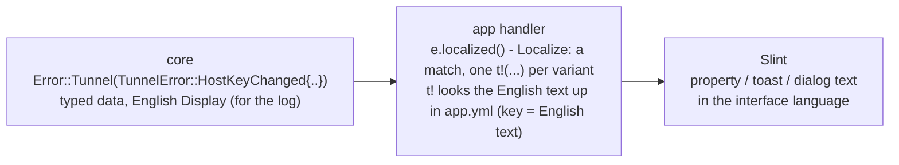

# Errors in the app

How a failure that happened somewhere in the core (or the app) becomes a sentence in the user's
language on the screen. The core produces typed errors with English `Display` (see its
[errors chapter](cachemire_core::wiki::errors)); this crate translates them at the edge.

Where to look:

- `crates/cachemire/src/error/mod.rs`: the app's [`Error`](crate::error::Error), the
  [`Localize`](crate::error::Localize) trait and one impl per core error type.
- `crates/cachemire/src/error/tests.rs`: one value of every error, checked in English.
- `resources/lang/app.yml`: the French text of every message built in Rust.
- `crates/cachemire/src/toast.rs`: transient messages.

## The idea



Two texts exist for each error, on purpose:

| Text | From | For |
|---|---|---|
| English | `Display` (`thiserror` `#[error("...")]`) | the log (`tracing`), tests |
| Interface language | [`Localize::localized`](crate::error::Localize::localized) | what the user reads |

In English the two must be identical. The test `every_error_reads_in_english_as_its_display`
(`error/tests.rs`) walks one instance of each core error variant and asserts
`error.localized() == error.to_string()`: an arm whose English text differs from `Display` would
lose that message's translation.

## The `Localize` trait

```text
 pub trait Localize { fn localized(&self) -> String; }
```

It is implemented for the app's [`Error`](crate::error::Error) and for every core error type:

| Implemented for | Notes |
|---|---|
| [`Error`](crate::error::Error) (app) | delegates `Core` to the core impl; `ReadFile` and `NoConnections` use `t!`; the others use `Display` |
| [`CoreError`](cachemire_core::error::Error) | one arm per variant, delegating to the sub-enum's impl; `Redis` is shown as given |
| [`Invalid`](cachemire_core::error::Invalid), [`NotFound`](cachemire_core::error::NotFound), [`Timeout`](cachemire_core::error::Timeout), [`SystemError`](cachemire_core::error::SystemError) | `t!` per variant, with interpolated values (`%{seconds}`) |
| [`FileError`](cachemire_core::error::FileError) | `Display` as is (OS and JSON messages, not translated) |
| [`TunnelError`](cachemire_core::connection::ssh_tunnel::TunnelError) | `t!` per variant; `Ssh(_)` falls back to `Display` |
| [`AwsError`](cachemire_core::aws::AwsError) | `t!` per variant; `Service` falls back to AWS's own message |
| [`QueryError`](cachemire_core::redisql::QueryError) | `t!` per variant |
| [`ParseError`](cachemire_core::json_path::ParseError) | `t!` per variant, with a `found_text` helper for the character found |
| [`KeyringError`](cachemire_core::secret_vault::KeyringError), [`VaultError`](cachemire_core::secret_vault::VaultError) | wrapped errors are localized first, then inserted into the outer message |

What is shown **as it was given**: Redis replies, I/O and JSON errors, clipboard errors, SSH
protocol errors, AWS service messages. They come from outside and are not ours to translate.

Nested errors compose: `KeyringError::CantStore(inner)` renders as
`t!("The system keyring is unavailable ...: %{error}", error = inner.localized())`, so the inner
text is translated before it is placed in the outer sentence.

## The app's own `Error`

[`crate::error::Error`](crate::error::Error) is "what can go wrong in the app beyond the core":

| Variant | Meaning |
|---|---|
| `Core(CoreError)` | any core error (`#[from]`) |
| `ReadFile(io::Error)` | a file chosen by the user could not be read |
| `NotJson(serde_json::Error)` | a file is not valid JSON |
| `NoConnections` | an imported file holds no connections |
| `Clipboard(arboard::Error)` | clipboard access failed |
| `Io(io::Error)` | other I/O |

Most handlers work with the core's `Error` directly: only a few places (for example
`value_actions.rs`) use the app's. A `JoinError` converts into `Error::Core(System(Task))`.

## How an error reaches the screen

There is no single error channel; each feature puts the text where it belongs. The patterns in the
code:

| Surface | How | Example |
|---|---|---|
| A property on a global | `set_error(e.localized().into())` | `Preferences.error`, `ConnectionEditor.error` in forms and settings |
| The connection pill's detail | `ConnectionView.status_detail` | `failed_view` in `connections/connect.rs` |
| The key panel's meta line | `t!("failed to load: %{error}", error = e.localized())` | `key_detail/load.rs` |
| A toast at the pointer | `toast::show(window, &t!("Saving failed: %{error}", error = e.localized()))` | edits, copy, delete |
| A dialog that asks | a dialog is opened *instead of* a message | unknown SSH host key, keyring unavailable |
| The log only | `tracing::warn!` | failures nobody can act on (saving the "active" id) |

A toast is raised by [`toast::show`](crate::toast::show) at the last pointer position
(tracked from winit events), so it appears next to the button just clicked.
[`show_copied`](crate::toast::show_copied) and [`show_refreshed`](crate::toast::show_refreshed) are the
two fixed ones.

### Errors that become questions

Two core errors are not reported, they start a dialog:

- `TunnelError::UnknownHostKey` : [`host_key_dialog::unknown`](crate::host_key_dialog::unknown) spots it in a
  failed connect; the user trusts, cancels, or the key could not be saved
  ([`Answered`](crate::host_key_dialog::Answered)); trusting retries the attempt.
- `KeyringError::CantStore`: [`keyring_dialogs::is_unavailable`](crate::keyring_dialogs::is_unavailable)
  recognises it, and the user is asked whether to keep the password in the settings file or leave it
  out; the save then runs again with that [`SecretsPolicy`](cachemire_core::secret_vault::SecretsPolicy).

## `ErrorKind`: what the UI can make of an error

[`Error::kind`](cachemire_core::error::Error::kind) returns an [`ErrorKind`](cachemire_core::error::ErrorKind)
(`Invalid`, `NotFound`, `Tunnel`, `Auth`, `Denied`, `Network`, `Timeout`, `Redis`, `Parse`, `Keyring`,
`File`, `Cloud`, `System`, `Unsupported`). In the app it is used in one place: the connection
failure marks the SSH badge red when the kind is `Tunnel` (and logs the kind). Inside the core it
also steers fallbacks (`is_script_refused` checks for `Denied`). Other kinds are available for the UI
to act on but no other use is established in the code read for this wiki.

## `app.yml` and the link with translations

Messages built in Rust live in `resources/lang/app.yml`. The **key is the English text**, which is also
what is shown when a language has no entry:

```text
"Connection name is required.":
  fr: "Le nom de la connexion est obligatoire."
```

- A `t!("...")` literal must have an entry. The test in `i18n/tests.rs` scans the sources for
  `t!("` calls and fails when one has no entry in `app.yml`.
- Interpolation uses `%{name}`: `t!("Connection timed out after %{seconds} seconds.", seconds = seconds)`.
- `.slint` texts (`@tr(...)`) are a different system: `.po` files and `cargo xtask i18n`. See
  [i18n](crate::wiki::i18n).
- Do not edit the `.pot`/`.po` files by hand; `app.yml` has no task and is edited by hand.

## How to add an error

1. **Core**: add the variant to the right enum in `cachemire-core` (`Invalid`, `NotFound`, a
   backend's own enum...), with an English `#[error("...")]` and its data as fields. Give it a
   `source` when it wraps another error. If it needs a new `ErrorKind`, extend `Error::kind` (or the
   sub-enum's `kind`). See [core errors](cachemire_core::wiki::errors) for conventions.
2. **App**: add the arm in the matching `Localize` impl in `error/mod.rs`, using `t!` with the same
   English text. The match is exhaustive, so the build fails until you do.
3. **Translations**: add the English text and its French in `resources/lang/app.yml`.
4. **Tests**: add one instance of the new variant to the lists in `error/tests.rs`
   (`core_errors`), so the English-equals-`Display` test covers it (only when asked to add tests;
   existing ones that fail must be fixed).
5. Use it: return it from the core, and in the handler call `.localized()` where the text is shown.

A new *sub-enum* also needs a variant in the core `Error` (with `#[from]`), an arm in
`Error::kind`, and an `impl Localize` here.

## Quirks worth knowing

- A `LoginRefused` tunnel error builds its text from pieces (`t!("private key")`, `t!("and")`,
  `t!("password")`): those short words need `app.yml` entries too.
- `Display` is the contract with the log and the test; `localized()` must not add or remove
  information relative to it.
- Not every error type is translated: `FileError` and a few arms use `Display` directly, so the
  text of OS errors stays in the system's or the library's language.
