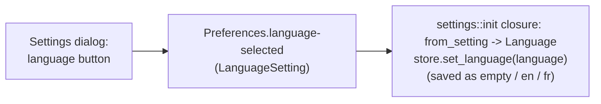
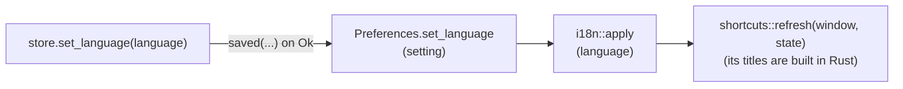

# Translations (i18n)

Every user-facing text is translated at compile time and switched at runtime. Texts written in
`.slint` files use `@tr(...)` and gettext `.po` files; texts built in Rust use `rust_i18n`'s
`t!(...)` and a YAML file. Nothing is loaded from disk at runtime: both catalogs are embedded in the
executable. English is the source language and the fallback; French is the only other language today.

## Where to look

- `build.rs`: `with_bundled_translations("../../resources/lang")`.
- `src/main.rs`: `rust_i18n::i18n!("../../resources/lang", fallback = "en")`.
- `src/i18n/mod.rs`: [`apply`](crate::i18n::apply), the runtime switch; `src/i18n/tests.rs` the completeness tests.
- `resources/lang/`: `cachemire.pot` (template), `fr/LC_MESSAGES/cachemire.po`, `app.yml`.
- `crates/xtask/src/i18n.rs`: `cargo xtask i18n`.
- `crates/cachemire-core/src/i18n/mod.rs`: [`Language`](cachemire_core::i18n::Language),
  [`LANGUAGES`](cachemire_core::i18n::LANGUAGES), [`FALLBACK`](cachemire_core::i18n::FALLBACK).
- Skill `translations` (the checklist, kept in `.claude/skills/translations/SKILL.md`).

## Two catalogs, one switch

| | Slint texts | Rust texts |
|---|---|---|
| Written as | `@tr("English")` in `ui/**/*.slint` | `t!("English %{name}", name = x)` |
| Source file | `resources/lang/<code>/LC_MESSAGES/cachemire.po` | `resources/lang/app.yml` |
| Key | the English msgid (no context, see below) | the English text itself |
| Placeholders | `{}` (gettext style, positional) | `%{name}` |
| Maintained by | `cargo xtask i18n` (extract + merge), translator fills `msgstr` | by hand |
| Compiled by | `slint_build` (`with_bundled_translations`) | the `rust_i18n::i18n!` macro |
| Selected with | `slint::select_bundled_translation(code)` | `rust_i18n::set_locale(code)` |
| Missing translation | shows the English msgid | shows the key, i.e. the English text |

`build.rs` uses `DefaultTranslationContext::None`, so `@tr` has no `msgctxt`; the extractor is run with
`--no-default-translation-context` to match. Two identical English strings therefore share one
translation.

Messages in Rust come from two places: this crate, and error text. Core errors are English in their
`Display`; the app's [`Localize`](crate::error::Localize) trait turns them into `t!` messages
(see [errors](crate::wiki::errors)), so a new core error variant needs an `app.yml` entry too.
Core itself depends on neither Slint nor rust-i18n.

## Switching language at runtime

Once saved, the window and the Rust side follow:

[`apply`](crate::i18n::apply) does two things with `language.resolve()`:
`rust_i18n::set_locale(code)` (messages built from now on) and
`slint::select_bundled_translation(code)` (the `.slint` texts follow immediately, since `@tr` is
re-evaluated). It must be called once the first window exists, because Slint's translations only
become available then; `main` calls it right after `AppState::load()`. A failure to select the Slint
translation is only logged.

Consequences to keep in mind:

- Rust text that was already built (a toast on screen, a model row filled with a `t!` string) stays in
  the old language until rebuilt. That is why the shortcuts page refreshes explicitly.
- [`Language`](cachemire_core::i18n::Language) has three values: `Automatic` (saved as `""`), `English`, `French`.
  `Automatic` resolves through `sys_locale`: the system locale is reduced to its base language
  (`fr_CA.UTF-8` and `fr-CA` give `fr`); an unsupported one gives [`FALLBACK`](cachemire_core::i18n::FALLBACK) (`en`).
- The language buttons name each language in itself (`"English"`, `"Français"` are plain strings,
  not `@tr`), so a user can find their language whatever the current one is. The settings search text
  includes these names.
- Before the settings are loaded (the "already running" dialog of a second launch) `main` sets the
  Rust locale from `Language::Automatic.resolve()` directly; Slint is not involved there.

## Adding or changing a text

Slint text:

1. Write `@tr("English text")` in the `.slint` file.
2. Run `cargo xtask i18n`. It runs `slint-tr-extractor` (installed on demand) over `ui/main.slint` and
   every `ui/components/*.slint`, rewriting `cachemire.pot`; then, for each `resources/lang/*/LC_MESSAGES/cachemire.po`,
   `merge` rebuilds the file in the template's order: existing translations are kept, new messages
   are added empty, messages no longer in the template are dropped. It prints each language's
   count and the untranslated msgids.
3. Fill in only the `msgstr` of what it reports, rerun until nothing is untranslated.
   The `.pot`/`.po` files are never edited by hand otherwise.

Rust text:

1. Write `t!("English text")`; with arguments use `%{name}`.
2. Add the entry to `resources/lang/app.yml` by hand:
   `"English text":` then `  fr: "Texte"`. No task exists for this file.
3. Changing an English key means changing it in `app.yml` too (the key *is* the text).

Both are checked by tests in `src/i18n/tests.rs`: every msgid of the `.pot` is present and non-empty in
each non-fallback `.po` with the same number of `{}`; every `app.yml` entry has every language with the
same `%{}` placeholders; every `t!("literal")` found by scanning the sources of both crates has an entry
(see [testing](crate::wiki::testing)).

## Adding a language

From the `translations` skill and the code:

1. [`LANGUAGES`](cachemire_core::i18n::LANGUAGES) (code and the name in that language) and a variant in
   [`Language`](cachemire_core::i18n::Language) with its `code`, `from_code` and `resolve` arms.
2. A variant in `LanguageSetting` (`ui/components/types.slint`) and both `match`es in
   `to_setting` / `from_setting` (exhaustive, so the compiler lists what is missing).
3. A button in `settings.slint`'s language row (hand-written, one `SegmentButton` per language) and
   the name in the search text of that row.
4. A folder `resources/lang/<code>/LC_MESSAGES/cachemire.po`; `cargo xtask i18n` discovers language
   folders by scanning `resources/lang`, so nothing is registered there. The new `.po` needs its header and
   is merged like the others.
5. A `<code>:` line under every entry of `app.yml`.
6. The installer or desktop-entry strings are not covered here (the `.desktop` file has its own
   `Comment[fr]`); packaging text is separate from this catalog.

The language list therefore lives in several places that the compiler only partly checks (the
buttons and the YAML are not checked by it, but the tests cover the `.po` and the YAML).

## Gotchas

- Never hard-code user text in Rust without `t!`, and never build a sentence by concatenating translated
  pieces: word order differs between languages; use placeholders.
- `@tr` in a binding that must update on a language change is fine (Slint re-evaluates); a string copied
  into a Rust-owned model is not.
- Dates, numbers and units are not localised by this mechanism; not established whether any other
  formatting is language-aware.
- The `.po` header's `POT-Creation-Date` is a header of the file; the merge keeps the file's own header
  (it rewrites entries only).
