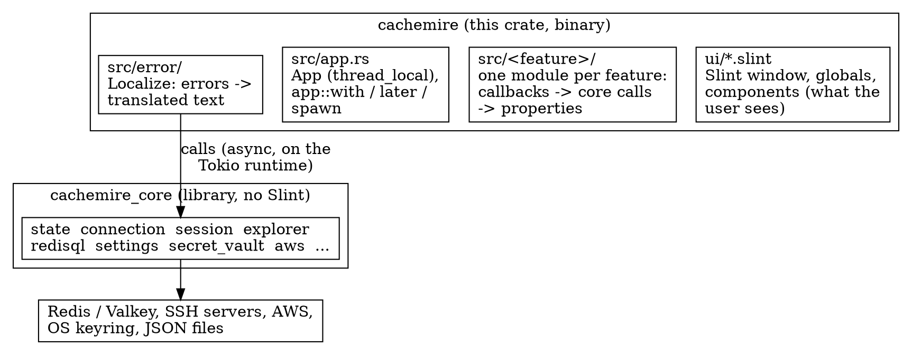

# Cachemire

Cachemire is a desktop client for Redis and Valkey. It browses the keyspace as a tree, shows and
edits values, runs searches and Redisql queries, reaches servers through SSH tunnels or AWS
ElastiCache, and keeps passwords in the operating system's keyring. The interface is in English
and French.

This crate, `cachemire`, is the **application**: the Slint window and the Rust glue behind it.
Everything that is not about the screen lives in the sibling library crate
[`cachemire_core`](cachemire_core), which knows nothing of Slint.

This page is the front page of the **wiki**: a set of chapters (the *Modules* of the list below)
that explain how the app works, written for someone new to the code.

## The two crates



- The **app** crate holds *no business logic* ([architecture](crate::wiki::architecture)): it
  attaches `on_*` callbacks to the Slint globals, calls the core, and writes the answer into
  Slint properties and models.
- The **core** crate holds the logic: how to connect, what a key looks like, how Redisql runs,
  where settings are saved. It is testable without a window. Its own wiki starts at the
  [`cachemire_core`] front page.

## Reading order

New to the code? Read in this order:

1. [architecture](crate::wiki::architecture): layers, startup, one action end to end.
2. [runtime](crate::wiki::runtime): which thread does what, and the one rule about blocking.
3. [state](crate::wiki::state): what is remembered, where, and the connection lifecycle.
4. [errors](crate::wiki::errors): how a failure becomes a sentence in the user's language.
5. [ui](crate::wiki::ui): the Slint side.
6. Then the feature chapters you need.

## Chapters of the app

| Chapter | What it covers |
|---|---|
| [architecture](crate::wiki::architecture) | Layers, startup sequence of `main`, module map, data flow of one user action. |
| [runtime](crate::wiki::runtime) | Threads: the UI thread, the `thread_local` [`App`](crate::app::App), Tokio, rayon; blocking rules. |
| [state](crate::wiki::state) | The states of the system: global, per connection, per tab; persisted or not; state machines. |
| [errors](crate::wiki::errors) | The [`Localize`](crate::error::Localize) trait, toasts and dialogs, `app.yml`, adding an error. |
| [ui](crate::wiki::ui) | Slint structure, globals, components, theme, styled text, shortcuts. |
| [keys_and_tabs](crate::wiki::keys_and_tabs) | The key panel, the keyspace tree, searches and the tab strip. |
| [connections](crate::wiki::connections) | Saved connections, connecting, cloud accounts, keyring and host-key dialogs. |
| [redisql](crate::wiki::redisql) | The query panel and tabs of the Redisql language. |
| [settings](crate::wiki::settings) | The Settings dialog and how preferences are saved and mirrored. |
| [i18n](crate::wiki::i18n) | Translations: `.slint` texts, `t!` messages, the `.po` and `app.yml` files. |
| [platform](crate::wiki::platform) | Links, updates, window state, last session, drag latch, logging. |
| [testing](crate::wiki::testing) | How tests are organised (unit, UI harness, end to end). |
| [glossary](crate::wiki::glossary) | The project's terms in alphabetical order. |

## Chapters of the core

The core crate has its own chapters, starting from its front page [`cachemire_core`]:

| Chapter | What it covers |
|---|---|
| [errors](cachemire_core::wiki::errors) | The typed `Error` and its sub-enums. |
| [connection](cachemire_core::wiki::connection) | Saved connections, client, pool, TLS, SSH tunnel. |
| [secrets](cachemire_core::wiki::secrets) | `Secret` and the OS credential store. |
| [aws](cachemire_core::wiki::aws) | AWS profiles, ElastiCache, SSO sign-in. |
| [session](cachemire_core::wiki::session) | The one way to talk to a Redis server. |
| [explorer](cachemire_core::wiki::explorer) | Walking and searching the keyspace, reading a key. |
| [redisql](cachemire_core::wiki::redisql) | The Redisql lexer, parser, executor, completion, history. |
| [settings](cachemire_core::wiki::settings) | Settings, profiles, saved queries, persistence. |
| [utilities](cachemire_core::wiki::utilities) | JSON paths, key names, export files. |

## Building this wiki

The wiki is the rustdoc of both crates, private items included, plus these chapters:

```text
cargo wiki --open
```

`cargo wiki` is an alias of `cargo xtask wiki` (see `.cargo/config.toml`): it runs
`cargo doc --no-deps --document-private-items` (on an emptied `target/doc`), then draws the diagrams. `mermaid` code blocks are drawn in your
browser by the Mermaid script of `resources/wiki`, `dot` blocks are rendered into the pages by Graphviz (`dot`, to install). The chapter files are Markdown, kept in `crates/cachemire/wiki/` and
`crates/cachemire-core/wiki/`. Each one is included as the documentation of an empty module of the
`wiki` module (`crate::wiki::<name>`), which exists only in documentation builds
(`#[cfg(doc)]`). This page is the crate's front page, included from `main.rs`.

Pages are cross-linked with rustdoc intra-doc links, so a broken link fails the build. Code
excerpts in the chapters use ` ```text ` fences, never Rust ones, because the core crate runs
doctests.

## How the code is organised

- `crates/cachemire/ui/`: the Slint files (`main.slint`, `globals.slint`, `components/`).
- `crates/cachemire/src/`: one module per feature, each with an `init` called from `main`.
- `crates/cachemire-core/src/`: the library.
- `resources/lang/`: translations (`app.yml` for Rust messages, `.po` files for `.slint` texts).
- `crates/xtask/`: project tooling (`cargo xtask i18n`, `cargo ship`, end-to-end runs).

The working rules of the repository (no tests unless asked, comment length, changelog, translation
workflow) are in `CLAUDE.md` at the repository root and in each crate.
