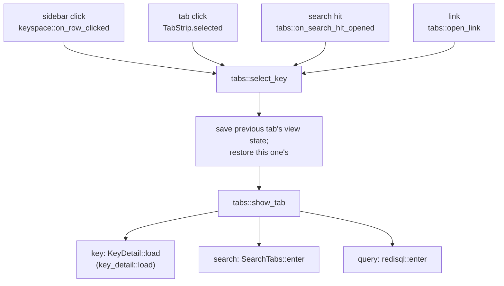
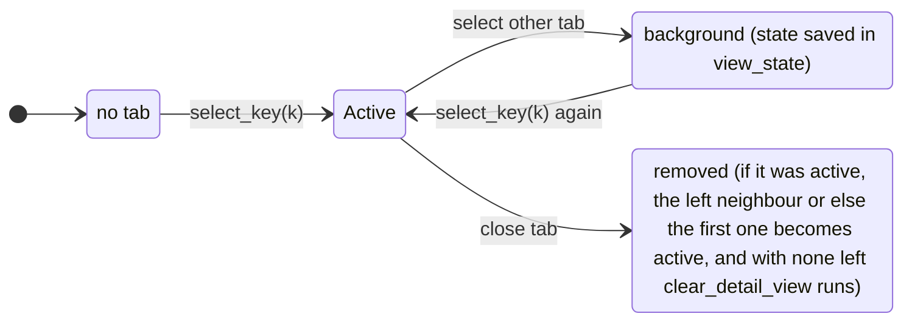
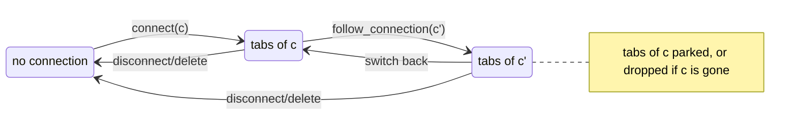
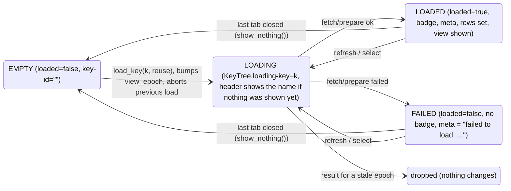
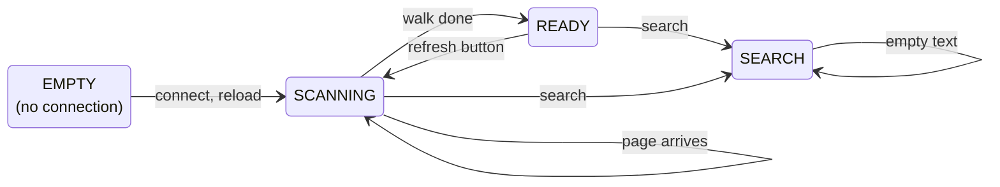
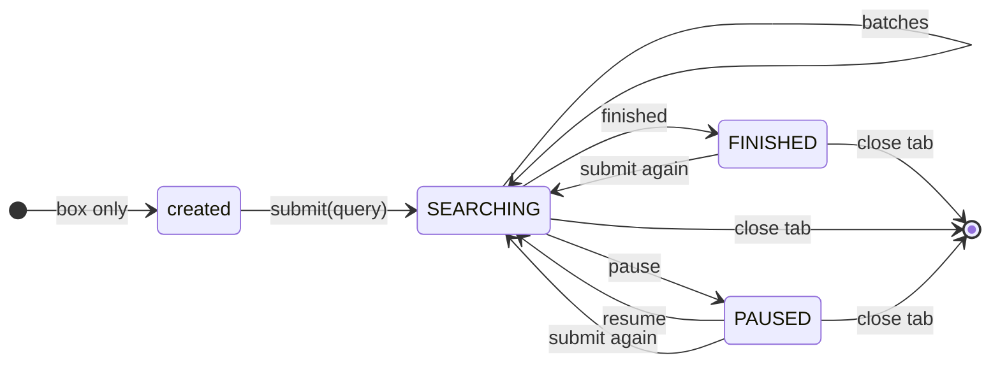

# Keys, keyspace, search and tabs

How a key gets from Redis to the screen, and how the app keeps track of what is open. Four modules
of the app crate: [`crate::key_detail`] (the key panel, the largest), [`crate::keyspace`] (the
tree in the sidebar), [`crate::search`] (global search tabs) and [`crate::tabs`] (the tab strip and
per-tab memory). They call the core's [`cachemire_core::explorer`] for every Redis read or write; see
[core explorer](cachemire_core::wiki::explorer) and [core session](cachemire_core::wiki::session).

## Where to look

| Area | Files |
|---|---|
| Tabs | `src/tabs/mod.rs` |
| Key panel | `src/key_detail/mod.rs` (state, `init`), `load.rs`, `paging/`, `filtering.rs`, `smart_search.rs`, `search_filter/`, `suggest/`, `value_list/`, `table/`, `field/`, `pretty.rs`, `pretty_text.rs`, `value_lines.rs`, `highlight/`, `scroll.rs`, `edit.rs`, `export/`, `full_value.rs` |
| Keyspace tree | `src/keyspace/mod.rs`, `walk.rs`, `index/`, `search/`, `selection/`, `edit.rs`, `rows.rs` |
| Search tabs | `src/search/mod.rs` |
| Slint side | `ui/components/key-detail*.slint`, `keyspace-panel.slint`, `content-header.slint`, `search-panel.slint`; globals `KeyPanel`, `KeyScroll`, `ExportPrefs`, `KeyTree`, `TabStrip`, `SearchTab` in `ui/globals.slint` and `key-detail-types.slint` |

The UI conventions used throughout (globals, `app::with`/`later`, models) are in [ui](crate::wiki::ui).



---

# Part 1. Tabs (`crate::tabs`)

A **tab** is identified by a string id and the strip is just a list of ids. The module's doc says it
all: the tab bar and the keyspace tree both drive selection through [`select_key`](crate::tabs::select_key).

## Tab kinds

| Kind | Id | Where its state lives | Shown in |
|---|---|---|---|
| Key | the key's id (see [`KeyName`](cachemire_core::key_name::KeyName)) | `Tabs::view_state` (filters, scroll...) and the key panel's fetched cache | key panel (`KeyDetail`) |
| Search | `"\u{1}search:N"` ([`is_search_id`](crate::search::is_search_id)) | [`SearchTabs`](crate::search::SearchTabs) in `App::searches` | `SearchPanel` |
| Query (Redisql) | `"\u{2}query:..."` ([`is_query_id`](crate::redisql::is_query_id)) | `QueryTabs` in `App::queries` | `QueryEditor` + the key panel showing result rows |

The prefixes start with a control character so they cannot clash with a key name. Internally the enum
`Special` (`Search`, `Query`) and `special_kind(id)` classify an id; `None` means a key. A query tab
has no key of its own but *does* use the key panel (its result rows are loaded as the fields of a
pseudo-key named by the tab id), so it keeps a `TabViewState` like a key; a search tab does not.

## Data

[`Tabs`](crate::tabs::Tabs) (in `App::tabs`):

```text
Tabs
  open: Vec<String>                tab order, left to right
  active: Option<String>
  view_state: id -> TabViewState   what each tab remembers while not shown
  loaded_on: String                connection id the key panel's content was loaded under
  connection: String               the connection open/active/view_state belong to ("" = none)
  parked: connection -> ParkedTabs tabs left behind by other connections
  highlighted: bool                whether the tree highlights the active tab's key
  parked_highlights: set
  discard_on_leave: bool           next connection change drops the tabs it leaves
```

`TabViewState` is "per-tab UI state outside the fetched key data":

| Field | Meaning |
|---|---|
| `badges`, `case_sensitive` | the smart box's search badges and case toggle |
| `json_filter` | the JSON path filter |
| `view` | `KeyView::Fields` or `Table` |
| `scroll` | [`ScrollPos`](crate::key_detail::ScrollPos): list y, table x and y |
| `expanded_fields` | open rows of the value list |
| `descending` | a hash's field order |
| `shown_escaped`, `escaped` | the two export format switches (`ExportPrefs.escaped`, `header-escaped`) |
| `reveal` | a field to scroll to the next time the tab is shown (set by links and search hits) |

A new tab always starts from `TabViewState::new`, never from the previous tab: the view comes from the
`Preferences.opening-view` setting (`Fields`, `Table` or `Last` = the last one picked; a query tab is
always `Table`) and the export switches from `Preferences.export-escaped`.

## How a tab remembers filters and scroll

There is exactly one key panel, so the window's properties *are* the active tab's state. Switching is
a save/restore around the swap:

1. `save_view_state(prev)`: reads `KeyPanel.filter-badges`, `filter-case-sensitive`, `json-filter`,
   `view`, `sort-descending`, `ExportPrefs.*`, the scroll position (`current_scroll`) and the open
   rows (`current_expanded_fields`) into `view_state[prev]`. A special tab instead `leave`s: a search
   tab keeps its query and pauses its search; a query tab saves its text.
2. `restore_view_state(next)`: writes the saved (or default) state back into the same properties and
   returns the `ScrollPos` to apply.
3. `show_tab(next, scroll, reuse)`: loads the key with that scroll (`KeyDetail::load`), or enters the
   search or query tab.

Scroll restore is a handshake with Slint: `arm_all_scroll` / `arm_table_scroll` write
`KeyScroll.restore-*` and set `restore-*-pending`; the view that receives the rows jumps and clears the
flag; `disarm_scroll` drops an unclaimed jump so it cannot fire on unrelated content. Open rows are
written to `KeyScroll.all-values-expanded` *before* the rows are built, so
`AllValuesRowData.initial-expanded` opens them without a flash.

## Lifecycle



`select_key(k)` opens the tab (`open`) and makes it active. Selecting a background tab again reuses it
(`reuse = true`: not refetched).

Rules visible in the code:

- `select_key` on the active tab, when the panel already shows it loaded on the same connection, does
  nothing; a failed load (not `loaded`) is retried. A search or query tab is always "already shown".
- A tab already `open` is shown with `reuse = true`: the key panel shows its `FetchedKey` from its cache
  instead of reading Redis. A new tab is fetched. The header's refresh button forces a fetch.
- The tree highlight (`KeyTree.selected`) is only the active tab's key when it was clicked in the tree or
  revealed: `highlighted` records that; switching tabs clears it, and the "show active tab's key" button
  (`KeyTree.reveal-active-tab` -> `focus_key`) brings it back.
- `close(key)` returns `(was_active, next_active)`; `close_others` keeps one tab and makes it active;
  `close_all` forgets everything. All of them call `KeyDetail::forget` (drops the fetched cache of those
  tabs) and `forget_special` (frees search or query state).
- Reordering is `TabStrip.reordered(key, index)`: the id is moved inside `open`.
- `rename_keys(moves)` (after a rename on the server) renames tab ids and their view state and reloads the
  active one; `close_keys(gone)` closes the tabs of deleted keys (not search or query tabs).
- Opening: `open_search` and `open_query(text)` create a special tab through `open_new_tab`; a saved query
  opens a fresh, unrun query tab. `on_search_hit_opened` prepares the key's state (Fields view, no filter,
  the hit's field open) and sets `KeyScroll.reveal-*` before `select_key`.
- Links: `open_link(target)` (`LinkTarget`: key, field, JSON path) either re-aims the active tab in place
  or seeds the target tab's `TabViewState` (`aim`) then selects it. `park_link` does the same for a
  connection that is not the one shown (its tab waits in `parked`).

## Tabs per connection

`follow_connection` is called when the connection changes. If the id differs from `Tabs::connection` it
saves the active tab, then `switch_connection`: the current `open/active/view_state` are *parked* under
the old connection id and those of the new one (if any) come back. The parking is run-only, never
saved (the last-session feature saves ids separately, see [platform](crate::wiki::platform)). If the
connection left no longer exists in the store, or `discard_on_leave` was set (for instance a deletion),
its tabs and cache are dropped instead. Afterwards the connection list is refreshed (it shows which
connections have parked tabs) and the new active tab is shown, or the panel is cleared
(`clear_detail_view`).

State diagram of the tab strip as the code implements it:



Switching back to `c` returns its parked tabs.

---

# Part 2. The key panel (`crate::key_detail`)

[`crate::key_detail`] "bridges `cachemire_core::explorer::get_key_details` to the key panel". It owns
everything shown to the right of the tree when a key (or a query's rows) is open: header, smart box,
the two views, value rows, editing and exports. Its public surface is small:
[`init`](crate::key_detail::init) returns a [`KeyDetail`](crate::key_detail::KeyDetail) handle stored in
`App::key_detail`, with `load(key, scroll, reuse)`, `show_rows(id, rows, scroll)` (query results),
`forget(connection, key)` and the new-hash bookkeeping (`mark_new`, `is_new`, `forget_new`).

## Shared state

Everything is bundled in `Ctx` (window weak handle, `AppState`, Tokio
`Handle`, shared state), cloned into each callback, and
`KeyDetailShared`, whose fields are all `Arc`s so Tokio tasks can
hold them:

| Field | Role |
|---|---|
| `content: Mutex<PanelContent>` | what the panel shows: `epoch`, key id and type, `loaded` fields, `current` fields (after the path filter), the `search` filter, the applied `path` |
| `pretty_cache` | pretty renderings of open rows, built off the UI thread |
| `view_epoch` | bumped when a key starts loading and when a filter is applied; stale results are dropped |
| `load_task` | `AbortHandle` of the load under way |
| `fetched` | `FetchedCache`: (connection id, key id) -> `FetchedKey`, the reuse cache |
| `table_generation`, `table_builds` | table builds: one at a time, one queued |
| `suggester` | completion of the JSON path |
| `paging_in_flight` | one hash page fetch at a time |
| `new_keys` | keys made in the app that Redis does not hold yet (empty hash) |

`FetchedKey` keeps `key_type` (None for query rows), `meta`, `fields`, and for hashes `all_names`,
`start` (offset of `fields` among the names), `field_count`, `ttl`, `names_cursor`, `descending`, and
`editable`. The cache is filled by every successful fetch; `tabs` decides when it may be shown
(`reuse`) and drops it when tabs close.

## The panel's states

There is no state enum; the state is the combination of `KeyPanel.loaded`, `KeyPanel.key-id`,
`KeyTree.loading-key` and the content epoch. Read from `load.rs`, `show_nothing` and the Slint side:



Inside LOADED there are orthogonal sub-states:

```text
 view:        Fields (value list)  <-- KeyPanel.on_view_changed -->  Table (built asynchronously)
 filters:     badges (pending|applied) , case toggle , JSON path (applied / error)
 paging:      all loaded | more pages (next/prev) | names still being scanned
 rows:        each AllValuesRowData folded | open (pretty text requested/ready) | too-long | loading
 editor:      closed | open (saving / conflict / error)
```

## Loading a key (`load.rs`)

`Ctx::load_key` takes a `LoadRequest`
(`key`, `scroll`, `reuse`, `announce`):

1. **UI thread, before spawning**: bump `view_epoch`; compute the cache slot `(connection, key)`; read
   the filters from the window (they were just written by `tabs::restore_view_state`): the smart box's
   badges, the parsed JSON path (a parse error goes to `json-filter-error`), the open rows. Mark
   `KeyTree.loading-key` (spinner on the leaf) and, if nothing was shown, put the name in the header.
2. **The cache**: with `reuse` and a matching `FetchedKey` it is used (for a hash only if its order
   matches `sort-descending` and it already holds the field a hit asked for, see `holds_field`).
3. **Async part**: otherwise
   [`explorer::get_key_details`](cachemire_core::explorer::get_key_details)`(state, connection, key,
   MAX_ITEMS = 500, HASH_PAGE_SIZE = 200, focus, descending)`. A `NotFound::Key` error for a key in
   `new_keys` becomes [`KeyDetails::empty_hash`](cachemire_core::explorer::KeyDetails::empty_hash).
4. **Blocking part** (`spawn_blocking`): build `Fields` (`fetched_key`), apply the JSON path
   (`filter_fields`), render pretty text for rows about to reopen (so they do not flash "Formatting..."),
   and build the `AllValuesRowData` rows (`build_all_values_table`), because all of this scales with the
   number of fields.
5. **Back on the UI thread** ([`app::spawn`](crate::app::spawn) callback): clear `loading-key` if still ours;
   drop everything if `view_epoch` moved on; else set badge, `editable` (only when the type allows it and the
   connection is not read-only), `loaded`, name, meta, filter status; arm the scroll; compute the reveal
   index for a search hit; set the rows; install the new `PanelContent`; `show_view` (build the table if
   that is the view); `kick_off_scan_if_active`; toast "Refreshed" if `announce`. On error: the FAILED state
   above.

A new `load_key` aborts the previous task (`load_task.replace`). The `Err` branch uses the `Localize`
trait for the message (see [errors](crate::wiki::errors)).

## Types and what is editable

`FetchedKey.editable` is true for hashes and for strings that were read whole (not truncated).
`fetched_key` builds one `Field` per hash field of the first page, or a single `single_value_field`
for every other type. A `Field` keeps the raw text, the parsed JSON
if it is JSON, `too_long` (value left out for its size: shows a size and a "Try to load"), and `binary`
(not UTF-8: displayed with `\xNN` escapes, never editable). Lowercased copies are computed lazily for
case-insensitive search.

## Paging a hash (`paging/`)

Hashes load in pages: `get_key_details` returns all the field *names* known so far, one page of
*values* (200), and `names_cursor` when the HSCAN of names is not finished.

- `near-end` / `near-start` callbacks (the list or table scrolled close to an edge) call
  `fetch_page(PageDir::Next | Previous)`: take the next 200 names after the loaded window, read their values
  with [`explorer::hash_field_page`](cachemire_core::explorer::hash_field_page), merge into the cache
  (`on_hash_page_loaded`) and into `PanelContent`, then add rows before or after those shown. "Rows
  prepended" is told to Slint through `KeyScroll.prepended` so the list stays put.
- Past the names read so far, `fetch_more_names` reads the next batch with
  [`explorer::hash_more_names`](cachemire_core::explorer::hash_more_names) (de-duplicating, since a scan
  may repeat a name) and then pages values.
- `paging_in_flight` allows one fetch at a time; `page_done`/`page_failed` release it. A failed page is not
  retried until the next scroll.
- While a search badge or the JSON path is active (`search_or_filter_active`), each landed page chains on
  (`kick_off_scan_if_active` -> `fetch_more`: Next, then Previous once the end is reached) until the whole
  hash is read, so the filter can find matches beyond the first page.
- `meta` ("N fields · M loaded, sorted among themselves") is recomputed with `hash_meta` as names arrive.

Sorting: the Field header's arrow (`sort-toggled` -> `toggle_sort`) flips `sort-descending`, folds every
row and reloads from the top (`reuse: false`); in the table, a column header triangle orders rows
locally (`sort_table`), except the Field column of a hash, which maps to the hash's own order.

## Filtering: the smart box (`filtering.rs`, `smart_search.rs`, `search_filter/`, `suggest/`)

The header has one text box that takes either words or a JSON path.

- **Badges.** Words typed then followed by a space become *pending* badges (`on_filter_query_edited`);
  Enter applies all of them (`on_filter_query_submitted` -> `add_badges(.., apply = true)`). A badge has
  text and a `SearchScope`: `Everywhere`, `Fields` or `Value` (prefix `field:` or `value:`, case
  insensitive). Quoted runs are one term, duplicates are dropped, at most `MAX_BADGES = 5`
  ("Remove a badge first (5 max)"). Clicking a badge's text moves it back into the box
  (`on_filter_badge_edited`); its x removes it.
- **Matching.** `SearchFilter` = applied terms
  (ANDed) + one case-sensitivity flag; `matches(field)` tests each term against the name, the raw value
  or both. `on_search_changed` rebuilds the rows on a blocking thread from `PanelContent::current`, with
  checks that the epoch and badges did not change meanwhile (and re-runs if a page landed). It also
  refreshes the table (`show_view`) and kicks off the paging scan.
- **JSON path.** A text starting with `$` or `.` is a path (`is_path`). It is parsed by
  [`json_path`](cachemire_core::json_path) (`parse_filter`); `on_json_filter_submitted` runs
  `filter_fields` off the thread (a field with no match drops out, several matches become an array),
  replaces `current`, clears the pretty cache (it was for the old contents) and sets the status "N
  matches in M fields". `apply_path` also applies waiting badges.
- **Suggestions.** `KeyPanel.suggest(text, cursor)` fills the list: for a path,
  `Suggester` completes keys from all loaded values (`records.`
  lists keys, `..` any depth, caps on visited values); for words, the three "search in..." choices
  plus, for a single word, "Apply a filter `$.word`". `complete_suggestion` applies the picked one and
  returns a `CompletionEdit` (a cursor of -1 means the box was acted on instead).

## Pretty text, lines and highlight

An open row shows the value as pretty JSON with syntax colors and match highlights.

- `pretty_text.rs`: a custom serde_json `Formatter` produces `ColoredParagraph`s (text plus
  color spans) in the single pass serde does, so escaping and numbers are exactly serde's. Strings over
  `MAX_SHOWN_STRING_BYTES` (10 000) become a placeholder; collapsed previews are capped by
  `COMPACT_PREVIEW_CHAR_BUDGET`. Colors come from `color.rs` (the generated `theme_colors`).
- Rendering is asynchronous: rows ask `request-pretty-value-async`; the result goes into
  `pretty_cache` and `pretty-ready-tick` is bumped; each row then asks `pretty-is-ready(field, escaped)`
  about itself (no shared "which field" property, so two completions cannot race).
- `value_lines.rs`: paragraphs are wrapped to the row's width in *characters* (`wrap`, `layout`) and
  served a few lines at a time (`request-value-lines(first, count)`), so a huge value only builds the
  lines near the view. Positions are (line, byte offset); `value-offset-at`, `value-selection`
  (double click = word via `word.rs`, triple = all) and `value-selected-text` support selection;
  `find-in-value` supports the row's own find bar.
- `highlight/`: `find_matches` (case folding with an offsets map), `overlay_highlights` /
  `window_highlights` merge badge matches (accent yellow), the current find match (orange) and the
  find-in-value matches over the colored spans, producing the forked `StyledText`
  (see [ui](crate::wiki::ui)). `compact_styled_texts_for` builds the collapsed preview, windowed around
  the first hit. `search_plain_text` and `search_value_text` are also used by search tabs.

## The two views

- **Fields (value list).** `build_all_values_table` makes one `AllValuesRowData` per field (field
  name, collapsed preview, flags: `too-long`, `initial-expanded`, binary...). Slint's `AllValuesTable`
  builds only the rows in view; row open/fold calls `field-expanded-changed`, which
  `scroll::set_field_expanded` mirrors into `KeyScroll.all-values-expanded` (so a tab can save it).
- **Table.** `table/` turns the fields into columns: "Field" plus one column per top-level key of the
  values (`table_columns`). Cells are `StyledText`, nested values pretty-printed, capped by
  `TABLE_CELL_BUDGET`; widths are first guesses (`column_sizes`; see `table_text`). Sorting
  (`TableSort`, `SortKey` ranking null < bool < number < string) only for columns whose cells are plain.
  Rows can be selected (click, Shift-click `select_table_range`) for export. The table is built by
  `spawn_table_build` on a blocking thread, one build at a time with one queued (`TableBuilds`), and
  shown by `table_built` only if the generation, view, search filter, epoch and sort are still the ones
  it was made from. Switching to Fields bumps `table_generation` and empties the data (`clear_table`);
  it is rebuilt on switching back.

Both views share `near-end`/`near-start`, the scroll restore, and `table_fields` (so the table and its
exports agree on row indices).

## Editing (`edit.rs`)

Writes are available when `KeyPanel.editable` (hash or whole string, connection not read-only).
`edit_value(field)` opens `ValueEditor` on the pretty JSON (`editor_view`: JSON text is re-laid out; plain
text is shown as a JSON string and written back as text). An `EditTarget` records connection, key, field,
what was shown, the original raw value (`opened`) and a shared slot for a conflict. Saving
(`save_value`, only valid JSON) calls core operations that **compare** with `opened`:
[`write_value`](cachemire_core::explorer::write_value),
[`rename_hash_field`](cachemire_core::explorer::rename_hash_field),
[`write_new_hash_field`](cachemire_core::explorer::write_new_hash_field),
[`delete_hash_field`](cachemire_core::explorer::delete_hash_field). The result type is
[`Checked`](cachemire_core::session::Checked): `Done`, `Taken` (name used) or `Changed(current)`.
`run_write` marks the editor busy and, via `app::spawn`, either closes it (toast "Saved"/"Deleted" and
`show_written`), or leaves it open with an error or a *conflict* ("This value changed in Redis since you
opened it") whose "Reload" (`reload`) takes the value now in Redis; "overwrite" retries without the
check. `show_written` drops the cache entry and the `new_keys` entry, opens/closes rows, sets
`KeyScroll.reveal-field` and reloads the key (`reuse: false`). A new hash field (`add_field`) is written
only if its name is free. Binary values are refused with a toast.

## Export, copy and full value

`export/` builds JSON, escaped JSON or CSV off the UI thread and then *opens* it in an external editor,
*downloads* it (file dialog) or *copies* it, through [`crate::value_actions`]: one row's field, the table's
selected rows, one table cell, the table as CSV, or all fields. Values left out for size are read in full
first (`with_full_values`, using `hash_full_values`). `ExportFormat` is `Json` or `Escaped`; the target is
`ExportTarget::{Open, Download, Copy}`. `full_value.rs` handles "Try to load" on a too-long row: reads it
with [`explorer::hash_full_values`](cachemire_core::explorer::hash_full_values), swaps the `Field` in
both `loaded` and `current`, rebuilds the row and opens it.

## Concurrency discipline in this module

Every long step is split as *snapshot on the UI thread, compute on a blocking thread, apply on the UI
thread after re-checking*. The checks are `view_epoch`/`PanelContent::epoch` (`shared.shows(epoch)`),
`table_generation`, and equality of `SearchFilter`/`TableSort`. Locks (`parking_lot::Mutex`) are held
only to clone `Arc` snapshots, never across builds.

---

# Part 3. The keyspace tree (`crate::keyspace`)

The sidebar's tree. A single walk of the whole keyspace per connection fills an *index* of every key by
folder, so opening a folder or searching never scans Redis again.

## Structures

- [`Keyspace`](crate::keyspace::Keyspace) wraps a `ScanContext` (weak window, `AppState`, runtime,
  `SharedTree = Arc<Mutex<Tree>>`, `generation`, `export_cancel`). Stored in `App::keyspace`.
- `Tree`: `nodes` (the rows on screen, a flat list with `indent`), `index` (every key found),
  `walk` (progress), `search` (`Some` while a search replaces the browse listing), `pending_reveal`,
  `pending_expand`, `export` (`Selection`), `connection` and
  `parked_folders` (open folders of other connections).
- `Node`: `indent`, `is_folder`, `expanded`, `leaf` (`LeafKind`: Hash, List, Other, the only types the tree
  tells apart), `full_name`, `label_start` (the label is a slice of the full name, never stored twice),
  `order`, `child_count`, `checked`.
- `Index` (`index/mod.rs`): per folder a `Level` of children; `place(id, leaf, added)` inserts a key and
  reports the new children to show; `remove`, `remove_folder` (prunes empty folders), `children`,
  `count`, `keys`.
- Folders are keys split on `DELIMITER = ":"`; a folder row's id ends with the delimiter. Sibling order:
  folders first, then labels that parse as numbers (numeric order), then the rest case-insensitively
  (`label_order`, `Node::cmp_sibling`).
- Rows are exposed to Slint as `KeyTree.rows`, a custom model `TreeRows` that supports batch insert and
  remove (`rows.rs`), so a page of 1000 keys is one pass.

## Walk and states

[`walk_keyspace`](cachemire_core::explorer::walk_keyspace) pages through SCAN (1000 per page), typing
each page, and calls back with a `WalkBatch` (`keys`, `scanned`, `total` from DBSIZE, `done`, `capped`).
`start_walk` bumps `generation`; each batch is sent to the UI thread and ignored if the generation
changed (a reload or another connection). `apply_walk_batch` places the keys in the index (and in the
search's index if they match), shows the additions (`show_additions`), updates the footer
(`show_footer`) and, in export mode, refreshes the boxes. It stops after `MAX_INDEXED_KEYS = 5 000 000`
("stopped after N keys: the keyspace is too large to list whole, search it instead").



| Transition | What happens |
|---|---|
| connect, reload | `load_root` clears nodes, index and walk; the footer reads "scanning..." |
| a page arrives | the walk's batches add rows, and the footer grows with them |
| search | the search text was submitted: rows come from the matching sub-index, later pages join in while scanning |
| walk done | the footer reads "N keys scanned" and `KeyTree.export-ready = true` |
| empty text, while searching | the browse listing is shown again, folders closed |
| refresh button | `load_root(keep_search = true, reopen = open folders)` |

- **Open/close.** `expand(pos)` inserts the folder's children from the shown index at `indent + 1`
  (`merge_children` keeps order); `collapse` removes the subtree range. A click on a folder row toggles
  it, on a key row calls [`tabs::select_key`](crate::tabs::select_key) (see `on_row_clicked`).
- **Reveal.** `focus_key` (the "show active tab's key" button) sets `pending_reveal`; `advance_reveal`
  opens each ancestor folder (`ancestor_folders`) shallowest first and scrolls (`scroll_to_row`: sets
  `scroll-row` and bumps `scroll-tick`); if a folder is not known yet it waits for the next page
  (`continue_reveal`). While searching it only highlights the row if present.
- **Reload and connections.** `reload(app)` (on connect) clears the search box and export selection,
  parks the leaving connection's open folders and reopens the new one's (`pending_expand`, retried per
  page by `continue_pending_expand`). `park_folders`, `forget` and `open_folders` serve the
  last-session feature and deleted connections.
- **Search** (`search/mod.rs`). The text becomes a glob (`search_pattern`: used as is when it contains
  `*`, `?`, `[` or `\`, else wrapped as "contains"; case-sensitive like Redis's MATCH, implemented by
  `glob_match`). `start_search` filters the already-found keys of the index into a second `Index`
  (`Search { pattern, index }`), replaces the rows and keeps matching newly walked keys. Folders holding
  matches auto-open while the tree has under `SEARCH_AUTO_EXPAND_ROWS = 2000` rows. Footer: "searching...
  N matches", "No keys match", "N matching keys".

## Export mode (`selection/`)

`KeyTree.export-mode` gives every row a three-state box. `Selection`
stores *lone keys* and *folders by prefix* (`""` = everything), never overlapping (`tick_key`,
`tick_folder`, `merge_up` collapses a fully ticked folder into its parent, `split` expands a folder when one
of its keys is unticked). `check_of(id, is_folder)` is the row's box (0 none, partial, full); in a search,
`full`/`partial` are computed against what the search shows (`refresh_view`). Shift-click ranges, select
all, clear; `export-count` counts keys. `Esc` leaves the mode unless an export is busy.
`plan()` turns it into a core [`Plan`](cachemire_core::export_files::Plan) (folders with their keys, lone
keys, `group`), and `start` asks for a file (one key) or folder (rfd dialog, async), then runs
[`export_files::run`](cachemire_core::export_files::run) on Tokio, reporting progress at most every 100 ms
through `KeyTree.export-progress`, with a cancel flag; the end is a toast ("Exported N keys", "left out that
couldn't be read", "cancelled", "failed").

## Writing from the tree (`edit.rs`)

Right-click menu: new key (an empty hash: `KeyDetail::mark_new`, since Redis stores a hash once it has a
field; the name is checked with `check_key_name` and `key_exists`), rename (key:
[`rename_key`](cachemire_core::explorer::rename_key); folder: [`rename_folder`](cachemire_core::explorer::rename_folder)
returning a `FolderMove`), delete (key: [`delete_key`](cachemire_core::explorer::delete_key); folder: first
[`count_keys_under`](cachemire_core::explorer::count_keys_under) for the confirmation dialog, then
[`delete_folder`](cachemire_core::explorer::delete_folder)). After a change the tree places or removes ids in
the index and the tabs follow (`tabs::rename_keys`, `tabs::close_keys`).

---

# Part 4. Global search (`crate::search`)

A search tab looks for a word in every key of the instance (names, fields, values), unlike the key
panel's filter (one key) and the tree's search (key names only).

- State: [`SearchTabs`](crate::search::SearchTabs) = `tabs: id -> TabSearch` (query, `searched`, `loading`,
  status, `progress`, a shared `rows: Rc<VecModel<SearchRowData>>`, `longest` for column widths, a `run`
  counter, a `paused` watch channel) plus the active id. `create`, `enter` (copies the tab's state into
  the `SearchTab` global), `leave` (saves the text, **pauses** a running search so Redis is free for the key
  that opens), `forget` (closing: bumps `run`, dropping what the task still sends).
- `submit(query)`: bumps `run`, resets rows and progress, then runs
  [`explorer::scan_entries`](cachemire_core::explorer::scan_entries)`(depth, server_filter, keep_going,
  paused, on_batch)`: each batch's keys are scanned for hits **across cores** with rayon
  (`hits_in_key`, `hits_in`). `depth` is the setting "search depth" (entries read per key, default 1000);
  `server_filter` is the experimental "server search" setting (a Redis script drops what cannot match).
- A hit row has highlighted key, field and value texts (`search_plain_text`, `search_value_text`),
  `key_name` (id) and `target_field` (for a non-hash key, the single `(value)` row). A key whose name alone
  matches yields one row. Duplicate keys (SCAN may repeat) are skipped via `keys_with_hits`.
- Limits and reporting: `MAX_HITS = 1000` stops the search (status "first N matches ... (search stopped)");
  reports without hits are throttled to every 60 ms (`PROGRESS_INTERVAL`); `progress` never goes back
  (`next_progress`, max 0.99 until done, -1 when the size is unknown). Reports go through
  [`app::later`](crate::app::later) and are dropped if `run` changed. A failure or a panic ends as
  "search failed: ..." (see [errors](crate::wiki::errors)).
- Clicking a hit: `SearchTab.hit-opened(key, field)` -> `tabs::on_search_hit_opened`, which opens the key
  with the hit's row open and revealed (the key panel loads the *page of the hash holding that field*:
  `focus` in `get_key_details`).
- Pause button: `toggle_pause` flips the watch value; `leave` and `enter` keep it consistent.

State of one search tab:



| Transition | What happens |
|---|---|
| batches | the rows grow |
| pause | the pause button, also when the tab is left |
| finished | done, 1000 hits reached, or an error (the status text says which) |
| submit again | a new run, the old results are dropped |
| close tab | the search is forgotten |

---

# Notes and loose ends

- `Tabs` (`ParkedTabs`) and `Keyspace` (`parked_folders`) each park per-connection state; the
  last-session code reads and writes both (see [platform](crate::wiki::platform)).
- The same width constants (`CHAR_PX`, `CELL_PAD_PX`) exist in `search/mod.rs` (7.4) and
  `table_text.rs` (7.5).
- `Tabs::park` is public; its caller is in the last-session restore (not re-verified here).
- Related chapters: [connections](crate::wiki::connections), [redisql](crate::wiki::redisql),
  [state](crate::wiki::state), [glossary](crate::wiki::glossary).
