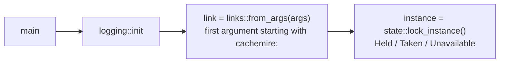
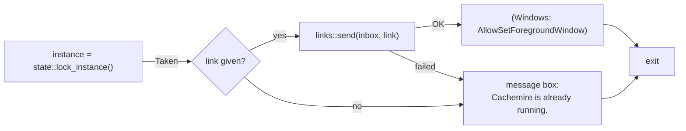
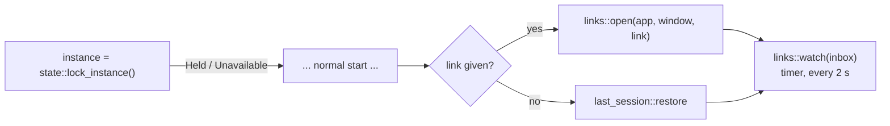

# Platform specifics

Everything that differs between Windows and Linux, or that touches the operating system around the
window: backend and renderer, winit event hooks, the single running instance and `cachemire://` links,
the update check, logging, icons and what packaging adds. Linux and Windows are the two supported
targets (CI runs both).

## Where to look

- `src/main.rs`: [`select_backend`](crate::select_backend), [`install_window_events`](crate::install_window_events),
  the single-instance branch of `main`, `use_exe_icon` (Windows).
- `src/drag_latch.rs` and `src/shutdown.rs` (Windows only), `src/window_state/mod.rs`, `src/toast.rs` (`on_window_event`).
- `src/links/mod.rs` and core [`link`](cachemire_core::link): `cachemire://` links and the inbox.
- `src/updates.rs` and core [`updates`](cachemire_core::updates).
- `src/logging.rs`: [`init`](crate::logging::init).
- `build.rs` (Windows resources), `resources/cachemire.desktop`, `resources/cachemire.wxs`, `crates/xtask/src/{windows,appimage,deb}.rs`.

## Differences at a glance

| Topic | Windows | Linux |
|---|---|---|
| Data directory | `%APPDATA%\Cachemire` | `~/.local/share/Cachemire` |
| Portable mode | `portable` file beside the exe (zip made by `xtask build-windows`) | same mechanism, no package builds it |
| Renderer | software renderer, forced by `select_backend` unless `SLINT_BACKEND` is set | the slint feature set compiles only `renderer-software`, so it is that one too |
| Window attributes | `with_transparent(false)` | default |
| Window icon | the exe's resource id 1, applied from the winit hook | Wayland: via the app id and the `.desktop` entry |
| Resize/move latch workaround | `drag_latch` | not compiled |
| Shutdown or restart | `shutdown`: saves the session and quits, or holds it (setting `hold_shutdown`); registered to be restarted by an installer or after a reboot | the process just ends |
| Link scheme registration | registry keys in the MSI (`resources/cachemire.wxs`) | `MimeType=x-scheme-handler/cachemire;` in `cachemire.desktop` |
| Update | downloads the MSI, checks its SHA-256, runs `msiexec /passive` from a hidden PowerShell that reopens the app, quits | opens the release page in the browser |
| Passing focus on link hand-over | `AllowSetForegroundWindow` | not needed |
| File mode | no mode bits | files `0600`, directories `0700` |
| Packages | MSI, portable zip | AppImage, `.deb` |

## Backend and renderer

[`select_backend`](crate::select_backend) runs before any window exists, after the instance check.
On Windows it asks for the winit backend with the software renderer (the comment says the OpenGL
path presented unreliably there: stale buffers and stalls during DWM animations) and disables window
transparency; if the environment variable `SLINT_BACKEND` is set, it leaves the choice to Slint. On
other targets it calls `BackendSelector::select()` with nothing forced. The app's `Cargo.toml` enables
Slint's `backend-winit` and `renderer-software` only (from a Slint fork, see `docs/slint-fork.md`),
so there is no other renderer to fall back to; "not established" whether that was intended for Linux.

`slint::set_xdg_app_id("cachemire")` follows: on Wayland there is no per-window icon, the shell
finds it through the app id, as the icon of the `cachemire.desktop` entry.

## The winit hooks

Slint keeps a single winit event hook per window, so [`install_window_events`](crate::install_window_events)
is the one place that registers it and fans out:

```text
window.on_winit_window_event(|window, event| {
    toast::on_window_event(..)               // all platforms
    use_exe_icon(..)                         // Windows: first event and on ScaleFactorChanged
    drag_latch::on_window_event(..)          // Windows
    shutdown::install(..)                    // Windows: first event, once
    EventResult::Propagate
})
```

`window_state` and `on_request_drag_window` / `on_request_toggle_maximize` in `main` use
`with_winit_window` directly (the window has custom decorations: the UI asks Rust to start a drag
or to toggle maximize).

### The Windows icon

`build.rs` embeds `resources/icon.ico` with id `1` (via `winresource`) plus version info. At runtime
`use_exe_icon` loads that resource at 16 and 32 logical pixels times the scale factor, for the window
icon and the taskbar icon, so Windows picks the matching `.ico` image instead of shrinking one bitmap.

### The drag latch (Windows)

Comment of `drag_latch.rs`: winit refuses every move/resize once one of them did not start the OS
move loop (the mouse button was already up when it ran), until a `WM_EXITSIZEMOVE` that never comes.
The workaround sends that message first: `clear` is called before `drag_window()` in
`on_request_drag_window`, and `on_window_event` calls it on a left press within the resize border (5
logical px, not when maximized). It keeps the last cursor position since a press carries none.
The module is declared `#[cfg(windows)]` in `main.rs`, so rustdoc cannot link it here.

### Shutdown and restart (Windows)

winit leaves `WM_QUERYENDSESSION` and `WM_ENDSESSION` to the default procedure, which neither saves
nor quits the app when Windows ends the session. `shutdown.rs` replaces the window procedure
(`SetWindowLongPtrW`, on the first winit event) and hands every other message on to winit's.
`WM_QUERYENDSESSION` answers yes, or, with `hold_shutdown` on (unless the shutdown is critical, or
an installer closes the app through the Restart Manager), sets a block reason ("Cachemire is still
open") and answers no: Windows then lists Cachemire and offers to shut down anyway. `WM_ENDSESSION`
clears the reason; when the session does end it runs what `main` gave `on_end` (last session and
window state saved) and exits the process.

`register_restart` (`RegisterApplicationRestart`, at startup, no crash nor hang restarts) lets the
Restart Manager start the app again once an installer that closed it is done, and Windows reopen it
after a reboot when the user's "restart apps" option is on.

## Single instance and links



When the instance is `Taken`, this one hands the link over (if any) and exits:



When the instance is `Held` or `Unavailable`, the start goes on:



The lock itself is described in core's settings chapter ([`lock_instance`](cachemire_core::state::lock_instance),
[`InstanceLock`](cachemire_core::state::InstanceLock)). The hand-over is a folder of files, no socket:

- [`inbox`](crate::links::inbox): `links/` beside the data files.
- [`send`](crate::links::send): writes `<nanosecond stamp>-<uuid>.partial`, then renames to `.link`, so the
  receiver never reads a half-written file.
- [`receive`](crate::links::receive): lists `*.link` sorted (oldest first), reads and removes each; one
  older than 60 s is dropped (it was meant for an app that has quit).
- [`watch`](crate::links::watch): a 2 s timer; for each link it brings the window to front
  (`cloud::bring_to_front`: un-minimise, focus, or request attention) then [`open`](crate::links::open).

### What a link is, and how it is followed

Core's [`Link`](cachemire_core::link::Link) parses and writes
`cachemire://open?v=1&redis=host:6379&db=2&key=...&field=...`: a server (a Redis address with optional TLS and SSH `via`,
or an AWS account/region/endpoint name), a database, a key and optionally a hash field and a JSON
path filter. It never carries credentials; unknown parameters are ignored; a newer `v` is refused with
[`LinkError`](cachemire_core::link::LinkError).

[`links::open`](crate::links::open) parses and calls `follow`, which finds the server (`find` returns `Found`):

| `Found` | Action |
|---|---|
| `Connection(id)` and already in use | open the key in the current window |
| `Connection(id)` otherwise | park the target on that connection, then `connect_to` |
| `CloudProfile` | park, then `cloud::resume` with that AWS profile |
| `CloudGone` | toast: no longer among the account's endpoints |
| `CloudUnknown` | link kept pending, toast asks to sign in with a profile that lists it |
| `NewServer` | opens the connection form filled in; link kept pending |

A pending link (thread-local `PENDING`) is retried by `retry_pending` when a connection is saved or
an AWS account is listed. A new `open` drops any pending link. The share buttons of the key panel
build links with `active_link` and copy them to the clipboard.

## Update check

[`updates::init`](crate::updates::init) sets the About page's version, channel toggle and button label, and when the
setting asks and the build is not a dev build, looks for a release at startup.

- Channels: [`Channel`](cachemire_core::updates::Channel) is derived from the version's pre-release: no
  suffix is `Stable`, `dev` is `Dev`, anything else `Beta`. Stable offers stable releases, Beta offers
  betas and stable, Dev none (the check is refused with a message). The picked channel is saved in the
  settings; unset, a beta build follows beta, everything else stable.
- [`newer_release`](cachemire_core::updates::newer_release) lists up to 50 GitHub releases (30 s timeout). On
  HTTP 403/429 (rate limit) it falls back to the releases Atom feed, inventing the MSI name by
  convention (`Cachemire-<v>-x64.msi`). Drafts are ignored; the newest offered version above the
  running one wins. The MSI's SHA-256 comes from the API's `digest` field when present (never from the feed).
- Off the UI thread: `rt.spawn` then `spawn_blocking` (ureq is blocking); the result returns with
  `upgrade_in_event_loop`. At startup only a found update is shown (and the About page is opened);
  other outcomes stay silent. The result is kept in the thread-local `FOUND`; changing the channel clears it.
- Download (Windows only, `cfg(windows)` in core): to `%TEMP%\cachemire-update`, written as `.part`,
  hashed while streaming, renamed when the checksum matches (no checksum means no check), then
  [`run_installer`](cachemire_core::updates) starts a hidden PowerShell (`-EncodedCommand`, script from
  [`update_script`](cachemire_core::updates::update_script)) and the event loop quits so the installer can
  replace the files. The script runs `msiexec /i … /passive /norestart` (a progress bar and the
  administrator prompt, no page to click), waits for it, then starts the app again as the user, unless
  the Restart Manager already did. On other platforms `launch` is a stub and `on_download` opens the release page instead.

## Logging

[`logging::init`](crate::logging::init) is the first call of `main`, with the directory `logs/` in the data dir.

- File: daily rolling, prefix `cachemire`, suffix `log`, keeps 7 files, written by a non-blocking worker whose
  guard is held by `main` (dropping it flushes).
- stderr: only in debug builds (also why debug Windows builds keep their console, see the
  `windows_subsystem` attribute at the top of `main.rs`).
- Filter: `warn,cachemire=info` by default, overridden by `CACHEMIRE_LOG` (e.g. `warn,cachemire=debug`).
- Panics are logged with a forced backtrace, then the previous hook runs.

If the log directory cannot be written the app prints a line to stderr and goes on without a file.

## Packaging touchpoints

- `resources/cachemire.wxs`: the MSI installs `cachemire.exe` and registers the `cachemire` URL protocol under
  `HKLM\Software\Classes`, passing `"%1"` as the argument. A first install asks on its first page for a Start menu
  entry (the package's own, for every user, its choice remembered as `HKLM\Software\Cachemire\StartMenuShortcut`
  for updates) and a desktop shortcut (the installing user's, made by a deferred PowerShell as that user); an update
  of a version older than this one removes the Start menu entry those made in the user's own folder. The last page
  offers to open the app. Also: App Paths (`cachemire` in Win+R), `RegisteredApplications` with the
  `Cachemire.Link` ProgID (Settings > Default apps), the GitHub links and install folder of Apps & features
  (`ARPURLINFOABOUT`, `ARPHELPLINK`, `ARPURLUPDATEINFO`, `ARPINSTALLLOCATION`), and the uninstall of the shortcuts.
  Windows' own Uninstall button skips the first page, so deleting the user's data is only offered through Modify.
- `resources/cachemire.desktop`: `Exec=cachemire %u`, `MimeType=x-scheme-handler/cachemire;`, `StartupWMClass=cachemire`.
- `crates/xtask`: `build-windows` (exe, MSI, portable zip with the empty `portable` file), `build-appimage`,
  `build-deb`; the `fast` cargo profile builds without LTO for quick tries. `docs/releasing.md` has the release process.
- `crates/installer-test`: a stand-in app used to test the real MSI (`build-installer-test`).

## Gotchas

- A change to a hook in `main.rs` must go through `install_window_events`, not a second `on_winit_window_event`.
- Code that exists only on Windows (`drag_latch`, `use_exe_icon`, the installer download) is not compiled by
  Linux CI builds or clippy: check it on Windows (CI runs a Windows job).
- The single-instance lock only protects the data dir of the running copy; a portable copy has its own.
- Linux has no download-and-install path: the release page opens in the browser.
