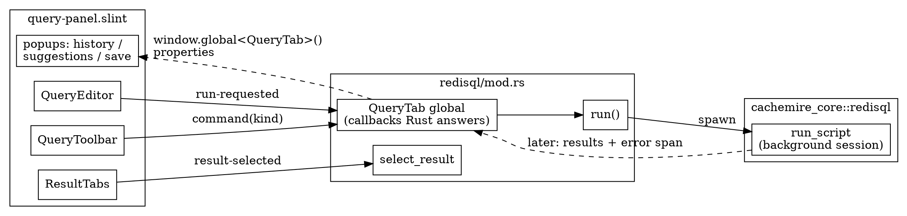
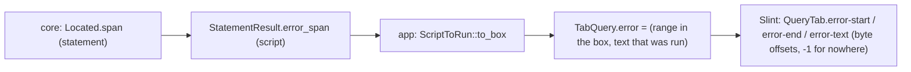
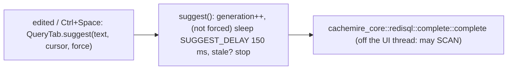
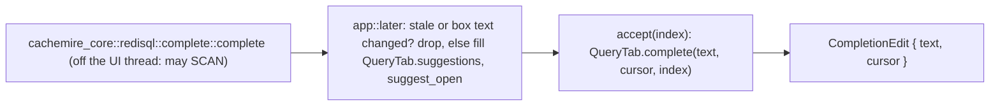

# Redisql in the app: query tabs

A query tab is a tab that holds a Redisql query box and shows the result as a table. All the
language work (lexing, parsing, execution, completion, history) is in core, see the
[core Redisql chapter](cachemire_core::wiki::redisql); this chapter is the glue: running a script off the
UI thread, turning results and error positions into UI state, the completion popup, the history
and the saved queries.

## Where to look

| File | Role |
|------|------|
| `src/redisql/mod.rs` | [`QueryTabs`](crate::redisql::QueryTabs), running, results, completion, history, `init` |
| `src/redisql/highlight/mod.rs` | colouring of the box: [`highlight_query`](crate::redisql::highlight::highlight_query) |
| `src/redisql/saved.rs` | the sidebar's list of saved queries |
| `ui/components/query-panel.slint` | `QueryEditor`, `QueryToolbar`, `ResultTabs`, the popups |
| `ui/globals.slint` | the `QueryTab` and `SavedQueries` globals (the Rust/Slint contract) |
| `ui/main.slint` | where the panel parts are placed (only when `TabStrip.active-is-query`) |
| `src/tabs/mod.rs` | creating, entering, leaving and closing the tab |
| `src/redisql/tests.rs` | unit tests of script selection and result texts |

## Structure



A query tab is an ordinary tab of the tab strip with a special id. The id starts with
`\u{2}query:` (a control character, so it can never equal a key name or a search tab's id);
[`is_query_id`](crate::redisql::is_query_id) tests it, and the tabs module uses it to pick the
panel and the right enter, leave and close hooks (see [keys_and_tabs](crate::wiki::keys_and_tabs)).

The flow is the standard one of the app (see [architecture](crate::wiki::architecture) and
[runtime](crate::wiki::runtime)): Slint callback, handler in `redisql/mod.rs`, work spawned on the
Tokio runtime, answer brought back with `app::later`/`app::spawn`, properties and models set on the
UI thread.

## State: `QueryTabs`

[`QueryTabs`](crate::redisql::QueryTabs) (owned by [`App`](crate::app::App) as `queries`, behind a
`RefCell`) keeps one `TabQuery` per tab plus a few shared fields:

```text
TabQuery
  text           the box's text, as of when the tab was last left
  ran            a run was attempted (before that, the table area shows a hint)
  loading        the spinner is on
  status         the line the toolbar shows: "n rows", an error, "running..."
  status_is_error
  results        Vec<ResultTable>   one per executed query of the last run
  active         which result is shown
  error          Option<(Range<usize>, String)>   where the last error is, and the text it was run on
  run            Arc<AtomicU64>     run counter, bumped to drop stale answers
  task           the running task's AbortHandle

QueryTabs
  tabs: FxHashMap<id, TabQuery>      last_id        active: Option<id>
  navigation     history stepping state     history_shown   rows of the history popup
  offered        the Completion the list shows    suggest_generation   completion request counter
```

The *active* tab's data is mirrored into the `QueryTab` Slint global, which the panel binds to:

| Moment | Function | What it does |
|--------|----------|--------------|
| a tab opens | [`QueryTabs::create`](crate::redisql::QueryTabs::create) | new id, text pre-filled (empty, or a saved query), not run |
| a tab is shown | [`enter`](crate::redisql::enter) | copies text/ran/loading/status/error into the global, shows the result |
| a tab is left | [`QueryTabs::leave`](crate::redisql::QueryTabs::leave) | stores the box's text; the last result is already kept |
| a tab closes | [`QueryTabs::forget`](crate::redisql::QueryTabs::forget) | bumps the run counter, aborts the task, drops the data |

Because every tab keeps its own `TabQuery`, a run in a tab that is not shown still lands in its own
entry (`apply_outcome` only touches the global when the tab is the active one).

## Running a query

Triggers: Ctrl+Enter (the statement at the caret or the selection), Ctrl+Shift+Enter (the whole
script), the toolbar's Run and Run-all buttons, picking a history row with Ctrl or Shift held.
The editor calls `run-requested(query, cursor, anchor, script)`; the toolbar goes through
`QueryTab.command-kind` and a bumped `command-tick` (0 undo, 1 redo, 2 run the statement, 3 run
the script), which the editor reacts to with `changed command-tick`. Both end in
`run`.

### What text runs

`script_to_run` builds a `ScriptToRun { script, in_script, in_box }`:

- `whole`: the box's text as is.
- A selection (`cursor != anchor`): the selected text, prefixed by the `var` declarations that
  come *before* the selection.
- Otherwise: the statement the caret is in (or, past the last one, the last statement before the
  caret), also prefixed by the earlier declarations.

The prefix is built from [`split_statements`](cachemire_core::redisql::split_statements) and
[`is_declaration`](cachemire_core::redisql::is_declaration). `in_script` is the length of that
prefix and `in_box` where the target starts in the box: `ScriptToRun::to_box`
maps a span of the script back into the box, and gives `None` when it lies in the added
declarations (they are not in the box). An empty script gives an "The query is empty." error
result instead of a run.

### The run

`run` does, in order:

1. Bumps the tab's run counter (`run_number`), keeps the text, sets status "running...", clears the
   previous error mark.
2. Computes the script. If empty, applies an error result and returns.
3. Starts a delayed task: after `LOADING_DELAY` (150 ms), if the run is not done and still the
   latest, sets `loading` (the Run button's spinner). A fast query never flashes it.
4. Spawns the real work with [`app::spawn`](crate::app::spawn):
   [`run_script`](cachemire_core::redisql::run_script) on the window's connection id (not the
   "active" one: the box belongs to the connection shown), then:
   - maps the last result's `error_span` into the box with `to_box`;
   - records a [`HistoryEntry`](cachemire_core::redisql::history::HistoryEntry) (the *script that
     ran*, with its declarations, duration, `ok` = every result succeeded) if there was at least one
     result and a connection;
   - builds the result tables on a blocking thread (`result_of`).
5. On the UI thread, `apply_outcome` stores the results unless the
   run counter moved on (a newer run or a closed tab: the answer is dropped), switches to the last
   result, and updates the status and error mark.
6. The new task's `AbortHandle` replaces and aborts the previous one.

If the task itself fails (`outcome` is an `Err`), one error result with the localised message is shown.

## Results

Each executed statement gives a `ResultTable { label, status, status_is_error, rows }` through
`result_of`:

- Success: label `"<n> · <rows>"`, status from `status_text`:
  `"N rows"`, or with `truncated` the "(more matched; raise LIMIT to see them)" form, or, when the
  shown rows already reached [`MAX_LIMIT`](cachemire_core::redisql::MAX_LIMIT), the "a query shows
  5000 at most" form. If `sources_truncated`, a sentence about a too-large source key is appended.
- Error: label `"<n> · !"`, status = the error localised (see [errors](crate::wiki::errors)), no rows.
- A single result has an empty label (no tabs shown).

`ResultTabs` (in `main.slint`, shown when there are several results) selects one
through `result-selected`, handled by `select_result`, which changes `active`, the status and the
table. If a run yields no result (only `var` declarations), the status is "Nothing to show: only
variables were declared.".

The table itself is not a Redisql widget: `show_results` hands the rows
(a `Vec` of JSON maps) to the key panel with `key_detail.show_rows(id, rows, scroll)`, and the tab's
view mode is the *table* view (`KeyView::Table` for query ids in `tabs/mod.rs`). Rows are the same
shape the key panel shows for a hash, so filtering, sorting and copying behave as there (see
[ui](crate::wiki::ui) and [keys_and_tabs](crate::wiki::keys_and_tabs)). An error result shows no rows.

## Error positions in the box

Core gives a span relative to the script it was handed. The app maps it to the box and stores it with
the text that was run:



`show_error` writes the three properties. The `highlight` callback receives them with the current
text and only draws the mark when `error_text == text`, i.e. while the box still holds exactly what
was run; any edit removes it. The mark is a translucent red background behind the characters
(`ACCENT_RED` at 40 % alpha).

## Highlighting

[`highlight_query`](crate::redisql::highlight::highlight_query) turns the text into one
[`StyledText`](crate::styled_text::StyledText), one paragraph per line (the highlighter is line-oriented: a quote
not closed on a line runs to the line's end). Per line it colours:

| Token | Colour (from `theme_colors`) |
|-------|------------------------------|
| keywords `from join where select limit as on and in key var` | `ACCENT_BLUE` |
| `true` / `false` | `JSON_BOOL` |
| numbers | `JSON_NUMBER` |
| quoted strings | `JSON_STRING` |
| `&name` variables inside strings (via core's [`variable_ranges`](cachemire_core::redisql::variable_ranges)) | `QUERY_VARIABLE` |
| `-- comment` | `TEXT_TERTIARY` |
| `. , ; = [ ] ( ) *` | `JSON_PUNCT` |

The error range is cut to each line's own byte offsets. It is a pure Slint callback bound
directly in the editor, so it is recomputed on every edit (cheap enough that no cache exists).
The editor draws the coloured text *under* an almost invisible real `TextInput`, so the user types
into the input while seeing the colours; line numbers are drawn from the `lines` callback.
[`normalize_line_endings`](crate::redisql::highlight::normalize_line_endings) (`sanitize` callback)
turns `\r\n` and lone `\r` into `\n` right after a paste, otherwise the overlay's layout would drift
from the input's.

The highlighter's keyword list is separate from the parser's and the completer's (`KEYWORDS` in
`complete/` also lacks `var`), so a new keyword must be added in each place.

## Completion popup





- A request carries a generation number from `suggest_generation`; an answer that is not the latest
  (typing went on) or whose text no longer equals the box's is dropped.
- Rows are `SuggestionRow { before, matched, after }`
  split on the item's matched range, so the popup can emphasise the match.
- The full [`Completion`](cachemire_core::redisql::complete::Completion) is kept in
  `QueryTabs::offered`; accepting calls `Completion::accept` and returns a `CompletionEdit`
  (`cursor: -1` means "nothing changed").
- When the accepted item is a folder (ends with `:`), the next level is requested at once, forced.
- One [`Caches`](cachemire_core::redisql::complete::Caches) is created in `init` and shared by all
  requests (30 s lifetime); see the core chapter for what is cached and the limits.
- The popup (`SuggestionPopup`, from `key-detail-widgets.slint`) handles the up/down/enter keys itself
  through `handle-key` before the editor's own shortcuts; it closes with the editor's focus.

## History

The history popup is the clock button in the toolbar (`HistoryPopup`).

- `history-requested`: reads
  [`HistoryStore::for_connection`](cachemire_core::redisql::history::HistoryStore::for_connection) (through
  `AppState::history`) for the window's connection; builds `HistoryRow { label, detail, failed }`
  where `label` is the text with whitespace collapsed to single spaces and `detail` is
  `"<ago> · <ms> ms"`; `ago` writes "just now", "N min ago", "N h ago" or "N d ago". The raw texts
  go to `history_shown`.
- `history-picked(index, run)`: puts the text in the box; with Ctrl or Shift held in the click, also
  runs it as a whole script.
- `history-cleared`: clears the connection's history and the popup.
- Ctrl+Up / Ctrl+Down (`history-step`): steps through the entries. `Navigation { position, draft }`
  remembers the position and what was in the box before the first step (the draft); going newer past
  the newest restores the draft; a text edited since the last step restarts from what the box holds.

Recording happens in `run` (see above), not in the history popup.

## Saved queries

"Save" in the toolbar opens `SaveQueryPopup` (name field, "for every connection" checkbox).
`save-requested(name, global)` calls
[`SettingsStore::create_saved_query`](cachemire_core::settings::SettingsStore::create_saved_query)
with the box's text and the window's connection id (empty id for a global one); a failure (empty
name, empty text) is shown as a toast.

The sidebar's Query view is [`saved`](crate::redisql::saved):

- [`saved::refresh`](crate::redisql::saved::refresh) fills the `SavedQueries` global: the connected
  connection's own queries (`saved_queries`), the global ones (`global_queries`), filtered by the
  filter box on name or text (case-insensitive), each row with a one-line `preview` (first non-blank
  line, 40 characters then an ellipsis), and `has_saved_queries`.
- `filter-changed` re-filters; `deleted(id)` removes a query with one click and no confirmation
  (losing one costs nothing but retyping it) then refreshes.
- Clicking a row (`SavedQueries.on_clicked`, wired in `tabs/mod.rs`) opens it in a new tab through
  `tabs::open_query`: pre-filled but not run, the user reviews it first.
- `tabs::follow_connection` calls `saved::refresh` when the connection changes, so the list follows it.

Persistence of saved queries is the settings store's job, see the core
[settings chapter](cachemire_core::wiki::settings).

## Tests

`src/redisql/tests.rs` covers the pure parts: that a query id is never a key or a search tab's,
`script_to_run` (the statement at the caret with its declarations, the selection, the whole box, a
caret past the last statement, span mapping), the result labels and the status texts.
`highlight/tests.rs` covers the colours and the error range per line. Core behaviour is tested in
core. As the project rules say, no tests are added unless asked.
