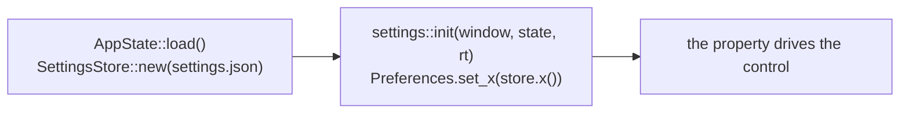
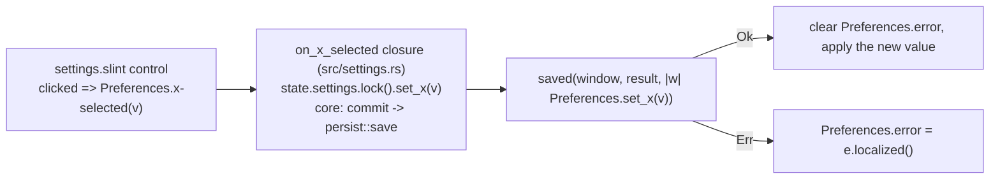
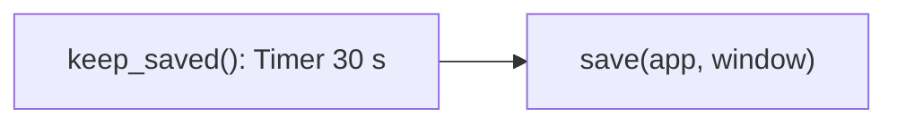
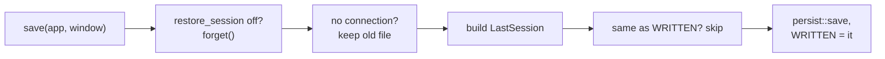
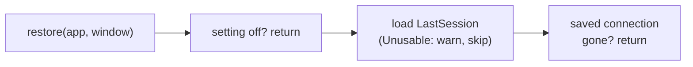
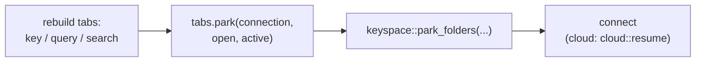

# Settings, session and window state

How a preference travels from a control in the Settings dialog to a JSON file and back at the
next start, and the two other things the app remembers between runs: the last session and the
window's place. The storage itself (files, atomic writes, defaults) is described in the core's
core `settings` wiki chapter chapter.

## Where to look

- `src/settings.rs`: [`init`](crate::settings::init) wires the `Preferences` global to
  [`SettingsStore`](cachemire_core::settings::SettingsStore); `to_setting` / `from_setting` mirror the language enum.
- `src/shortcuts.rs`: the key bindings page (settings stored under `shortcuts`).
- `src/last_session.rs`: restore-session (`last_session.json`).
- `src/window_state/mod.rs`: window rect and maximized flag (`window.json`).
- `ui/globals.slint` (`Preferences` global), `ui/components/settings.slint` (the dialog),
  `ui/components/types.slint` (mirrored enums).
- `src/updates.rs`: the About page's channel toggle (also a setting, see [platform](crate::wiki::platform)).

## The path of a preference

At startup:

When the user clicks a control:

Key points of this design:

- The UI never shows a value that was not saved: the window's own property is set only inside the
  `apply` closure of `saved`, after the core returned `Ok`. A failure is
  localised ([errors](crate::wiki::errors)) into `Preferences.error`, shown in the dialog.
- At startup `init` pushes every stored value into the global (`set_language`, `set_server_search`,
  `set_restore_session`, `set_search_depth`, `set_opening_view`, ...). A few values are also
  copied into other globals (`ExportPrefs` takes `escaped` and `header_escaped` from
  `export_escaped`).
- The settings are read on the UI thread with a short `state.settings.lock()`. Nothing in
  this file does keyring work on the UI thread, except through the dedicated path below.
- Settings stay valid for open tabs: the export format and opening view are "what *new* tabs start
  with"; open tabs keep their own state.

### The settings handled in `init`

| Preference | Core setter | Extra effect in the app |
|---|---|---|
| language | `set_language` | [`i18n::apply`](crate::i18n::apply) and [`shortcuts::refresh`](crate::shortcuts::refresh): see [i18n](crate::wiki::i18n) |
| export escaped | `set_export_escaped` | updates `Preferences` only; `ExportPrefs` is seeded at startup |
| opening view / last view | `set_opening_view`, `set_last_view_table` | `on_view_picked` saves quietly: a failure is only logged |
| search depth, server search | `set_search_depth`, `set_server_search` | used by the next search |
| check updates at startup | `set_check_updates_at_startup` | read at the next start by [`updates::init`](crate::updates::init) |
| accept new SSH host keys | `AppState::set_accept_new_ssh_host_keys` | also updates the live host-key checker at once |
| restore session | `set_restore_session` | turning it off calls [`last_session::forget`](crate::last_session::forget) |
| hold shutdown (Windows) | `set_hold_shutdown` | `shutdown::set_hold` (Windows only, not linked), read when Windows ends the session |
| SSH profiles | create / update / remove / set active | drops the pooled connections that used the active profile (`drop_profile_pools`) |

Not in this file: connection profiles ([connections](crate::wiki::connections), `connections/profiles`),
saved queries (`redisql/saved.rs`), cloud settings (`cloud/settings`), keyboard shortcuts
(`shortcuts.rs`) and the update channel (`updates.rs`). Each is a separate `init` that talks to the
same store.

### Enums mirrored from core

[`Language`](cachemire_core::i18n::Language) exists in core (no Slint there) and as `LanguageSetting` in
`types.slint`. `to_setting` / `from_setting` are exhaustive `match`es so that adding a variant on
one side does not compile until the other is done. `OpeningView` is mirrored in the same way, with an inline `match`.

### SSH profile save: the one slow path

Saving a profile may store its password in the OS credential store, which can block (first-time
setup, an unlock prompt). So `save_profile_off_thread` runs on `spawn_blocking`, and calls
[`staged`](cachemire_core::secret_vault::staged) so that the settings mutex is not held across the vault calls.
It returns to the UI thread with [`app::later`](crate::app::later). If the keyring is unavailable
([`is_unavailable`](crate::keyring_dialogs::is_unavailable)) the user is asked
([`ask_keyring`](crate::keyring_dialogs::ask_keyring)) whether to keep the password in the file or leave
it out, and the save is retried with the chosen
[`SecretsPolicy`](cachemire_core::secret_vault::SecretsPolicy). The first attempt uses `VaultOrFail`.
See the core `secrets` wiki chapter.

### The search box of the dialog

[`found`](crate::settings::found) implements the dialog's search: every word of the query must
occur in the text, ignoring case and accents (`fold` maps accented Latin letters to ASCII; it is a
hand-written table, not Unicode normalisation). Slint calls it through `Preferences.search-matches`;
`settings.slint` builds a text per setting from its translated titles.

## Keyboard shortcuts

`shortcuts.rs` has a `SPECS` table of twelve actions: Slint `ShortcutAction`, a `code` (the name stored
in `settings.json`), a `Scope` (window, query box, value editor) and default key parts.
Only a *change* from the defaults is stored (`SettingsStore::set_shortcut(code, Some(keys))`;
`None` restores the default). Two actions may not share keys inside one scope nor with a window-wide
one, since the focused box would hide it (the page refuses with a message). Titles are translated, which is why a language
change calls `shortcuts::refresh`.

## Restoring the last session

[`last_session`](crate::last_session) keeps the connection in use with its tabs and open folders in
`last_session.json`, next to `settings.json` (its path is derived from the settings file's path).

While the app runs, a 30 s timer keeps the file current:

On exit, and at each tick of that timer, `save` goes through these steps:

At the next start:

and continues with:

- A `LastSession` holds `connection`, `cloud_profile` (for AWS ids, whose connection id starts with
  [`aws::ID_PREFIX`](cachemire_core::aws::ID_PREFIX)), `tabs` (an enum tagged by `kind`: `Key`, `Query`
  with its text, `Search` with its query), `active` as an index into `tabs`, and `open_folders`.
- The `WRITTEN` thread-local avoids rewriting an unchanged session every 30 s.
- "Park" means the tabs and folders wait: they are applied when the connection finishes connecting, not
  immediately (see [keys_and_tabs](crate::wiki::keys_and_tabs)).
- Order in `main`: a `cachemire://` link on the command line replaces the restore
  (`Some(link) => links::open`, `None => last_session::restore`). The save at exit runs after
  `window.run()` returns.
- If no connection is in use at save time the old file is kept (a restore under way or a failed
  attempt must not erase it); a disconnect calls `forget`.

## Window state

[`window_state::install`](crate::window_state::install) runs right after the window is created, before
it is shown: it reads `window.json` (via [`persist::load`](cachemire_core::persist::load), an unusable file only
warns), sets size/position/maximized, and starts a 100 ms `Timer` that watches the winit window.
It returns a closure that saves once more, which `main` calls after the event loop ends.

- State: `normal` rect (not maximized/minimized), `maximized`, `maximized_rect` (tells which screen).
- Start rect: `WindowState::start_rect` enforces a minimum size of 720x300, and when the window was
  maximized on a screen it re-centres a rect whose centre is not on that screen.
- Settling: for up to 30 ticks (3 s) the window is pushed to the saved place (the OS may rescale it first)
  and nothing is recorded; settled after two matching looks. On Wayland the position cannot be
  read, so only the size is compared.
- Offscreen: on the first settle tick `on_a_screen` moves a rect that overlaps no monitor by at
  least 100x40 px onto the primary monitor (a screen unplugged since).
- Recording: a changed place is saved after it stays the same for 5 ticks (500 ms). Minimized and
  fullscreen windows are not recorded.
- Why polling and not winit move/resize events: the comment says polling is the one way certain to
  see every change, maximize and drag included.

## Gotchas

- Anything that must apply live (host-key policy, language) is applied in the same callback that saves.
- A new setting needs the five places listed in the `add-setting` skill (core field, global, control,
  `init`, optional enum mirror) plus translations ([i18n](crate::wiki::i18n)).
- `last_session` and `window_state` use [`persist`](cachemire_core::persist) directly and are not part of `StoredSettings`.
