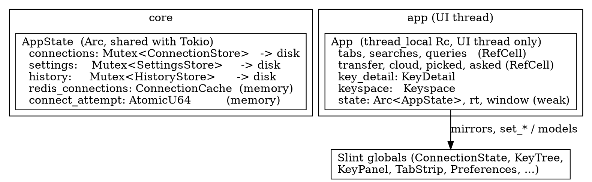
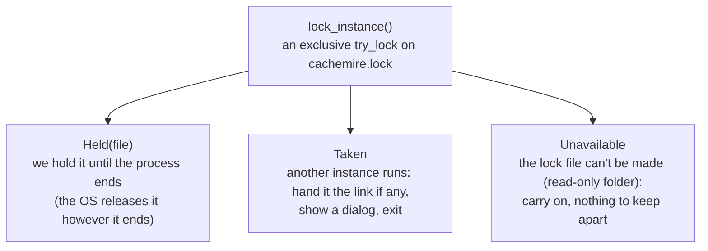
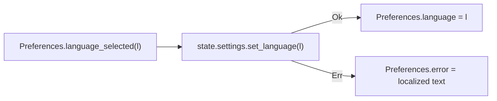
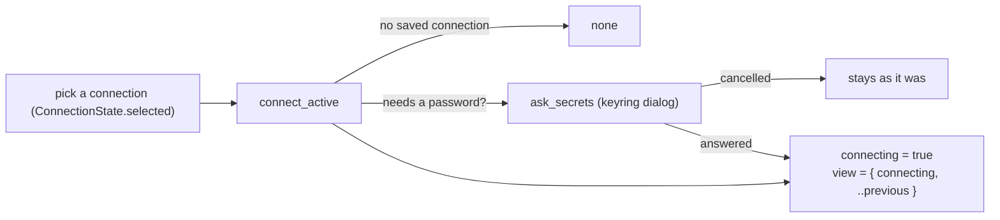
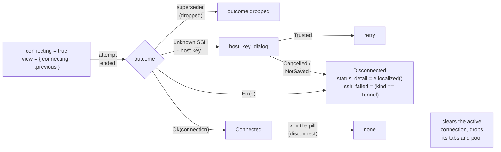
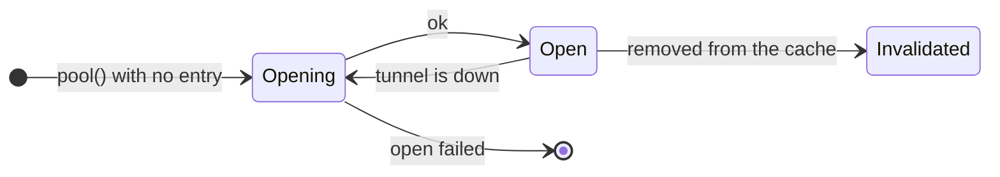
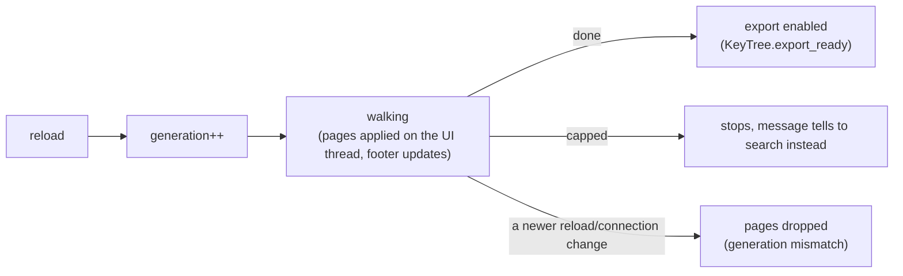

# State of the system

What the program remembers, who owns it, where it lives (Rust, a Slint global, a file) and how it
changes. This chapter is the map; the feature chapters hold the details.

Where to look:

- `crates/cachemire-core/src/state.rs`: [`AppState`](cachemire_core::state::AppState),
  [`InstanceLock`](cachemire_core::state::InstanceLock), the data-file location.
- `crates/cachemire/src/app.rs`: [`App`](crate::app::App).
- `crates/cachemire/ui/globals.slint`: the Slint globals that mirror part of it.
- `crates/cachemire/src/connections/connect.rs`: the connection lifecycle on the UI side.
- `crates/cachemire-core/src/connection/pool.rs`: the connection lifecycle on the core side.

## The three owners



- **[`AppState`](cachemire_core::state::AppState)** is the core's shared state: three persisted
  stores behind `parking_lot::Mutex`, the pool cache, and the connect attempt counter. It is built
  once by [`AppState::load`](cachemire_core::state::AppState::load) and shared as `Arc<AppState>`.
  Core functions take `&AppState` (or `&Arc<AppState>`) and a connection id.
- **[`App`](crate::app::App)** is the UI thread's state, not `Send` (see
  [runtime](crate::wiki::runtime)). It holds the handles to the feature state.
- **Slint globals** are what the screen is bound to. They are a *view* of the above, written by
  Rust. A few hold state that exists only on the Slint side (an open dialog flag, the text in a field
  being typed).

### What `AppState` holds

| Field | Type | Persisted in | Notes |
|---|---|---|---|
| `connections` | [`ConnectionStore`](cachemire_core::connection::store::ConnectionStore) | `databases.json` | saved connections, the active connection id, cloud connections |
| `settings` | [`SettingsStore`](cachemire_core::settings::SettingsStore) | `settings.json` | preferences, SSH and connection profiles, saved queries, cloud settings |
| `history` | [`HistoryStore`](cachemire_core::redisql::history::HistoryStore) | `query_history.json` | queries run from query tabs |
| `redis_connections` | [`ConnectionCache`](cachemire_core::connection::pool::ConnectionCache) | memory | one lazily opened pool per connection id; owns the SSH host keys |
| `connect_attempt` | `AtomicU64` | memory | numbers connection attempts (see "tickets") |

Test builds use `AppState::for_tests` (in-memory secrets, files in
a temp dir).

### What `App` holds

| Field | Per | Meaning |
|---|---|---|
| `window` | app | weak handle to the main window |
| `state`, `rt` | app | the core state, the Tokio handle |
| `tabs: RefCell<`[`Tabs`](crate::tabs::Tabs)`>` | connection, then tab | the open tabs of the connection shown, and the tabs *parked* for each other connection |
| `searches: RefCell<`[`SearchTabs`](crate::search::SearchTabs)`>` | search tab | what each search tab holds |
| `queries: RefCell<`[`QueryTabs`](crate::redisql::QueryTabs)`>` | query tab | what each query tab holds |
| `key_detail`: [`KeyDetail`](crate::key_detail::KeyDetail) | tab (cached by connection and key) | the key panel's loaded content |
| `keyspace`: [`Keyspace`](crate::keyspace::Keyspace) | connection | the tree, its index, the walk |
| `transfer`: [`TransferLists`](crate::connections::transfer::TransferLists) | dialog | rows of the import/export dialog |
| `cloud`: [`Cloud`](crate::cloud::Cloud) | app | the AWS account sign-in |
| `picked` | app | id of the connection last picked (what a retry connects to; `""` for none) |
| `asked`: [`Asked`](crate::keyring_dialogs::Asked) | dialog | what the open secret dialogs do with the answer |

## Scopes: global, per connection, per tab

| Scope | Examples | Lifetime |
|---|---|---|
| **Global** (whole app, all connections) | settings and preferences, profiles, saved connections list, language, shortcuts, the window rect | persisted; loaded at start |
| **Process-wide, in memory** | the instance lock, `connect_attempt`, the SSH known-host cache, the Tokio runtime | until exit |
| **Per connection** | the pool and its SSH tunnel (core), the keyspace tree and its open folders, the parked tabs, the saved queries (removed with the connection), the read-only flag, the profile tint | while connected (pool) or for the run (parked tabs) |
| **Per tab** | scroll position, view (fields/table), filter badges, JSON filter path, expanded fields, case sensitivity, escape format | for the run; kept in `TabViewState` and restored when the tab is shown again |

Per-connection state is switched when the connection in use changes: `Tabs` keeps one set of
tabs per connection (`connection`, `parked`), with the comment that this is "kept for the run only,
never saved". The tree also remembers the folders open per connection (`parked_folders`).
The key panel's fetched data is cached under `(connection id, key)` because the same key name can
hold something else on another server.

## Persisted versus in-memory

Files live in one directory. [`resolve_data_file`](cachemire_core::state::resolve_data_file) gives
`databases.json` in the platform's per-user data directory (`~/.local/share/Cachemire` or
`%APPDATA%\Cachemire`), or in a `data` folder next to the executable when a `portable` file sits
beside it. Everything else is a sibling of that file. Files of older layouts (the former name
`Redust`, or files beside the executable) are copied once when the new directory has no saved
connections yet.

| File (next to `databases.json`) | Written by | Content |
|---|---|---|
| `databases.json` | `ConnectionStore` | saved connections (passwords go to the keyring) |
| `settings.json` | `SettingsStore` | preferences, profiles, saved queries |
| `query_history.json` | `HistoryStore` | Redisql history |
| `ssh_known_hosts` | `HostKeys` | trusted SSH host keys (the user's own `known_hosts` is also consulted) |
| `last_session.json` | [`last_session`](crate::last_session) | connection, tabs, active tab, open folders |
| `window.json` | [`window_state`](crate::window_state) | the window rect or maximized |
| `cachemire.lock` | [`lock_instance`](cachemire_core::state::lock_instance) | the single-instance lock (no data) |
| `logs/` | [`logging`](crate::logging) | one file a day, last seven kept |
| `<name>.unusable-<ms>` | [`persist::set_aside`](cachemire_core::persist::set_aside) | a file that could not be read, kept |

Outside this directory: passwords live in the OS credential store
([`secret_vault`](cachemire_core::secret_vault)), and the AWS SSO token in `~/.aws/sso/cache`
(shared with the AWS CLI).

How files are saved: [`persist::save`](cachemire_core::persist::save) writes a private temp file,
syncs it and renames it over the original, so the file is always whole. At load,
[`persist::load_store`](cachemire_core::persist::load_store) moves an unreadable file aside and starts
from defaults; if it cannot be moved aside, nothing is written over it for the rest of the run.

Never persisted: the tree, fetched values, search results, query rows, parked tabs, the connection
state itself. Only [`last_session`](crate::last_session) keeps part of the tab layout, and only
when the setting "restore the last session" is on.

### The instance lock

[`InstanceLock`](cachemire_core::state::InstanceLock) records whether this process may save to the
data directory:



Only `Taken` stops the app. `Unavailable` is logged and tolerated.

## Mirrored into Slint

Rust owns the truth and *pushes* it into globals; Slint raises callbacks to ask for changes. The
rule in the code: persist first, then mirror on success.



Kinds of mirrors:

| Kind | Example | Written by |
|---|---|---|
| A struct set whole | `ConnectionState.view` (`ConnectionView`) | `connections/connect.rs` (`show`) |
| A `VecModel` rebuilt | `ConnectionState.connections`, `Preferences.ssh_profiles` | `refresh` functions |
| A persistent model mutated incrementally | `KeyTree.rows` (`TreeRows`) | `keyspace` |
| A scalar copy of a setting | `Preferences.accept_new_ssh_host_keys` | `settings.rs`, once at start and on toggle |
| Slint-only state | an open dialog, a field being typed | Slint, read by Rust in handlers |

The `read-only` flag shown for the connection in use is a mirror of core's
[`is_read_only`](cachemire_core::state::is_read_only); the *check* that guards writes is always the
core's [`ensure_writable`](cachemire_core::state::ensure_writable), never the UI's copy.

Slint enums that mirror core enums (language, opening view, profile colours) are converted with
exhaustive `match`es (`to_setting` and `from_setting` in `settings.rs`): adding a variant to one
side breaks the build until the other follows.

## State machines

### Connection lifecycle (what the title bar shows)

`ConnectionView` (a Slint struct in `globals.slint`) carries `status`, a `connecting` flag,
`connected`, the `connection_id`, a failure text (`status_detail`) and `ssh_failed`. The status is
the enum `ConnectionStatus { none, connected, disconnected }`; "connecting" is a flag layered on top of
whatever status was showing.





Transitions, from `connect.rs`:

- A **picked** connection id is stored in `App::picked`. A retry ([`connect_active`](crate::connections::connect_active))
  reconnects to it; with none, the view becomes `none` with the text "No saved connection".
- **Connecting** sets the flag and keeps the other fields. The attempt gets a number from
  [`connect_attempt`](cachemire_core::state::AppState::connect_attempt).
- **Success** sets the store's active connection and shows `Connected` with address, name and the
  SSH server label; the `established` callback then refreshes the list and reloads the keyspace.
- **Failure** shows `Disconnected`. The failure is logged with its [`ErrorKind`](cachemire_core::error::ErrorKind);
  the SSH badge turns red when the kind is `Tunnel`.
- **Host key unknown**: the failed outcome carries the server; the user decides in a dialog. Trusting
  records the key and retries the same attempt.
- **Disconnect** (the cross in the pill): clears `picked`, discards the connection's tabs and the saved
  last session, clears the store's active connection, invalidates the pool, resets the view.
- A view with an empty connection id also clears the active connection in the store (`show`), so
  whatever falls back to "the active connection" finds none.

The order on success is fixed in the module's comment: the title bar's view is set, the store's
active connection follows, then the tabs.

### Connection pool (core side)

[`ConnectionCache`](cachemire_core::connection::pool::ConnectionCache) keeps one cell per connection
id; [`ConnectionPool`](cachemire_core::connection::pool::ConnectionPool) holds three physical
connections (one for long reads, two for clicks) and the SSH tunnel they go through.



| Transition or state | Detail |
|---|---|
| `Opening` to the end | open failed: an error is returned and nothing is cached |
| `Open` to `Opening` | tunnel is down: the next `pool()` drops the cell and opens again |
| `Opening` | callers racing share one open (`OnceCell`); open failed: 30 s limit (`Timeout::Connect`) |
| `Invalidated` | disconnect, delete, profile change, a stale pool found by connect |

- **Opening** opens the SSH tunnel (if any), then the first connection alone (so bad credentials fail
  once and fast), refuses a cluster-mode server ([`Error::ClusterMode`](cachemire_core::error::Error::ClusterMode)),
  then opens the other two in parallel. The whole open is bounded by 30 seconds.
- **Stale detection**: [`connect_connection`](cachemire_core::connection::connect_connection) pings every
  connection of an already open pool (3 seconds); if one does not answer, the pool is invalidated and
  reopened. A pool whose SSH tunnel died is replaced at the next `pool()` call.
- [`is_connected`](cachemire_core::connection::pool::ConnectionCache::is_connected) says whether a pool is
  open *this run*: the store's "active" connection may come from a previous run, and polling it
  would connect silently at startup (see `server_stats.rs`).

### Tickets: dropping stale answers

Several counters make the UI ignore answers to questions that were superseded:

| Ticket | Bumped by | Checked by |
|---|---|---|
| [`connect_attempt`](cachemire_core::state::AppState::connect_attempt) (atomic in `AppState`) | each connection attempt, on the UI thread | the attempt's `then` and the host-key answer |
| `generation` (in `ScanContext`) | each keyspace walk | the walk's pages, and the closing step |
| `view_epoch` / table generation (key panel) | each key load or filter change | the load's `then`, table builds |
| the abort handle returned by [`app::spawn`](crate::app::spawn) | a caller that no longer wants the result | skips `then` |
| `loading_key` (Slint property) | a key load | cleared only if still its own |

### Tabs

Tab ids select the kind: a search tab and a query tab have their own id prefix (checked by
`search::is_search_id` and `redisql::is_query_id`), everything else is a key name.

```text
   [Tabs of connection A]  <-- connection changes -->  parked[A]   Tabs of B shown
        open: Vec<id>             follow_connection              open/active/view_state of B
        active: Option<id>        (park or discard_on_leave)
        view_state[id]: TabViewState   (restored when the tab is shown again)
```

Leaving a tab saves its view state; showing one restores it, or starts from `TabViewState::new` (a
new tab never inherits the previous tab's state). The details are in
[keys_and_tabs](crate::wiki::keys_and_tabs).

### The key walk

`Walk { scanned, total, done, capped }` in `keyspace/walk.rs` drives the tree's footer: "scanning...
n of m keys", then "n keys scanned", or "stopped after n keys" when `MAX_INDEXED_KEYS` (five
million) is reached. During a search the same walk fills a second index and the footer counts
matches.



## Startup and exit, in terms of state

| When | State change |
|---|---|
| start | `AppState::load` reads the three files; the tree and tabs are empty; no pool exists; no connection is "in use" (`keep_active_in_step` clears a stale active id) |
| first connect | pool opens; view becomes `Connected`; tree reload fills the index |
| every 30 s, and at exit | [`last_session::save`](crate::last_session::save) writes the session if it changed (only with the setting on; with none connected, what was kept stays) |
| exit | window state saved; the lock is released by the OS |

## See also

[architecture](crate::wiki::architecture), [runtime](crate::wiki::runtime),
[settings](crate::wiki::settings), [connections](crate::wiki::connections),
[`cachemire_core`] chapters [connection](cachemire_core::wiki::connection) and
[settings](cachemire_core::wiki::settings).
