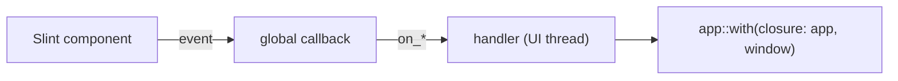
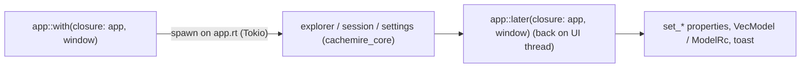

# UI architecture

The window is written in [Slint](https://slint.dev) (`crates/cachemire/ui/`), the Rust side only
glues it to the core: each feature has an `init` function that attaches callbacks to a Slint
*global*, and pushes results back by setting properties and models. There is no business logic in
this crate; see [architecture](crate::wiki::architecture) for the layers and
[runtime](crate::wiki::runtime) for threads.

## Where to look

- `ui/main.slint`: the root `MainWindow`, layout, overlays, global shortcuts, zoom, toast, hover hint.
- `ui/globals.slint`: one global per feature (state + callbacks Rust answers).
- `ui/components/*.slint`: the widgets and dialogs; `types.slint` holds the shared enums and structs,
  `theme.slint` the `Theme` global.
- `build.rs`: compiles the UI.
- `src/theme/mod.rs`: the themes and syntax themes; sets the `Theme` colors and keeps `paint()`.
- `src/main.rs`: includes the generated code (`mod ui`), calls every `init`.
- [`crate::app`]: the `App` struct, [`app::with`](crate::app::with) / [`app::later`](crate::app::later).
- [`crate::styled_text`], [`crate::toast`], [`crate::shortcuts`], [`crate::table_text`],
  [`crate::server_stats`], [`crate::value_actions`]: small cross-cutting UI helpers.
- `.claude/skills/add-ui-dialog/SKILL.md`: the recipe for adding a screen (summarised at the end).

## 1. Compilation: `build.rs` and `mod ui`

`build.rs` does one thing (and, on Windows, embeds the icon and version info).

1. `slint_build::compile_with_config("ui/main.slint", ..)` with
   - `EmbedResourcesKind::EmbedFiles`: fonts and images are embedded in the executable;
   - `with_bundled_translations("../../resources/lang")`: the `.po` files are compiled in, so
     `@tr(...)` strings switch language at run time (see [i18n](crate::wiki::i18n));
   - `DefaultTranslationContext::None`: no context is added to `@tr`.

Rust code that paints text itself (syntax colors in `key_detail/color.rs`, highlight colors in
`key_detail/highlight`, the query box in `redisql/highlight`) reads its colors from
[`theme::paint`](crate::theme::paint). Rule from the crate's `CLAUDE.md`: never hard-code `#rrggbb`
outside `theme.slint` and `src/theme/`.

In `main.rs`, the Slint output lives in a private `mod ui { slint::include_modules!(); }` re-exported
with `pub(crate) use ui::*`, so every module writes `crate::MainWindow`, `crate::KeyPanel`,
`crate::KeyView`... (with a lint `allow` for the generated `unwrap`/`todo`). `MainWindow` gets one
hand-written method, `connection_id()`, reading `ConnectionState.view.connection_id`.

## 2. Slint structure

```text
main.slint            MainWindow  (root, overlays, shortcuts, zoom, toast, hint)
  |-- globals.slint   ConnectionState, ConnectionEditor, AwsAccount, About, Preferences,
  |                   Shortcuts, KeyTree, SavedQueries, TabStrip, SearchTab, QueryTab, KeyPanel
  |-- components/
        theme.slint       Theme (colors, fonts, zoom, px()/pt(), metrics) + bundled fonts
        types.slint       enums and row/form structs shared with Rust
        widgets.slint     Hint, IconButton, FloatingCard, scrollbars, WheelScroller, resize handles...
        icons.slint       one Icon* component per glyph (drawn with Path)
        title-bar.slint   TitleBar (connection pill, AWS buttons, window buttons)
        keyspace-panel    KeyspacePanel (tree + saved queries)
        content-header    TabBar and the three context menus
        key-detail*.slint KeyDetail and its parts (rows, table, values, widgets, types)
        search-panel      SearchPanel   (global search tab)
        query-panel       QueryEditor / QueryToolbar / ResultTabs (Redisql tab)
        settings.slint    SettingsModal
        *-dialog(s).slint small modals (see section 6)
```

### 2.1 Components by file

| File | What it holds |
|---|---|
| `main.slint` | `MainWindow`: title-bar, sidebar + resize handle, tab card, dropdowns and context menus, hover hint, toast, all modals |
| `globals.slint` | the feature globals (table below) and the `ConnectionView` struct |
| `components/theme.slint` | `Theme` global: colors, fonts, zoom, metrics |
| `components/types.slint` | enums (`ConnectionStatus`, `TreeRowKind`, `KeyView`, `SearchScope`, `ProfileTint`, `ShortcutAction`...) and structs (`KeyspaceRowData`, `TabData`, `SearchRowData`...) |
| `components/widgets.slint` | `Hint` global, `IconButton`, `CheckBox`, `FloatingCard`, `PastePopup`/`TextMenuPopup`, `VScrollBar`/`HScrollBar`, `WheelScroller`, `HResizeHandle`/`VResizeHandle`, `ModalButton`, `SegmentedToggle`... |
| `components/icons.slint` | ~40 `Icon*` components |
| `components/title-bar.slint` | the custom title bar (the window has `no-frame: true`) |
| `components/connection-picker.slint` | `ConnectionDropdown`, `ConnectionModal` (the connection form), SSH fields |
| `components/cloud-picker.slint`, `cloud-settings.slint` | AWS profile dropdown; the cloud account dialog (`CloudSettings` global) |
| `components/connection-transfer.slint` | import/export of saved connections (`ConnectionTransfer` global) |
| `components/keyspace-panel.slint` | `KeyspacePanel`: tree, search box, export mode bar, saved queries |
| `components/content-header.slint` | `TabBar` (drag to reorder) and `TabContextMenu`, `SelectionContextMenu`, `RowContextMenu` |
| `components/key-detail.slint` | `KeyDetail`: header, smart box, view switcher, the two views |
| `components/key-detail-row.slint`, `-values`, `-table`, `-widgets`, `-types` | rows of the value list, the list itself, the table, `SmartBox`/`ViewSwitcher`/menus, `KeyScroll` + `ExportPrefs` globals and row structs |
| `components/search-panel.slint` | `SearchPanel` (global search tab) |
| `components/query-panel.slint` | `QueryEditor`, `QueryToolbar`, `ResultTabs` (Redisql) |
| `components/value-editor.slint` | `ValueEditor` global + `ValueEditorModal` |
| `components/key-name-dialog`, `folder-delete-dialog`, `secrets-dialogs`, `host-key-dialog` | the small modals |
| `components/settings.slint` | `SettingsModal` (all settings pages, SSH and connection profiles) |

### 2.2 The globals and who answers them

A global is the contract between a Slint area and a Rust module: `in-out` properties hold state,
`callback`s are what the UI asks, `pure callback`s are synchronous questions (their Rust handler must
be quick). Components read and write globals directly; `main.slint` mostly forwards component events
to them.

| Global | Feature | Answered by (Rust) |
|---|---|---|
| `ConnectionState` | connection in use (`ConnectionView`), saved and cloud connection lists, memory, read-only | [`crate::connections`], `crate::connections::connect`, [`crate::server_stats`] (sets `memory`) |
| `ConnectionEditor` | the connection form | [`crate::connections`], [`crate::connections::profiles`] |
| `AwsAccount` | cloud account status, profiles | [`crate::cloud`] |
| `CloudSettings`, `ConnectionTransfer` (declared in their component file) | cloud dialog; connection import/export | [`crate::cloud::settings`], [`crate::connections::transfer`] |
| `About` | version, update check | [`crate::updates`] |
| `Preferences` | settings window, SSH and connection profiles, search depth | [`crate::settings`], [`crate::connections::profiles`] |
| `Shortcuts` | the keys of the app's actions | [`crate::shortcuts`] |
| `KeyTree` | keyspace tree rows, footer, export mode, add/rename/delete | [`crate::keyspace`] |
| `SavedQueries` | saved Redisql queries in the sidebar | [`crate::redisql::saved`] (list), [`crate::tabs`] (opens one) |
| `TabStrip` | open tabs, active tab and its kind | [`crate::tabs`] |
| `SearchTab` | the global search tab shown | [`crate::search`] |
| `QueryTab` | the Redisql tab shown | [`crate::redisql`] |
| `KeyPanel` | the key panel (list/table, smart box, export, editing) | [`crate::key_detail`] and its submodules |
| `KeyScroll`, `ExportPrefs` (in `key-detail-types.slint`) | scroll positions and open rows; export format switches | `key_detail::scroll`, [`crate::tabs`] (saves them per tab), [`crate::settings`] |
| `ValueEditor`, `KeyNameDialog`, `FolderDeleteDialog` | edit modals | `key_detail::edit`, `keyspace::edit` |
| `KeyringDialog`, `SecretsPrompt`, `HostKeyDialog` | secret and SSH-trust prompts | [`crate::keyring_dialogs`], [`crate::host_key_dialog`] |
| `Theme` | design tokens, zoom, profile tint | zoom is Slint-only; the tint is set from [`crate::connections::profiles`] |
| `Hint` | the hover tooltip | Slint-only (components raise it, `main.slint` draws it) |

`MainWindow` itself has a few root callbacks answered in `main.rs`: `request-drag-window`,
`request-toggle-maximize`, `clipboard-has-text` (the right-click "Paste" row), and `show-toast`
(a public function Rust invokes).

## 3. The theme

`Theme` (in `theme.slint`) is the single source of design tokens.

- **Colors**: backgrounds (`bg-*`), borders, text levels, accents. They are `in` properties that
  [`theme::apply`](crate::theme::apply) sets (the values in the file are the default theme's): a theme
  (`theme::COMBOS`) is four colors, background, text, accent and highlight, and `derive` works out the
  rest: surfaces and borders are the background with some text mixed in, dimmer texts the reverse,
  selections the accent over the background, status colors (red, green...) fixed hues made readable.
  A syntax theme (`theme::SYNTAXES`) gives the token colors of [`Paint`](crate::theme::Paint), each
  brought closer to the text color when it would not read on the background. Both are picked in the
  Display settings (`Preferences.theme`, `syntax-theme`); picking one applies it, bumps
  `Theme.paint-tick` (the query box is colored again) and shows the tab again (`tabs::repaint`).
  Profile colors (`profile-color`) are fixed.
  `bg-app` is `bg-app-base` mixed with the profile tint when `env-tinted` is true (25%), and
  `chrome-border` mixes 50%. This is how a connection profile (Production = red...) colors the window.
- **Fonts**: `font-ui` = Roboto, `font-mono` = JetBrains Mono, both bundled by `import "...ttf"` lines
  at the top of the file. Roboto has no 600 weight, so 600 renders as Bold.
- **Zoom**: `Theme.zoom` (1.0 = 100%, bounds 0.6..2.0, step 0.1 in `main.slint`). The Display setting
  (`Preferences.zoom`, saved as `zoom` percent) sets it at start and on release of its slider; Ctrl+0 returns to it.
  `Theme.px(base)` and `Theme.pt(base)` both multiply by `zoom` (the two are identical; `pt` marks a
  font size). Every size in a component is written `Theme.px(12px)` or `Theme.pt(13px)` so the whole
  UI scales together. Derived metrics (`radius-*`, `gap`, `icon-*`, `btn-*`, scrollbars) already apply it.
- **Zoom-independent storage**: values Rust or `MainWindow` keep for later (the sidebar's width, table
  column widths from [`crate::table_text`]) are stored unscaled and multiplied at the point of use.

## 4. The Rust glue pattern





The pieces:

- **`init` per feature.** `main.rs` builds the [`App`](crate::app::App) (window handle, `AppState`,
  Tokio handle, tabs, searches, queries, key panel, keyspace...) and calls `tabs::init`,
  `keyspace::init`, `search::init`, `redisql::init`, `connections::init`, `cloud::init`... Each `init`
  does `window.global::<G>().on_xxx(...)`. Order in `main.rs`: first what needs the app's shared state,
  then what needs only the stores and the runtime (`server_stats`, `redisql::saved`, `shortcuts`,
  `settings`).
- **`app::with`** reaches the thread-local `App` and the window from a callback;
  **`app::later`** does it from any thread by going through `slint::invoke_from_event_loop`;
  [`app::spawn`](crate::app::spawn) and [`app::spawn_blocking`](crate::app::spawn_blocking) run a task
  and hand the (panic-checked) result to a closure on the UI thread. Details in
  [runtime](crate::wiki::runtime).
- **Weak handles.** Closures capture `window.as_weak()` or `Rc<App>` and upgrade on use; if the window
  is gone the work is dropped.
- **Models.** Lists are `ModelRc<VecModel<Row>>` set whole with `set_xxx(ModelRc::new(VecModel::from(rows)))`.
  Big, incrementally changing lists use a custom model: the keyspace tree's `TreeRows`
  (`keyspace/rows.rs`) inserts and removes many rows in one pass.
- **Epoch counters.** Late results are dropped by comparing a counter taken at start (`view_epoch` in
  the key panel, `generation` in the keyspace walk, `run` in search tabs); see
  [keys_and_tabs](crate::wiki::keys_and_tabs).
- **Ticks.** To trigger something that is not a value (re-scroll the same row, refocus, pulse), Rust or
  Slint bumps an `int` property (`KeyTree.scroll-tick`, `KeyScroll.refocus-tick`, `toast-tick`,
  `pretty-ready-tick`) and the other side reacts with `changed` or a re-read.
- **Errors** shown to the user go through the `Localize` trait of [`crate::error`]
  (see [errors](crate::wiki::errors)).

### Enums mirrored between Slint and Rust

State that is "one of a few named values" is a Slint `enum` in `types.slint`, exported by `main.slint`,
and therefore a real Rust enum (`crate::KeyView`, `crate::SearchScope`, `crate::ConnectionStatus`...).
Where the same choice exists in core (language, opening view, export format), conversions are written
as exhaustive `match`es in [`crate::settings`] (`to_setting` / `from_setting`), so a new variant fails
to compile until handled. The comment above `KeyView` lists what a new view must touch: the enum,
`KeyDetail.views`, the `if` that shows it in `key-detail.slint`, and `show_view` in
`key_detail/mod.rs`.

## 5. The forked `StyledText`

Slint's built-in text cannot draw per-range colors, a marker-pen background or a selectable read-only
block fast enough for large JSON. The app therefore builds against a **fork of Slint** (see
`docs/slint-fork.md` in the repository) whose `StyledText` element gains
`from_colored_paragraphs`, `from_highlighted_paragraphs`, read-only selection with copy, click and
drag callbacks, and `overflow: elide`.

- [`crate::styled_text`] is the only file allowed to name `slint::private_unstable_api`; everything else
  imports `crate::styled_text::StyledText`. It is a one-line re-export.
- Rust builds the value, Slint draws it: the type travels through a Slint `styled-text` property or a
  struct field.
- Users in Rust: `key_detail/highlight` (search matches over colored paragraphs), `key_detail/value_lines`
  (the lines of an open row), `key_detail/table` (cells), `key_detail/edit` (the value editor's
  highlighting) and `redisql/highlight` (the query box, exposed as `QueryTab.highlight`, a pure callback).
- Users in Slint: `key-detail-row.slint` (collapsed preview and open lines), `query-panel.slint`,
  `value-editor.slint`. `StyledText` cannot be typed into, so the two editors draw it *behind* a nearly
  transparent `TextInput` that keeps the caret and edits, with `x`/`y` pinned so both line up; a hidden
  "probe" copy measures the text.

## 6. Dialogs, popups and overlays

Modals are components that `inherit Rectangle` filling the window, shown in `main.slint` by
`if Global.open: SomethingModal { width: 100%; height: 100%; }` at the end of the window body so they
paint over everything. Their state is a global with an `open` flag; Rust opens a dialog by setting the
properties then `set_open(true)`.

- Typical model: `host-key-dialog.slint` (global `HostKeyDialog` with `open`, display properties and
  two callbacks) and [`crate::host_key_dialog`] (`ask` fills the global, stores the continuation in
  `App::asked`, `init` answers `trusted`/`cancelled`). [`crate::keyring_dialogs`] does the same for the
  two secret prompts, sharing `DialogBackdrop` from `secrets-dialogs.slint`.
- A dialog that must resume a flow after the user answers keeps a boxed closure in
  [`App::asked`](crate::app::App) and calls it on answer (see host-key `Answer`).
- Dropdowns and context menus (connections, AWS profiles, tab menu, row menu, "Copy selection") are
  `if flag: TouchArea` catchers (any click outside closes) followed by the menu component, so the menu
  paints on top. Positions are clamped to the window with `min(x, root.width - ..)`. The flags
  (`connections-open`, `tab-menu-open`, `row-menu-open`...) are pure UI state on `MainWindow`; they are
  not in globals.
- Text boxes use `PastePopup`/`TextMenuPopup`; "Paste" is offered only when the root callback
  `clipboard-has-text` (answered by [`value_actions::clipboard_has_text`](crate::value_actions::clipboard_has_text))
  says so. Components forward it up to `MainWindow`.

### Toasts

`MainWindow.show-toast(text, x, y)` shows a pill for 1.3 s anchored near the pointer.
[`toast::show`](crate::toast::show) (and `show_copied`, `show_refreshed`) calls `invoke_show_toast` with
the last pointer position. Slint cannot ask where the pointer is, so [`crate::toast`] tracks
`CursorMoved` from winit's window events: `main.rs` installs a single winit hook
(`install_window_events`) that calls `toast::on_window_event` (also keeps `device-scale` fresh) and, on
Windows, the icon and drag-latch handlers. Restarting the timer while a toast is visible works because
`toast-tick` folds into the timer interval. Under `cfg(test)` the last text is recorded for assertions.

### The hover hint

The `Hint` global (in `widgets.slint`) is raised by components with `Hint.show-below` /
`show-above` (and a footer variant); `main.slint` draws one window-level rectangle (no `TouchArea`, so it
never steals input) kept inside the window.

## 7. Shortcuts

[`crate::shortcuts`] owns the keys of the app's own actions. Eleven `Spec`s (action, settings code,
`Scope`, default chords) give: zoom in/out/reset, search, close tab (scope `Window`); run statement/script,
suggest, history previous/next (scope `Query`); save value (scope `ValueEditor`). Keys chosen in
Settings are stored in the settings and applied by `set_keys` to the `Shortcuts` global as Slint
`keys` values.

- Window-wide actions are `KeyBinding { keys: Shortcuts.zoom-in; activated => ..}` elements in
  `main.slint`'s `root-scope` `FocusScope`; the query box (which must see keys before its text input)
  asks the pure callback `Shortcuts.pressed(keys, event)`, which Rust answers by matching a `Chord`.
- Recording: the settings page sets `Shortcuts.recording`; the next key press reaches the `recorded`
  callback, `bind` refuses chords that overlap another in the same or the window scope, or are
  function keys, and says why via `Refused::message`.
- The page's rows (actions plus the fixed "standard keys") and its search filter are built by
  `refresh`; the filter text lives in a thread-local.
- `Esc` is handled in `root-scope.key-pressed`: bumps `collapse-tick` (the key panel folds the open
  value under the pointer) and leaves export mode.

## 8. Behaviours visible in `main.slint`

- **Window chrome**: `no-frame: true`; `TitleBar` emits `drag-requested`, `maximize-toggle-requested`,
  `minimize-requested`, `close-requested`. Drag and maximize are done in Rust against the winit window
  (`drag_window`, `set_maximized`) because flipping `maximized` in Slint reaches the OS a frame late.
  On Windows, `drag_latch` (cfg(windows), plain code) clears a winit state that otherwise blocks moves
  and resizes. A 1px frame rectangle is drawn when not maximized; `resize-border-width` is 5px, 0 when
  maximized.
- **Sidebar**: shown only when a connection was chosen (`connection-chosen`) and not
  `sidebar-hidden`; width `keyspace-width` is dragged with `HResizeHandle` (clamped 180..440 base px,
  divided by zoom). When no tab is open an empty-state hint with the app mark replaces the tab card;
  its text depends on `AwsAccount.error`, connection state and failure.
- **Tab card**: `TabBar`, then depending on `TabStrip.active-is-query` / `active-is-search`:
  `QueryEditor` (z: 10 so its completion list covers results), `ResultTabs` when several results,
  `SearchPanel`, or `KeyDetail` (a query's rows reuse `KeyDetail` with a `QueryToolbar` child).
- **Zoom**: Ctrl+plus/minus/0 through `KeyBinding`s; Ctrl+wheel through a `TouchArea` (`scroll-zoom`)
  that wraps the layout and accepts scroll events with `modifiers.control`. The fork's Flickable change
  lets Ctrl+wheel reach it. `ctrl-held` (set from Control key press/release) is passed to
  `KeyspacePanel` so its own scrollers do not pan during a zoom.
- **Focus**: `forward-focus: root-scope`; `refocus-tick` (from `KeyScroll`) hands focus back to
  `root-scope` when a row opening or folding destroyed the focused item. `key-search-focus-tick` is
  bumped by the Search shortcut so the key panel focuses its smart box; if no key is loaded it opens a
  search tab instead.
- **Scroll behaviours**: `WheelScroller` (in `widgets.slint`) turns wheel events into `scroll-by`
  with velocity, optionally sideways; the key panel's list and table use custom `VScrollBar`/`HScrollBar`
  (thicker, appear near the edge: `view-scrollbar-reach`, `linger`). Scroll *restore* per tab is in the
  `KeyScroll` global (see [keys_and_tabs](crate::wiki::keys_and_tabs)).
- **Tab dragging**: tab items have `drag-started`/`drag-moved`/`drag-ended`; the bar then calls
  `TabStrip.reordered(key, index)`.

## 9. Small Rust UI helpers

- [`crate::table_text`]: how a JSON cell is written as text (`cell_text`), a first column width guess
  (`column_width`, 7.5 px per character plus padding, clamped 6..40 chars), and `push_csv_row`
  (RFC 4180; a field that starts with `=`, `+`, `-` (non-number), `@`, tab or CR is prefixed with `'`
  against spreadsheet formula injection). Shared by the key panel's table and the query tab.
- [`crate::server_stats`]: one Tokio task polling `used_memory` every 3 s for the *active* connection,
  only if its pool is open (so it never connects by itself), and only touching the UI when the text
  changed.
- [`crate::value_actions`]: open a value in an external editor (temp file under `cachemire-values`,
  private permissions, files older than a day removed, tries a list of known GUI editors before the OS
  default), copy to clipboard (a process-wide `arboard::Clipboard` on Unix because X11 serves the
  content), `clipboard_has_text`, and `sanitize_filename` (also avoids Windows reserved names).

## 10. Adding a screen or a callback

Following `.claude/skills/add-ui-dialog/SKILL.md`:

1. Declare state and callbacks in a global of `globals.slint` (new global or an existing one); shared
   types go in `components/types.slint`. Export new globals/structs from `main.slint`.
2. Write the component in `components/<name>.slint`, import and place it in `main.slint`
   (`if X.open: XModal { width: 100%; height: 100%; }`).
3. Add a Rust module with `pub fn init(window: &MainWindow)` (or `init(app, window)` if it needs the
   `App`) that does `window.global::<G>().on_<callback>(..)`; declare `mod` and call `init` in
   `main.rs`.
4. Async work: `app::with(|app, _| app.rt.spawn(..))` then `app::later`; never block the UI thread.
5. Colors from `Theme`, sizes through `Theme.px`/`pt`, texts with `@tr(...)` followed by
   `cargo xtask i18n`; errors through `Localize`.
6. Do not name `private_unstable_api` outside `styled_text.rs`; no business logic in this crate.

UI tests (`src/ui_tests/`, headless, software renderer) are described in
[testing](crate::wiki::testing); other chapters: [state](crate::wiki::state),
[connections](crate::wiki::connections), [settings](crate::wiki::settings).

## Notes and loose ends

- `Theme.px` and `Theme.pt` have identical bodies.
- `table_text` (7.5 px per character) and `search` (7.4 px) each keep their own width constants.
- `value_actions` and `table_text` are generic and Redis-agnostic, but live in the app crate.
